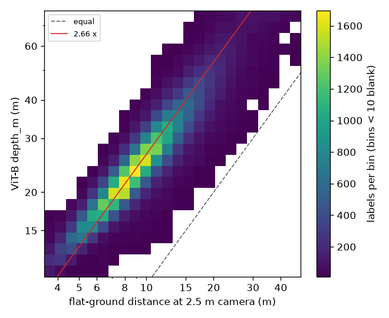

# Depth at the label: ViT-B against flat ground, ViT-L and Google (November 2026)

Issue: [#21](https://github.com/ProjectSidewalk/sidewalk-validator-ai/issues/21). Earlier step:
[#51](https://github.com/ProjectSidewalk/sidewalk-validator-ai/pull/51) (depth-sized against fixed-size crops).
Code: [`analysis/depth_agreement.py`](../analysis/depth_agreement.py). Generated tables:
[`depth-ablation-2026-11/tables.md`](depth-ablation-2026-11/tables.md).

## 1. In short

- **Done (CPU, every round-3 row).** The served depth model (Depth Anything V2 metric, vKITTI, ViT-B) was compared
  with a flat-ground reference, `h / sin(depression)`, on 63,672 human-authored round-3 labels. **The reference is an
  assumption, not a measurement** (section 4.1). Against it, at a nominal 2.5 m camera height, ViT-B's depth is
  **2.66×** the flat-ground distance at the median (95 % interval 2.65 to 2.67; 5th to 95th percentile 1.76 to
  3.43). That puts the constant 6100 at a crop about **4.5 m wide** at the label, not the 11.9 m the formula
  would give with true metric depth. With a 2.3 m or a 2.9 m camera the median is 2.89× or 2.29×.
- The four ground types agree with each other (2.67 to 2.73). Obstacle is lower (2.42), as expected for labels
  that are not on the ground. In log space the slope of ViT-B against the reference lies somewhere between 0.75
  and 0.97 (both OLS directions; reduced-major-axis 0.85). That bracket straddles the [0.9, 1.1] band, so the
  question "does ViT-B compress the range?" is **not resolved** by this reference.
- **Clipping at the view edge is not worth an experiment.** 38 of 64,465 round-3 crops touch the edge (0.06 %),
  0.05 % at a constant of 4000 and 0.08 % at 8000.
- **Designed, not run.** These arms need a GPU and Google's depth artifacts on klone: ViT-L against ViT-B on the
  same rendered views, Google's plane-model depth along each crop's centre ray, and the constant sweep
  (4000 / 6100 / 8000, a later PR). The decision rules R0 to R3 for those runs are in section 7. They were fixed
  before any of those numbers existed.

## 2. The question

A crop is `int(6100 / depth_m)` px on each side of the label, cut from a 2048 px, 90° view centred on it.
`depth_m` is ViT-B's metric depth at the view centre. This geometric choice decides how much context every
classifier sees, in training and in serving. Before this study the depth model had never been checked against
anything. The study asks:

1. Is ViT-B's depth at the label on the right scale, and is it proportional to the distance?
2. Would the larger ViT-L encoder size crops differently? The 2025 production crops were sized with ViT-L and
   served with ViT-B ([`retrain-2026-10.md`](retrain-2026-10.md)).
3. Is 6100 the right constant (the sweep, a later PR)?
4. How often does a crop run off the view?

## 3. The sources

| source | what it is | where it is used |
|---|---|---|
| ViT-B (vKITTI, max 80 m) | the served model; `depth_m` in every round-3 manifest | sizing, training and serving |
| ViT-L (vKITTI) | the larger encoder of the same family | 2025 production crops; an arm here |
| flat ground | `h / sin(depression)`: the ray length to level ground `h` below the camera | this note, section 4 |
| Google depth artifact | `<city>/<id[:2]>/<id>.depth.npz`, decoded by the panorama-tools scrape: a per-panorama **plane model** (`depth`, `plane_indices`, `planes_n`, `planes_d`, pose) | the klone arm, as a reference |

What the Google artifact models and leaves out: it is a fit of planes, not a measurement. Vehicles, people, poles
and vegetation are absent. About 91 % of ground cells lie within 1 m of `camera_height / tan(depression)`, and curb
ramps sit about 0.15 m above the modelled road. It exists only for GSV panoramas that the backfill has reached.
For these technical reasons it is a reference here, never a candidate sizing source.

## 4. Flat-ground reference: results

### 4.1 What the reference assumes (read this before the numbers)

`trig_m = h / sin δ`, where δ is the label's depression below the horizon, read from the **stored** (gravity-level)
`pano_y`. That is the distance along the ray to a level plane `h` metres below the camera. It assumes three things:

1. **one nominal camera height** for every panorama (2.5 m in the headline; 2.3 m and 2.9 m as sensitivity);
2. **level ground** between the camera and the label (hills, cambers, ramps and sidewalks above road level all break
   it);
3. **a label on the ground.** An Obstacle label on a pole, a parked car or a bin is clicked above its base, so its
   depression is too shallow and its trig distance too long.

So the ratio `depth_m / trig_m` is **ViT-B relative to this reference, not ViT-B's error.** The honest reading is
"ViT-B's metric scale and the 2.5 m flat-ground geometry differ by a factor near 2.7 on typical labels", not
"ViT-B is 2.7× wrong". The camera height multiplies every ratio by one factor (`ratio ∝ 1 / h`). It changes no slope,
no spread and no ranking.

Rows: all five round-3 `split.csv` files, 64,465 rows over 50 deployments, every one GSV, joined one-to-one on
`label_uid` to the rawLabels exports for `pano_x`/`pano_y`. Excluded from the headline, and counted: the 220
AI-authored rows, whose stored pixel is in the rig frame so their depression is off by the tilt (their own median
ratio is 2.61), and 573 rows within 2° of the horizon or above it, where `1 / sin δ` explodes.

### 4.2 Headline, by label type (h = 2.5 m)

`n`: rows used. `train n`: rows of the type in the round-3 train split, whether used here or not.

| label type | n | train n | ViT-B / flat ground, median [95 % CI] | 5th–95th pct | implied crop width, median (5th–95th), m |
|---|---|---|---|---|---|
| CurbRamp | 10,179 | 6,925 | 2.73 [2.72, 2.74] | 2.09–3.45 | 4.37 (3.45–5.70) |
| NoCurbRamp | 18,078 | 12,199 | 2.71 [2.70, 2.71] | 2.06–3.36 | 4.40 (3.54–5.78) |
| Obstacle | 16,600 | 10,554 | 2.42 [2.39, 2.44] | 1.39–3.35 | 4.92 (3.56–8.56) |
| SurfaceProblem | 15,715 | 10,500 | 2.73 [2.72, 2.74] | 2.00–3.58 | 4.37 (3.33–5.97) |
| Crosswalk | 3,100 | 2,089 | 2.67 [2.66, 2.68] | 2.10–3.23 | 4.46 (3.69–5.68) |
| four ground types | 47,072 | 31,713 | 2.71 [2.71, 2.72] | 2.05–3.46 | 4.39 (3.45–5.82) |
| all types | 63,672 | 42,267 | **2.66 [2.65, 2.67]** | 1.76–3.43 | **4.48 (3.47–6.77)** |

Interval: 2,000 bootstrap resamples of panoramas within each deployment. Implied crop width is the crop's physical
width at the flat-ground distance, `(2 · 6100 / 1024) · trig_m / depth_m`, where 1024 px is the view's focal length.
The median depression is 15.1°, which is 9.6 m of flat-ground distance against a ViT-B median of 24.9 m.

**Camera height.** The all-types median is 2.89 at 2.3 m, 2.66 at 2.5 m and 2.29 at 2.9 m (ground types 2.95, 2.71,
2.34). The implied median width is 4.12, 4.48 and 5.19 m. No plausible car-roof height brings the ratio near 1.



*Figure: ViT-B depth against flat-ground distance, both on log axes. Bins with fewer than 10 labels are blank, so no
bin locates a single label. Dashed: equality. Red: the 2.66× median.*

### 4.3 Proportionality: the slope bracket

In log space, OLS of ln ViT-B on ln trig gives `β_yx`, and the inverse of OLS of ln trig on ln ViT-B gives `β_xy`.
Noise in the reference pulls `β_yx` toward 0, and noise in ViT-B pushes `β_xy` away from it. With independent errors
the true slope therefore lies between them. The reduced-major-axis slope is the point summary. No one-direction
estimator is read on its own.

| rows | n | β_yx [95 % CI] | β_xy [95 % CI] | RMA | r | against [0.9, 1.1] |
|---|---|---|---|---|---|---|
| all types | 63,672 | 0.747 [0.738, 0.754] | 0.968 [0.959, 0.977] | 0.850 | 0.879 | straddles |
| four ground types | 47,072 | 0.805 [0.793, 0.814] | 0.986 [0.976, 0.996] | 0.891 | 0.903 | straddles |
| CurbRamp | 10,179 | 0.816 | 0.960 | 0.885 | 0.922 | straddles |
| NoCurbRamp | 18,078 | 0.820 | 0.993 | 0.903 | 0.909 | straddles |
| Obstacle | 16,600 | 0.673 | 0.951 | 0.800 | 0.841 | straddles |
| SurfaceProblem | 15,715 | 0.757 | 1.023 | 0.880 | 0.860 | straddles |
| Crosswalk | 3,100 | 0.858 | 0.922 | 0.889 | 0.965 | straddles |

Every bracket straddles the band's lower edge. Read on the reference's terms, ViT-B may compress the range
somewhat, but this reference cannot separate that from the reference's own noise (camera height, grade, click
position). The by-decile table in `tables.md` falls from 3.04 to 2.12. It is descriptive only: binning on a noisy
reference produces a falling ratio even under exact proportionality.

### 4.4 Slices

Full tables, all with `n` and `train n`, cells under 20 labels marked "n too small", are in
[`tables.md`](depth-ablation-2026-11/tables.md): type × severity, type × tag, type × label class, type ×
capture-year band, type × round-3 split, and by deployment (public deployments named; the 8 others pooled into
one row). What they show:

- **Severity and class barely move the ratio** within a ground type (CurbRamp severity 1 to 3: 2.72 to 2.80;
  correct against incorrect within 0.11 for every type).
- **Obstacle tags follow the off-ground caveat.** Labels on raised objects have the lowest ratios: parked car 2.04
  (n = 1,937, train n 1,293), utility cabinet 2.19 (314), outdoor dining 2.21 (120, train n 1), street vendor 2.26
  (159). Garage entrances and height differences, which sit on the ground, are near the ground types (2.65, 2.66).
  So the lower Obstacle ratio is what assumption 3 predicts, and it is not evidence about ViT-B.
- **Ground-type tags stay within 2.52 to 2.85** (n ≥ 20), with the steepest at the high end (CurbRamp `steep`
  2.85, n = 330, train n 226). A ramp or slope breaks assumption 2 in the direction that raises the ratio.
- **Capture year:** older imagery has higher ratios (CurbRamp 2.91 for 2007–2012 against 2.66 for 2023–2026;
  NoCurbRamp 2.80 against 2.67, SurfaceProblem 2.84 against 2.72, Obstacle 2.74 against 2.35; Crosswalk barely
  moves). A different camera height across rig generations would do this, and so would
  a different scene mix. The Google arm's per-panorama height can tell the two apart.
- **Held-out deployments:** `test_heldout` ratios are lower than `train` for CurbRamp (2.58 against 2.73) and
  NoCurbRamp (2.57 against 2.71); the other three types differ by 0.01 to 0.07.
- **By deployment** (public, n ≥ 20): medians range from 2.38 to 2.96. The pooled non-public row is 2.60. These
  differences are why one constant could size crops differently across deployments, and they are the main thing
  the per-panorama camera height will test.

### 4.5 What this settles and what it does not

Settled without Google:

- the scale offset between ViT-B and a car-height flat-ground geometry is large (2.3 to 2.9× over plausible
  heights) and nearly the same across the four ground types;
- `6100 / depth_m` therefore sizes crops at about 4.5 m of scene at the label, varying 3.5 to 6.8 m between the 5th
  and 95th percentiles;
- the constant that would give the reference the same median crop is `6100 / 2.66 ≈ 2,292`. Sized by the reference at
  6100 itself, 13.4 % of crops would clip, against 0.06 % today.

Not settled: whether the residual spread is ViT-B or the reference (camera height, terrain, off-ground clicks).
The Google arm addresses exactly that.

## 5. Clipping at the view edge

A label-centred crop is clipped only when `int(C / depth_m) > 1024`, i.e. `depth_m` below about `C / 1025` m (5.95 m
at 6100). All 64,465 round-3 rows, pooled over deployments:

| label type | n | clipped (recorded) | at 4000 | at 6100 | at 8000 |
|---|---|---|---|---|---|
| CurbRamp | 10,437 | 6 | 6 (0.06 %) | 6 (0.06 %) | 6 (0.06 %) |
| NoCurbRamp | 18,162 | 19 | 16 (0.09 %) | 19 (0.10 %) | 25 (0.14 %) |
| Obstacle | 16,894 | 6 | 5 (0.03 %) | 6 (0.04 %) | 12 (0.07 %) |
| SurfaceProblem | 15,852 | 7 | 7 (0.04 %) | 7 (0.04 %) | 10 (0.06 %) |
| Crosswalk | 3,120 | 0 | 0 | 0 | 1 (0.03 %) |
| all types | 64,465 | **38** | 34 (0.05 %) | **38 (0.06 %)** | 54 (0.08 %) |

The recomputed count at 6100 equals the recorded `clipped` column on every type. The clipping the October audit
saw came from the 2025 pitch-0 view, which no longer exists. **The arm is dropped.** It would reopen if a source or
constant put more than 1 % of crops under the clip distance. Sizing by the flat-ground reference at 6100 would do
that (13.4 %); at its scale-matched constant it would not (0.0 %).

## 6. Design of the klone arms (not run)

### 6.1 Sample and estimand

- **Frame:** the five round-3 splits joined to rawLabels (as in section 4), **public deployments only**. Visibility
  comes from the live `/v3/api/cities` listing, saved on 2026-11-12 (46 public; sha256 below).
- **One label per panorama per type**, the one with the lowest rank. Rank is
  `int(sha256("depth-agreement:20261112:<label_uid>")[:12], 16) / 16^12`, which is independent of every other label.
- **Round-robin over deployments in rank order** per type: each deployment's best label, then each deployment's
  second, and so on. **The estimand is city-balanced:** each public deployment has about equal say. Each row
  records an inclusion weight (its deployment's round-3 rows over its sampled rows) for a row-mix-weighted
  sensitivity with its Kish effective n.
- **Set A** is the first 200 per type (1,000 labels), drawn without regard to Google coverage. The encoder comparison
  uses Set A. **Candidates** are the first 600 per type (3,000); artifacts are requested for all of them. **Set G**
  is the first 200 per type among candidates whose artifact is usable **at the file level** (status not
  `no_artifact`, `old_format` or `unreadable`). Set G membership never depends on a depth value or on whether the
  ray hit ground.
- Drawn on 2026-11-12: 3,000 candidates over 2,929 panoramas and 42 public deployments (33 to 39 per type).
  [`data/depth-agreement-2026-11/sample_public.csv`](../data/depth-agreement-2026-11/sample_public.csv) lists their
  uids, type, class, rank, order and Set A flag (no paths, no depths); `sample.json` beside it has the counts and
  hashes.

### 6.2 The same ray for every source

- **ViT-B re-run and ViT-L** (`depth-pass`): the panorama is read with `data_generation.read_store_panorama` (the
  8192 × 4096 resize) and rendered with the torch renderer on the GPU, as round 3 was. The pose comes from
  `crop_pose.pose_for_row(row, 0.95)` and is passed exactly as `data_generation.py`'s loop passes it. Each encoder
  runs on the same BGR view. Both the centre value and the median of the 33 × 33 px centre box are recorded (the
  jitter measure). Depth Anything returns z-depth, and the read pixel is 0.03° off axis, so it equals the ray
  length.
- **Google** (`google-depth`): the lookup pixel is the crop's own centre ray, `pano_pose.corrected_pixel` under the
  crop's pose and beta. Where that pose applies no tilt (AI-authored rows, no pose), it is the stored pixel. A test
  pins it to the centre 2 × 2 of a real 2048 px view to within 0.01 px.
  - The pixel is truncated to a raster cell, and the 3 × 3 neighbourhood is read (columns wrap at the seam, rows do
    not). A cell counts when `depth > 0` and its plane index is above 0. With fewer than 5 cells the status is
    `sky` above the horizon split, else `no_plane`.
  - The plane is the centre cell's, or else the most common counted plane (lowest index on a tie). It is `ground`
    when `|n_z| / |n| ≥ 0.7`, otherwise `facade`.
  - The ray length is the **exact intersection** of the label's ray `v = −RFU(b, el)` with that plane (the artifact
    frame is x left, y back, z down; derivation and numeric check in the tests). The sign is fixed per plane so
    that the plane's own cells lie in front of the camera, so the payload's sign convention for `d` is not relied
    on. A hit behind the camera, a parallel ray, or a hit outside 0.5 to 80 m is `out_of_range`. CropRunner's
    `|d / (v · n)|` and the raster cell value are recorded as well.
  - Per-panorama camera height is `|d| / |n|` of the ground plane: the near-horizontal plane that holds the most
    below-horizon cells, panorama-tools' rule. `trig_cam_m` is the flat-ground distance at that height.

### 6.3 Statistics

For each pair (ViT-L, ViT-B), (ViT-B, Google), (ViT-L, Google), (ViT-B, trig) and (Google, trig), with `L = ln(a / b)`:

- the median ratio `s = exp(median L)`, with 95 % intervals from panoramas within deployment and from whole
  deployments. `6100 · s` is the constant that gives *a* the median crop that *b* gives at 6100;
- spread: IQR, 5th to 95th percentile, `1.4826 · MAD`;
- the slope bracket `[β_yx, β_xy]` with bootstrap intervals, and RMA;
- crop moved by more than t (`|ln| > ln(1 + t)`, t = 10, 25, 50 %), raw and after the scale match, with Wilson
  intervals, city-balanced and row-mix-weighted (Kish n);
- the jitter floor: the same shares for `ln(d_centre / d_box)` per encoder;
- physical crop width at Google's ground distance; Spearman ρ;
- selection on coverage: ViT-B, trig and their ratio for Set A labels with and without a usable artifact, and for
  ground hits against all other hits;
- slices by type, type × severity, type × tag, deployment, year band, with sample n and train n;
- the artifacts' roll, and their pitch minus the database `camera_pitch`.

Figures are binned only. No per-label scatter is committed.

## 7. Decision rules R0 to R3 (pre-registered)

**Fixed on 2026-11-12**, in the commit that added this file (branch `depth-agreement`; the numbers of section 4
came from code at b2756eb). **They were written after the flat-ground results of section 4 were known, and before
any ViT-L, Google or sweep number existed.** They are pre-registered with respect to those arms, not with respect
to the ViT-B / flat-ground relation. Any later change to this section shows in `git log -p`. **Pending Jon's
confirmation** of the thresholds (section 11).

- **R0, parity.** At least 99 % of GPU-rendered Set A labels have `|d_vitb / depth_m − 1| < 0.001`. The threshold's
  source: serving parity found depth maps reproducing to ≤ 1.8 mm across torch versions
  ([`serving-parity-2026-10.md`](serving-parity-2026-10.md)), far inside 0.1 % at 25 m. If R0 fails, stop and
  explain the drift before reading anything else.
- **R1, encoder (ViT-L against ViT-B).** Quantity: on Set A, city-balanced, after the scale match, the share of
  labels with `|ln(d_vitb / (d_vitl / s))| ≤ ln(1.10)`. Rule: **at least 95 % overall and at least 90 % in every
  label type, judged on the point estimates.** Wilson intervals are reported. At n = 200 their half-width is about 4
  points, so a type between 86 % and 94 % is reported as marginal.
  - Met: the encoders are interchangeable for sizing. **ViT-B stays**, and the encoder question closes without a
    retrain.
  - Not met, or the row-mix-weighted estimate falls on the other side of 95 %: the encoder becomes a sweep arm
    (CurbRamp cut with ViT-L depth at its scale-matched constant). The default changes only under R3.
  - Anchor: the only crop-size contrast measured to matter (#51's fixed 238 px against depth-sized; +0.014 AUC in
    the training deployments) moved **82.4 %** of CurbRamp crops by more than 10 %, 60.2 % by more than 25 % and 33.5 %
    by more than 50 % (n = 10,437, same symmetric log form). R1 asks that an encoder swap move at most 5 %, more
    than an order of magnitude less.
  - Jitter: if more than 5 % of labels already differ by more than 10 % between the centre pixel and the box median
    for ViT-B itself, the 10 % threshold is measuring click jitter. R1 is then read at 25 % (same 95 / 90 shares),
    and the doc says the 10 % reading was not informative.
- **R2, proportionality against the reference.** Quantity: the slope bracket `[β_yx, β_xy]` of ViT-B against
  Google's `g_ray_m`, on `ground` hits of the four ground types in Set G (point estimates of the two ends). The band
  is [0.9, 1.1]. Its rationale: over the 5th to 95th percentile of ViT-B depth (1.37 in ln), a slope of 0.9 changes
  the relative crop size by 15 % end to end, about ±7 % around the middle, which is inside R1's ±10 %. A slope
  outside the band moves crops by more than the tolerance R1 calls negligible.
  - **Bracket inside the band:** proportional. The constant is the only knob, and the sweep is the whole
    experiment.
  - **Bracket entirely outside the band:** ViT-B compresses (or stretches) the range. Add one sweep arm sized by the
    reference (`trig_cam_m` where a camera height exists, at the constant matching the median crop).
  - **Bracket straddles a band edge:** not resolved by this sample. No new arm is added; the sweep goes ahead as
    planned, and the doc reports the bracket.
  - Known now, on the flat-ground reference: [0.747, 0.968], RMA 0.850, which straddles. The Google arm has to
    narrow the bracket to change anything, and "not resolved" is a likely outcome.
  - Google depth itself is **not** a candidate default whatever the numbers say, for technical reasons only. It
    exists for one provider (round 4 trains on three), and only for panoramas the backfill has reached and that
    still serve a payload. Its plane model also omits the objects Obstacle labels sit on. A trig-sized arm is
    possible **for ground types, given a camera height per provider**; it is not provider-free.
- **R3, the constant and any added arm** (the sweep PR). For each swept type and arm, the statistic is the **mean
  over the three seed pairs** (arm seed 42 with baseline seed 42, 43 with 43, 44 with 44) of the paired ΔAUC against
  the 6100 baseline. It is recomputed inside each of 2,000 panorama resamples, with interval level `1 − 0.05 / m`,
  where m is the number of non-baseline arms run for that type (two arms: 97.5 %).
  - An arm **passes for a type** when the interval's **lower bound is above 0** on `test`, **and** the point
    estimate of the same mean for within-city AUC on `test_heldout` is **≥ 0**.
  - The default changes only if one arm passes for **every swept type**. Across types the requirement is a
    conjunction, so no further adjustment is made.
  - If several arms pass, take the one with the largest mean ΔAUC on `test` summed over types. If the paired
    interval between two passing arms includes zero, take the smaller change in this order: constant only (ViT-B),
    then encoder, then reference-sized.
  - **CurbRamp only** (if Jon chooses that scope): a passing arm is recorded as a *candidate*, and the default does
    not change until the second type is run.
  - No arm passes: `vitb` / 6100 stays, and the curve is the deliverable.
  - An arm significantly worse than 6100 is reported as such; it does not "pass" by excluding zero.
- A change of default means retraining all five types plus a serving change, and it lands with a round.

`compare` prints the R0 to R2 read-out mechanically (`rule_readout` in the module, tested at the boundaries:
exactly 95 % / 90 % is met, 89.5 % in one type is not, the jitter switch, a weighted estimate on the other side of
95 %, the three R2 verdicts).

## 8. Results of the klone arms

*Not run yet. Filled by pasting from `tables.md` after `compare` and `report`.*

### 8.1 Coverage of the sample by Google artifacts
### 8.2 Parity (R0)
### 8.3 Encoders: ViT-L against ViT-B (R1)
### 8.4 Google against ViT-B and flat ground (R2); per-panorama camera height
### 8.5 Crop change and physical width
### 8.6 Slices
### 8.7 Selection on coverage
### 8.8 Rule read-out

## 9. Constant sweep (later PR)

`analysis/crop_constant_sweep.py recrop` (not in this PR). It re-cuts CurbRamp and SurfaceProblem at 4000 and 8000
from the same views (read through `read_store_panorama`, torch render, `crop_pose` pose). The 6100 arm reuses the
manifest's `crop_half_px` as its control, because 17 round-3 rows differ from `int(6100 / depth_m)` by 1 px. Each arm
keeps `depth_m` as the ViT-B value and adds `sizing_depth_m` and `crop_depth_constant`. Seeds 42, 43 and 44. The
baseline's seeds 43 and 44 already exist on round 3's split, so only the new arms are trained. Estimated cost on
klone's free `ckpt-all`: about 45 GPU-h for both types, about 20 for CurbRamp alone. These estimates are unverified
until replaced by the existing runs' `train_runtime`. R1 and R2 may add one arm each.

## 10. Outcome and what was recorded

*After the runs:* an Outcome line in [`decisions.md`](decisions.md), and a pointer from
[`retrain-2026-10.md`](retrain-2026-10.md)'s fixed-crop paragraph.

## 11. Limits, and decisions owed

- **Both references are models.** Flat ground assumes a height, level terrain and an on-ground label. Google's
  planes omit objects, place ramps about 0.15 m above the modelled road, and exist only where the backfill has
  reached. The pre-registered rules lean on bracket readings, which allow for this.
- **Errors may be correlated** (both sources read the same pixel), in which case the slope bracket can miss.
- **Depth at one pixel.** The box median and R1's jitter clause measure how much that matters.
- **Public deployments only** in the klone sample; the city-balanced estimand differs from the training mix, and
  both are reported.
- **One checkpoint family** (Depth Anything V2 metric, vKITTI).
- **`camera_roll` is empty on all 64,465 round-3 rows**, while the depth artifact carries a roll. The klone run
  reports the roll distribution. The artifact-pose lookup is a pose study and is deferred
  (`TODO(#21): npz_pose arm`).

Decisions owed by Jon: the go for the klone run (about 1 GPU-h, free, and one rsync connection to makelab2); the
thresholds of R0 to R3; R1's estimand (city-balanced with the weighted share as a veto, as written, or the weighted
share as the rule); the sweep scope (CurbRamp + SurfaceProblem with three seeds, CurbRamp only, or one seed); the
2.5 m headline height; whether `camera_roll` gets its own issue. **One reading needs confirming.** The plan's R1 text
said a type between 86 % and 94 % "counts as not met", but its boundary test says exactly 90 % is met. The module
implements the boundary test: a type is met at ≥ 90 %, and 86 to 94 % is flagged as marginal.

## 12. Reproduce

On the Mac (CPU, about 20 s for `trig`), from the repo root, with the CI dependency set and
`sidewalk-panorama-tools` v1.0.0:

```bash
R3=~/Data/sidewalk-validator-ai-retrain-2026-10/round3
D=~/Data/sidewalk-validator-ai-depth-2026-11
python analysis/depth_agreement.py trig --root $R3 --rawlabels-dir $R3/rawlabels --cities-json $D/cities.json \
    --check-pins --out-dir $D/trig
python analysis/depth_agreement.py clipping --root $R3 --out $D/clipping.csv
python analysis/depth_agreement.py sample --root $R3 --rawlabels-dir $R3/rawlabels --cities-json $D/cities.json \
    --out-dir $D --public-out data/depth-agreement-2026-11
python analysis/depth_agreement.py report --trig-dir $D/trig --clipping $D/clipping.csv \
    --assets docs/depth-ablation-2026-11
```

`$D/cities.json` is the `/v3/api/cities` listing as fetched on 2026-11-12 (`data_generation.load_city_listing`).
Without `--cities-json`, the subcommands fetch the live listing.

Inputs (`--check-pins` stops on any mismatch; all six matched on 2026-11-12):

| file | sha256 |
|---|---|
| `CurbRamp/split.csv` | `f2ec89f8032c9b6b7c1533bea7ac82d82b7c139847b14286dd53d932a2195610` |
| `NoCurbRamp/split.csv` | `fbb1e53bd121bdd5eaca8b12d8fcf5a6ec3f6102920f1f68735eb78c9703ce33` |
| `Obstacle/split.csv` | `d41e865f45b5f0b91d3bc81c1a60dae5e3effea2d30dd92c7883207feb87e8aa` |
| `SurfaceProblem/split.csv` | `c48cac6c889b1df2c125238401f8f886904ae2a28c8e43628f5e2e799abd8fdd` |
| `Crosswalk/split.csv` | `91001f64b778ec3d59b381d50911c6bd8ea35449052574d97eb4c9380d37f00f` |
| `rawlabels/*.csv` (54 files; `cd rawlabels && shasum -a 256 *.csv \| shasum -a 256`) | `42c0dcfab78943d3e329b21c3d86322a0894469d4fd11eb5ea2f576d5dd6999a` |
| `cities.json` (listing, 2026-11-12; 46 public) | `91dae5cf726719e8c9f079428cb3a580993e03de1e377dd2c68cb3af4e6b1b51` |

Outputs. Per-label files stay in `$D` and are pinned here; `trig.json` (local) also records each rawLabels file's
own hash.

| file | sha256 |
|---|---|
| `$D/trig/trig.csv` (per label, local) | `7a7d5a8f7d6dc6e8d80ffa522d1779437e5f718ccb45106d04f8579adf16109d` |
| `$D/trig/trig_tables.json` | `3937871a8e2c8099174c28237f743e2eb8860e24306a228b6bb84376e2cd7386` |
| `$D/clipping.csv` | `dc1dd988e084f363a6fa75e9ac366b6811ea6c7bc2f6c0546735f32c1e05ccc8` |
| `$D/sample.csv` (per label with `pano_path`, local) | `b87374268a0005ae4c13739065e192c32327353f6bcd8bbdde796f8f9d47fdf4` |
| `$D/stage_files.txt` | `9e689aaff2130d60b7beb31f8626b03ff58a1add9a4f32375247c2dacdc7d61c` |
| `data/depth-agreement-2026-11/sample_public.csv` | `efd5a3e9fd6c9da8e966836b57b58c54b94a476ac99bf1392a941ff1c0b249dc` |

`trig_tables.json` reproduces byte for byte: two runs gave the same hash. `docs/depth-ablation-2026-11/provenance.json`
records the hashes of `tables.md` and the figure.

### klone recipe (Jon or the parent session; needs a live klone master)

Everything is written under `W=/gscratch/scrubbed/jfroehli/depth-ablation-2026-11`. Both job files refuse any other
working directory, so the shared clone in `/gscratch/makelab` and the `nosidewalk-*` directories stay untouched.
The pano-stage stores and the conda env are only read.
Scrubbed purges after 21 days.

1. **Login node:** do a real write test (`dd` 8 MiB into `$W`, then remove it) and run `hyakstorage
   /gscratch/scrubbed`. Then
   `git clone --recurse-submodules -b depth-agreement https://github.com/ProjectSidewalk/sidewalk-validator-ai $W/sidewalk-validator-ai`
   and copy `sample.csv` and `stage_files.txt` from `$D` into `$W`. Check that round 3's staged panoramas still
   exist (`pano_path` of a few rows of `sample.csv`). Download both checkpoints into the clone; the URLs are in
   `analysis/depth_agreement.slurm`. **The ViT-L revision is not pinned yet** (`TODO(#21)` there): read it from the
   HF model API on the login node and pin it, then record both sha256s here.
2. `cd $W && sbatch $W/sidewalk-validator-ai/analysis/depth_agreement_stage.slurm`: one rsync connection to
   makelab2. Exit 23 is expected, because a missing artifact is the coverage measurement. On one timeout or any
   other failure, stop and do not resubmit. If step 1 showed the panoramas are gone, re-run `sample --stage-panos`
   first and submit step 3 with `PANO_STORE=$W/store`.
3. `cd $W && sbatch $W/sidewalk-validator-ai/analysis/depth_agreement.slurm`: `depth-pass` (ViT-B and ViT-L) and
   `google-depth`, on one GPU on `ckpt-all`, resumable. **Estimated 50 to 75 GPU-minutes** for 3,000 labels (one
   decode and resize, one torch render and two inferences each, at 1 to 1.5 s); 3 h is requested. Free (klone,
   not Tillicum). Storage: artifacts up to about 0.75 GB, checkpoints 1.7 GB, outputs a few MB. Staging the
   panoramas as well would take up to about 45 GB. All estimates are unverified.
4. **Mac:** copy `out/depths.csv`, `out/google.csv` and the logs into `$D`, then run
   `compare --sample $D/sample.csv --depths $D/depths.csv --google $D/google.csv --trig $D/trig/trig.csv --out-dir $D/compare`
   and `report ... --compare-dir $D/compare`. Paste the results into section 8 and pin the hashes here.
