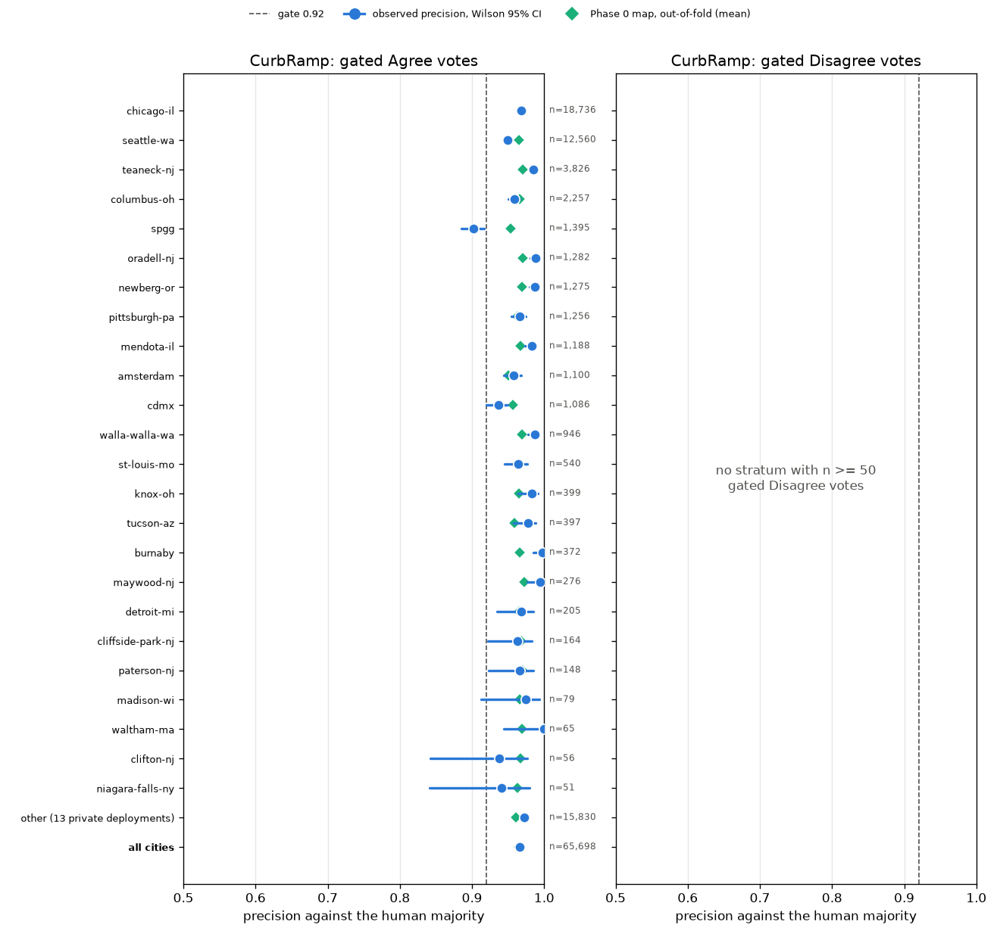
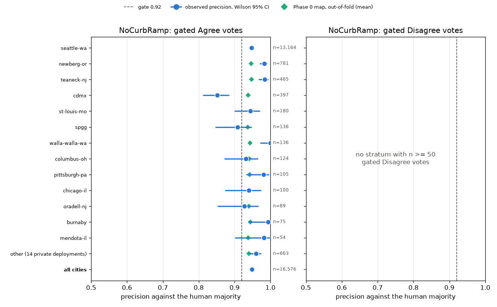
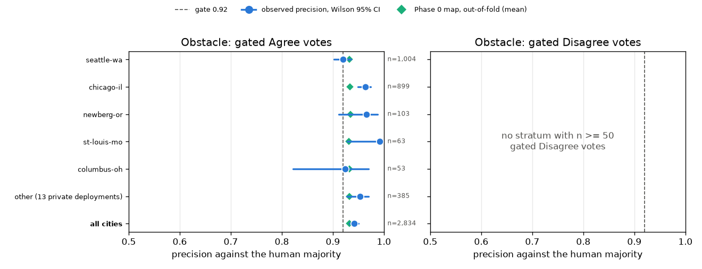
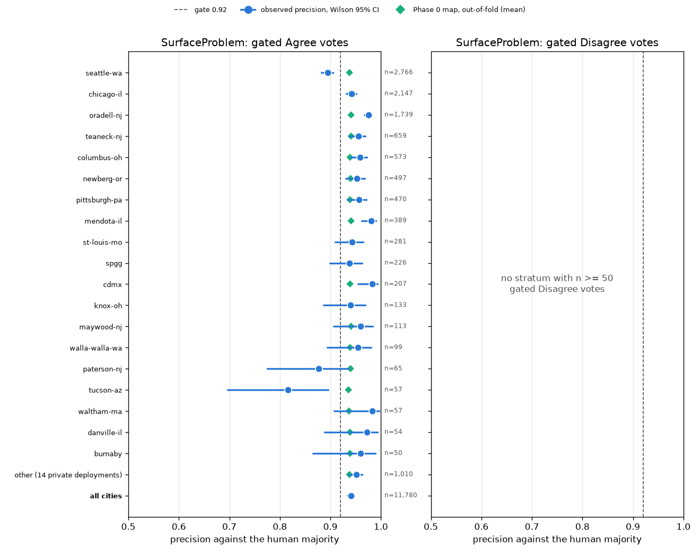
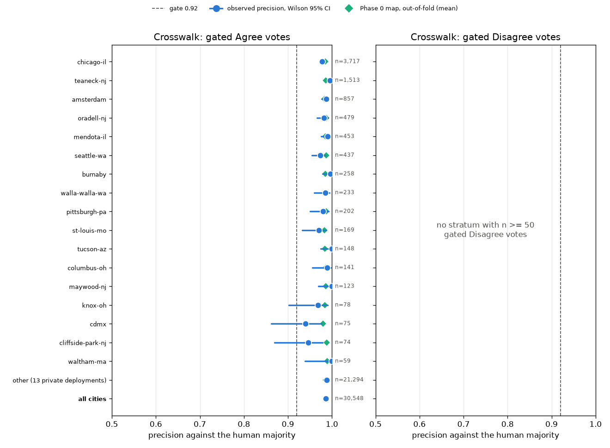
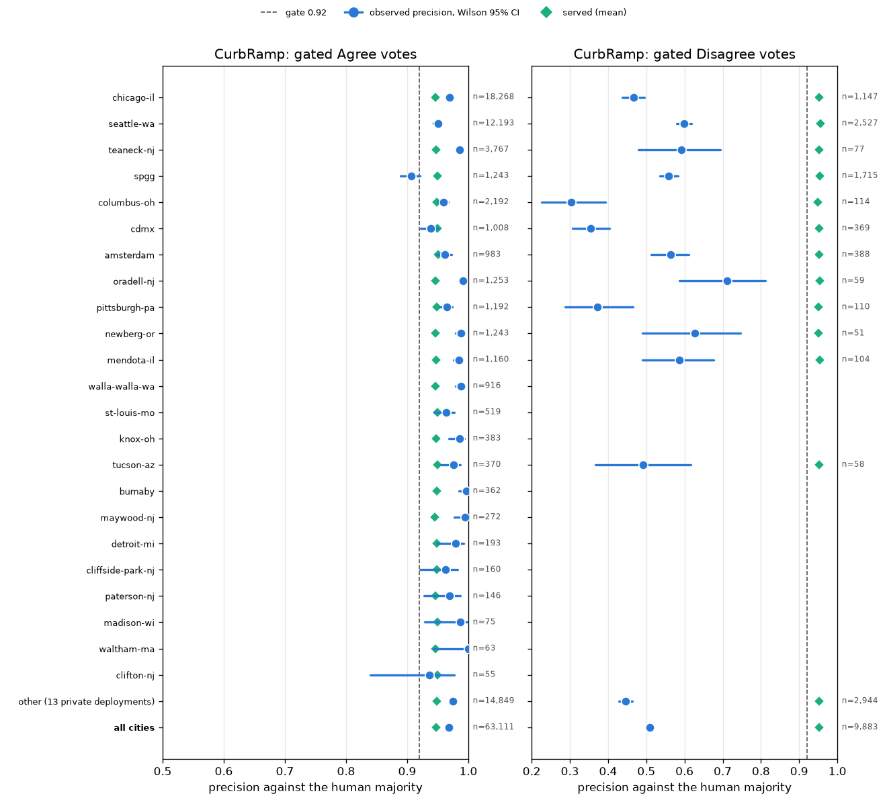
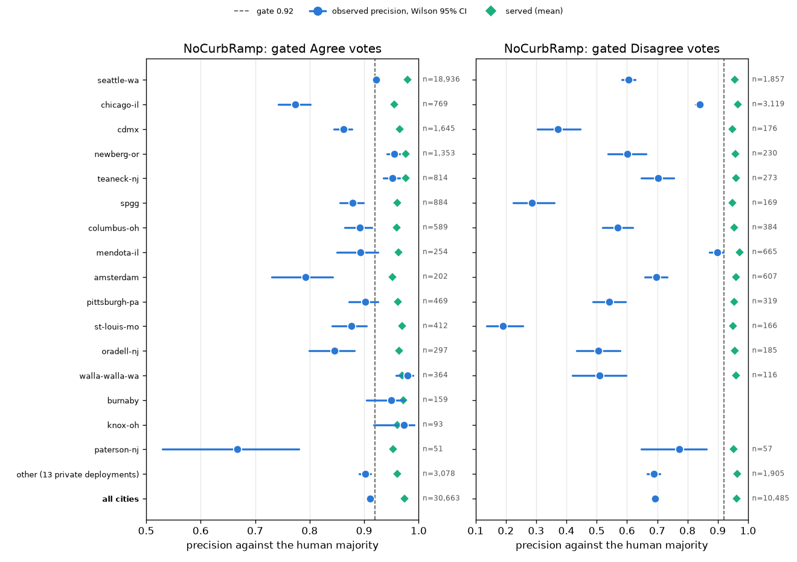
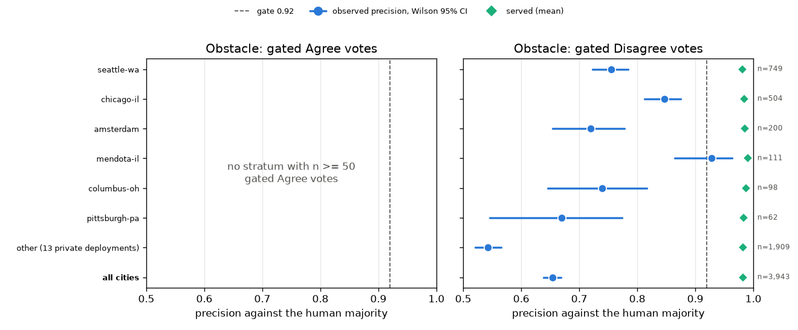
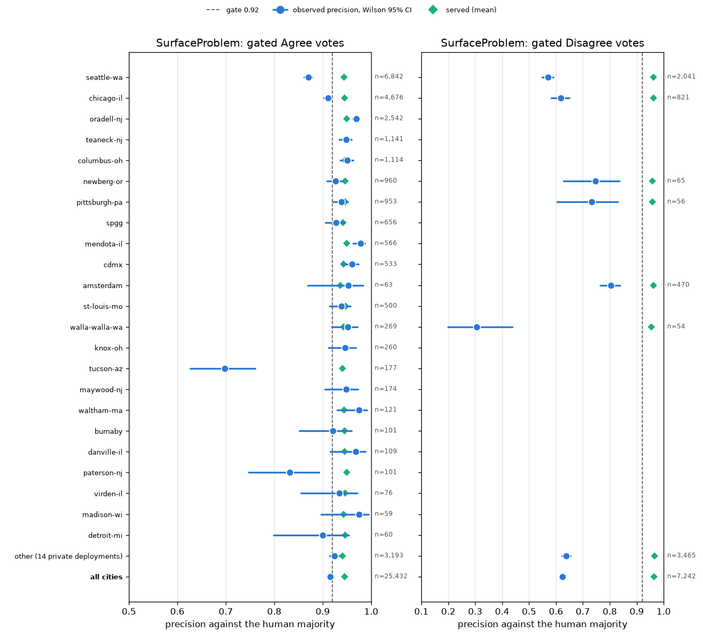
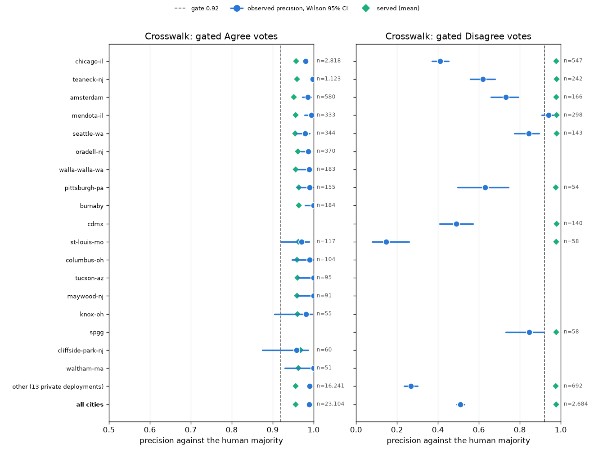

# Per-city calibration of the deployed validators (October 2026)

Does the 0.92 gate mean the same thing in every city? This note answers that for the models in production today,
from the same production pull as [`calibration-2026-10.md`](calibration-2026-10.md) (2026-10-17, labels with at least
two human votes, outcome `tie_half`). It is the production half of
[#15](https://github.com/ProjectSidewalk/sidewalk-validator-ai/issues/15). The held-out-city benchmark for the
retrained models is the [Held-out-city benchmark](running-on-hyak.md#held-out-city-benchmark) recipe, which has
not been run yet.

**Reproduce.** Every table, count and figure below is the unedited output of `calibration/per_city.py`, run on the
`labels_oof.csv` that the calibration note's `calibrate_from_production` command wrote:

```
python -m calibration.per_city --labels ~/Data/<pull>/phase0/labels_oof.csv --cities-json ~/Data/<pull>/cities.json --served-column oof_accuracy --out-dir ~/Data/<pull>/per_city_oof
python -m calibration.per_city --labels ~/Data/<pull>/phase0/labels_oof.csv --cities-json ~/Data/<pull>/cities.json --out-dir ~/Data/<pull>/per_city_served
```

`cities.json` is the `/v3/api/cities` response saved with the pull. The figures are each run's `per_city_<type>.png`,
copied as `per-city-calibration-2026-10/current_<type>.png` (first command) and `served_<type>.png` (second).

## Method

- **Rows.** Every AI-assessed label with at least two human Agree/Disagree votes: 273,169 labels from 49 of the 52
  assessed schemas, with the internal test schema dropped. The AI's own vote is excluded from the human count.
- **Gated vote.** A row whose served accuracy is at least 0.92, SidewalkWebpage's `ai-validation-min-accuracy`
  (`GATE` in `calibration/_isotonic_map.py`). Two served accuracies are measured:
  - **Current maps:** `oof_accuracy`, the out-of-fold value of the Phase 0 maps that have been live since
    sidewalk-ai-api [PR #16](https://github.com/ProjectSidewalk/sidewalk-ai-api/pull/16) (API 1.0.5). Each label is
    scored by a map fitted without its fold, so this is an honest estimate of what the live maps do in each city.
  - **As served:** `ai_accuracy`, what production served when the vote was cast, under the maps before PR #16.
- **Per city × label type × verdict:** the number of gated votes `n`, their mean served accuracy, and their
  **observed precision**. Observed precision is the mean outcome: 1 if the strict human majority matches the
  verdict, 0.5 for a tie, 0 otherwise. It comes with a Wilson 95% interval. The **gap** is served minus observed,
  per verdict; positive means the map over-promised in that city. Agree and Disagree are never pooled, because their
  gaps often have opposite signs and would cancel.
- **Threshold whose lower bound reaches the gate.** For an Agree stratum below 0.92, this is the lowest served
  threshold at which that city's votes of that type pass the same test as the Phase 0 hold-back rule: the Wilson
  95% lower bound of their precision is at least 0.92, on at least 50 votes. The table also gives the share of the
  stratum's gated votes that threshold keeps. It is chosen on the rows it is measured on, so it is optimistic. It is
  "n/a" for the pooled private row, which is not one deployment.
- **Naming.** A city is named by its `city_id` only if `cities.json` identifies it as public. That means the schema
  name is a listed `city_id`, or exactly one listed `city_id` is the schema name plus a region suffix, like
  `seattle-wa`. Every other deployment is pooled into one row, labelled with the number of pooled deployments that
  have a gated vote. Under both runs 13 of the 14 private deployments do. For the private deployments one at a time,
  only a count of strata below the gate is reported, never a name. Strata with fewer than 50 gated votes are shown
  as —, and cities with no such stratum are counted only in **all cities**.

## The live question is Agree votes

No Disagree map in the Phase 0 set reaches 0.92. `summary.csv` gives `below gate` for all five types, and the
shipped `incorrect` maps top out between 0.71 and 0.90. So **no Disagree verdict becomes a vote anywhere** under the
current maps. Whether the gate should vary by city is therefore a question about Agree votes today, and about the
retrained models later. The Disagree columns of the current-maps tables are empty for that reason. The dozen
out-of-fold Disagree rows above 0.92 in NoCurbRamp come from the fold maps, not the shipped one.

## Results under the current maps (Agree votes)

Agree strata with n >= 50: 78 named public city x type strata and 5 pooled private rows. Below 0.92: 6 named (4 with the whole interval below, 4,816 votes) and 0 pooled.

Private deployments one at a time (counts only): 5 of 29 deployment x type Agree strata with n >= 50 are below 0.92 (2 with the whole interval below), holding 521 of all 127,436 gated Agree votes (0.4%).

| city | type | n | served | observed (95% CI) | below the gate by | whole CI below | threshold whose lower bound reaches the gate (votes kept) |
|---|---|---:|---:|---:|---:|---|---:|
| tucson-az | SurfaceProblem | 57 | 0.936 | 0.816 (0.696–0.895) | 0.104 | yes | none with n >= 50 |
| cdmx | NoCurbRamp | 397 | 0.937 | 0.851 (0.813–0.883) | 0.069 | yes | none with n >= 50 |
| paterson-nj | SurfaceProblem | 65 | 0.940 | 0.877 (0.775–0.936) | 0.043 | no | none with n >= 50 |
| seattle-wa | SurfaceProblem | 2,766 | 0.938 | 0.894 (0.882–0.905) | 0.026 | yes | none with n >= 50 |
| spgg | CurbRamp | 1,395 | 0.953 | 0.902 (0.885–0.916) | 0.018 | yes | none with n >= 50 |
| spgg | NoCurbRamp | 136 | 0.937 | 0.908 (0.848–0.946) | 0.012 | no | none with n >= 50 |

- **83 Agree strata have at least 50 gated votes: 78 named public city × type strata, plus 5 pooled private rows.**
  72 of the 78 named strata are at or above 0.92, and so are all 5 pooled rows. The 6 named strata below hold 4,816
  of the 127,436 gated Agree votes (3.8%), and 4 of them have their whole 95% interval below the gate.
- **The private deployments hold 39,182 gated Agree votes (30.7%).** Their per-deployment behaviour is visible here
  only as the anonymous count above: 5 private deployment × type strata with at least 50 votes are below the gate,
  holding 0.4% of gated Agree votes.
- Among the 36 named strata with at least 300 votes, the Agree gap runs from −0.039 to +0.086, and 3 are below the
  gate.
- For each type, the all-cities row is calibrated to within 0.01. The out-of-fold construction makes that close to
  automatic. What the maps cannot see is the spread between cities.

Notes on the strata below the gate:

- **seattle-wa SurfaceProblem** (n = 2,766): 0.894, about 2.6 points short, with a tight interval.
- **cdmx NoCurbRamp** (n = 397): 0.851, 6.9 points short.
- **spgg CurbRamp** (n = 1,395): 0.902, 1.8 points short.
- **tucson-az SurfaceProblem** (n = 57): 0.816, the largest shortfall, with its whole interval (0.696–0.895) below
  the gate.
- **paterson-nj SurfaceProblem** (n = 65) and **spgg NoCurbRamp** (n = 136) are below on the point estimate, but
  their intervals reach the gate.
- **No threshold qualifies for any of the six.** No served threshold gives a Wilson lower bound of at least 0.92
  on 50 or more votes. A stricter gate in those cities would not fix them; the problem is how the model does there.
- **seattle-wa Obstacle** is exactly at the gate: 0.920 (n = 1,004; interval 0.902–0.936).

Three of these city × type strata were already flagged in the calibration note: cdmx NoCurbRamp, Seattle
SurfaceProblem and spgg CurbRamp. This note adds their intervals, tucson-az SurfaceProblem, and the full table.

### Per-city tables, current maps

#### CurbRamp

| city | Agree n | Agree served | Agree observed (95% CI) | Agree gap | Disagree n | Disagree served | Disagree observed (95% CI) | Disagree gap |
|---|---:|---:|---:|---:|---:|---:|---:|---:|
| chicago-il | 18,736 | 0.969 | 0.968 (0.966–0.971) | +0.000 | 0 | — | — | — |
| seattle-wa | 12,560 | 0.965 | 0.950 (0.946–0.953) | +0.015 | 0 | — | — | — |
| teaneck-nj | 3,826 | 0.970 | 0.985 (0.981–0.989) | -0.016 | 0 | — | — | — |
| columbus-oh | 2,257 | 0.966 | 0.959 (0.950–0.966) | +0.007 | 0 | — | — | — |
| spgg | 1,395 | 0.953 | 0.902 (0.885–0.916) | +0.051 | 0 | — | — | — |
| oradell-nj | 1,282 | 0.970 | 0.988 (0.981–0.993) | -0.018 | 0 | — | — | — |
| newberg-or | 1,275 | 0.969 | 0.987 (0.980–0.992) | -0.019 | 0 | — | — | — |
| pittsburgh-pa | 1,256 | 0.962 | 0.966 (0.954–0.974) | -0.003 | 0 | — | — | — |
| mendota-il | 1,188 | 0.967 | 0.983 (0.974–0.989) | -0.016 | 0 | — | — | — |
| amsterdam | 1,100 | 0.951 | 0.958 (0.944–0.968) | -0.007 | 0 | — | — | — |
| cdmx | 1,086 | 0.957 | 0.936 (0.920–0.949) | +0.021 | 0 | — | — | — |
| walla-walla-wa | 946 | 0.969 | 0.987 (0.978–0.993) | -0.018 | 0 | — | — | — |
| st-louis-mo | 540 | 0.963 | 0.964 (0.945–0.977) | -0.001 | 0 | — | — | — |
| knox-oh | 399 | 0.965 | 0.982 (0.964–0.991) | -0.018 | 0 | — | — | — |
| tucson-az | 397 | 0.959 | 0.977 (0.957–0.988) | -0.018 | 0 | — | — | — |
| burnaby | 372 | 0.966 | 0.997 (0.985–1.000) | -0.032 | 0 | — | — | — |
| maywood-nj | 276 | 0.972 | 0.995 (0.977–0.999) | -0.023 | 0 | — | — | — |
| detroit-mi | 205 | 0.965 | 0.968 (0.934–0.985) | -0.004 | 0 | — | — | — |
| cliffside-park-nj | 164 | 0.968 | 0.963 (0.922–0.983) | +0.005 | 0 | — | — | — |
| paterson-nj | 148 | 0.970 | 0.966 (0.923–0.985) | +0.004 | 0 | — | — | — |
| madison-wi | 79 | 0.967 | 0.975 (0.912–0.993) | -0.008 | 0 | — | — | — |
| waltham-ma | 65 | 0.969 | 1.000 (0.944–1.000) | -0.031 | 0 | — | — | — |
| clifton-nj | 56 | 0.967 | 0.938 (0.842–0.977) | +0.030 | 0 | — | — | — |
| niagara-falls-ny | 51 | 0.963 | 0.941 (0.841–0.980) | +0.021 | 0 | — | — | — |
| other (13 private deployments) | 15,830 | 0.961 | 0.973 (0.970–0.975) | -0.012 | 0 | — | — | — |
| **all cities** | 65,698 | 0.965 | 0.966 (0.965–0.967) | -0.001 | 0 | — | — | — |

12 more cities have fewer than 50 gated votes of either verdict (209 votes); they are counted in **all cities**.

#### NoCurbRamp

| city | Agree n | Agree served | Agree observed (95% CI) | Agree gap | Disagree n | Disagree served | Disagree observed (95% CI) | Disagree gap |
|---|---:|---:|---:|---:|---:|---:|---:|---:|
| seattle-wa | 13,164 | 0.948 | 0.947 (0.943–0.951) | +0.001 | 2 | — | — | — |
| newberg-or | 781 | 0.946 | 0.983 (0.971–0.990) | -0.037 | 0 | — | — | — |
| teaneck-nj | 465 | 0.948 | 0.984 (0.968–0.992) | -0.036 | 0 | — | — | — |
| cdmx | 397 | 0.937 | 0.851 (0.813–0.883) | +0.086 | 0 | — | — | — |
| st-louis-mo | 180 | 0.944 | 0.944 (0.901–0.970) | -0.000 | 0 | — | — | — |
| spgg | 136 | 0.937 | 0.908 (0.848–0.946) | +0.029 | 0 | — | — | — |
| walla-walla-wa | 136 | 0.943 | 1.000 (0.973–1.000) | -0.057 | 0 | — | — | — |
| columbus-oh | 124 | 0.940 | 0.931 (0.873–0.964) | +0.009 | 0 | — | — | — |
| pittsburgh-pa | 105 | 0.942 | 0.981 (0.933–0.995) | -0.039 | 0 | — | — | — |
| chicago-il | 100 | 0.937 | 0.940 (0.875–0.972) | -0.003 | 0 | — | — | — |
| oradell-nj | 89 | 0.940 | 0.927 (0.854–0.965) | +0.013 | 0 | — | — | — |
| burnaby | 75 | 0.944 | 0.993 (0.939–0.999) | -0.050 | 0 | — | — | — |
| mendota-il | 54 | 0.938 | 0.981 (0.902–0.997) | -0.044 | 0 | — | — | — |
| other (13 private deployments) | 663 | 0.940 | 0.960 (0.942–0.972) | -0.020 | 10 | — | — | — |
| **all cities** | 16,576 | 0.947 | 0.948 (0.945–0.952) | -0.001 | 12 | — | — | — |

14 more cities have fewer than 50 gated votes of either verdict (107 votes); they are counted in **all cities**.

#### Obstacle

| city | Agree n | Agree served | Agree observed (95% CI) | Agree gap | Disagree n | Disagree served | Disagree observed (95% CI) | Disagree gap |
|---|---:|---:|---:|---:|---:|---:|---:|---:|
| seattle-wa | 1,004 | 0.933 | 0.920 (0.902–0.936) | +0.012 | 0 | — | — | — |
| chicago-il | 899 | 0.934 | 0.963 (0.949–0.974) | -0.030 | 0 | — | — | — |
| newberg-or | 103 | 0.935 | 0.966 (0.911–0.987) | -0.031 | 0 | — | — | — |
| st-louis-mo | 63 | 0.931 | 0.992 (0.928–0.999) | -0.061 | 0 | — | — | — |
| columbus-oh | 53 | 0.932 | 0.925 (0.821–0.970) | +0.008 | 0 | — | — | — |
| other (13 private deployments) | 385 | 0.933 | 0.953 (0.927–0.970) | -0.021 | 0 | — | — | — |
| **all cities** | 2,834 | 0.933 | 0.942 (0.933–0.950) | -0.009 | 0 | — | — | — |

20 more cities have fewer than 50 gated votes of either verdict (327 votes); they are counted in **all cities**.

#### SurfaceProblem

| city | Agree n | Agree served | Agree observed (95% CI) | Agree gap | Disagree n | Disagree served | Disagree observed (95% CI) | Disagree gap |
|---|---:|---:|---:|---:|---:|---:|---:|---:|
| seattle-wa | 2,766 | 0.938 | 0.894 (0.882–0.905) | +0.044 | 0 | — | — | — |
| chicago-il | 2,147 | 0.939 | 0.942 (0.931–0.951) | -0.003 | 0 | — | — | — |
| oradell-nj | 1,739 | 0.941 | 0.976 (0.968–0.982) | -0.034 | 0 | — | — | — |
| teaneck-nj | 659 | 0.940 | 0.956 (0.938–0.969) | -0.016 | 0 | — | — | — |
| columbus-oh | 573 | 0.939 | 0.959 (0.939–0.972) | -0.020 | 0 | — | — | — |
| newberg-or | 497 | 0.940 | 0.953 (0.930–0.968) | -0.013 | 0 | — | — | — |
| pittsburgh-pa | 470 | 0.939 | 0.956 (0.934–0.971) | -0.017 | 0 | — | — | — |
| mendota-il | 389 | 0.941 | 0.981 (0.962–0.990) | -0.039 | 0 | — | — | — |
| st-louis-mo | 281 | 0.940 | 0.943 (0.910–0.965) | -0.003 | 0 | — | — | — |
| spgg | 226 | 0.937 | 0.938 (0.899–0.963) | -0.001 | 0 | — | — | — |
| cdmx | 207 | 0.939 | 0.983 (0.955–0.994) | -0.045 | 0 | — | — | — |
| knox-oh | 133 | 0.941 | 0.940 (0.886–0.969) | +0.001 | 0 | — | — | — |
| maywood-nj | 113 | 0.941 | 0.960 (0.906–0.984) | -0.019 | 0 | — | — | — |
| walla-walla-wa | 99 | 0.939 | 0.955 (0.894–0.981) | -0.016 | 0 | — | — | — |
| paterson-nj | 65 | 0.940 | 0.877 (0.775–0.936) | +0.063 | 0 | — | — | — |
| tucson-az | 57 | 0.936 | 0.816 (0.696–0.895) | +0.120 | 0 | — | — | — |
| waltham-ma | 57 | 0.937 | 0.982 (0.907–0.997) | -0.045 | 0 | — | — | — |
| danville-il | 54 | 0.939 | 0.972 (0.888–0.994) | -0.033 | 0 | — | — | — |
| burnaby | 50 | 0.939 | 0.960 (0.865–0.989) | -0.021 | 0 | — | — | — |
| other (13 private deployments) | 1,010 | 0.938 | 0.951 (0.936–0.963) | -0.013 | 0 | — | — | — |
| **all cities** | 11,780 | 0.939 | 0.941 (0.937–0.945) | -0.002 | 0 | — | — | — |

14 more cities have fewer than 50 gated votes of either verdict (188 votes); they are counted in **all cities**.

#### Crosswalk

| city | Agree n | Agree served | Agree observed (95% CI) | Agree gap | Disagree n | Disagree served | Disagree observed (95% CI) | Disagree gap |
|---|---:|---:|---:|---:|---:|---:|---:|---:|
| chicago-il | 3,717 | 0.985 | 0.978 (0.972–0.982) | +0.008 | 0 | — | — | — |
| teaneck-nj | 1,513 | 0.986 | 0.995 (0.990–0.998) | -0.010 | 0 | — | — | — |
| amsterdam | 857 | 0.983 | 0.987 (0.976–0.992) | -0.004 | 0 | — | — | — |
| oradell-nj | 479 | 0.988 | 0.982 (0.966–0.991) | +0.005 | 0 | — | — | — |
| mendota-il | 453 | 0.985 | 0.990 (0.976–0.996) | -0.005 | 0 | — | — | — |
| seattle-wa | 437 | 0.987 | 0.974 (0.954–0.985) | +0.013 | 0 | — | — | — |
| burnaby | 258 | 0.985 | 0.996 (0.978–0.999) | -0.011 | 0 | — | — | — |
| walla-walla-wa | 233 | 0.986 | 0.985 (0.960–0.994) | +0.001 | 0 | — | — | — |
| pittsburgh-pa | 202 | 0.987 | 0.980 (0.950–0.992) | +0.007 | 0 | — | — | — |
| st-louis-mo | 169 | 0.983 | 0.970 (0.933–0.987) | +0.013 | 0 | — | — | — |
| tucson-az | 148 | 0.984 | 1.000 (0.975–1.000) | -0.016 | 0 | — | — | — |
| columbus-oh | 141 | 0.986 | 0.989 (0.955–0.998) | -0.004 | 0 | — | — | — |
| maywood-nj | 123 | 0.986 | 1.000 (0.970–1.000) | -0.014 | 0 | — | — | — |
| knox-oh | 78 | 0.984 | 0.968 (0.902–0.990) | +0.016 | 0 | — | — | — |
| cdmx | 75 | 0.979 | 0.940 (0.862–0.975) | +0.039 | 0 | — | — | — |
| cliffside-park-nj | 74 | 0.988 | 0.946 (0.869–0.979) | +0.042 | 0 | — | — | — |
| waltham-ma | 59 | 0.989 | 1.000 (0.939–1.000) | -0.011 | 0 | — | — | — |
| other (13 private deployments) | 21,294 | 0.986 | 0.988 (0.986–0.989) | -0.002 | 0 | — | — | — |
| **all cities** | 30,548 | 0.986 | 0.986 (0.985–0.988) | -0.001 | 0 | — | — | — |

17 more cities have fewer than 50 gated votes of either verdict (238 votes); they are counted in **all cities**.

### Figures, current maps

Each row is one city. The blue dot and line are the observed precision of its gated votes with the Wilson 95%
interval. The green diamond is the mean value the map served those votes. A city left of the dashed gate line voted
below 0.92 precision.







## Results as served (the maps before PR #16)

These are the votes as the platform recorded them before the Phase 0 maps. Both verdicts voted then, and Obstacle
never voted Agree.

Agree strata with n >= 50: 78 named public city x type strata and 4 pooled private rows. Below 0.92: 16 named (12 with the whole interval below, 18,671 votes) and 1 pooled.

Private deployments one at a time (counts only): 8 of 31 deployment x type Agree strata with n >= 50 are below 0.92 (4 with the whole interval below), holding 2,406 of all 142,310 gated Agree votes (1.7%).

| city | type | n | served | observed (95% CI) | below the gate by | whole CI below | threshold whose lower bound reaches the gate (votes kept) |
|---|---|---:|---:|---:|---:|---|---:|
| paterson-nj | NoCurbRamp | 51 | 0.953 | 0.667 (0.530–0.780) | 0.253 | yes | none with n >= 50 |
| tucson-az | SurfaceProblem | 177 | 0.941 | 0.698 (0.626–0.761) | 0.222 | yes | none with n >= 50 |
| chicago-il | NoCurbRamp | 769 | 0.956 | 0.773 (0.742–0.801) | 0.147 | yes | none with n >= 50 |
| amsterdam | NoCurbRamp | 202 | 0.952 | 0.792 (0.731–0.842) | 0.128 | yes | none with n >= 50 |
| paterson-nj | SurfaceProblem | 101 | 0.949 | 0.832 (0.747–0.892) | 0.088 | yes | none with n >= 50 |
| oradell-nj | NoCurbRamp | 297 | 0.964 | 0.845 (0.800–0.882) | 0.075 | yes | none with n >= 50 |
| cdmx | NoCurbRamp | 1,645 | 0.965 | 0.862 (0.844–0.878) | 0.058 | yes | none with n >= 50 |
| seattle-wa | SurfaceProblem | 6,842 | 0.944 | 0.870 (0.862–0.878) | 0.050 | yes | none with n >= 50 |
| st-louis-mo | NoCurbRamp | 412 | 0.970 | 0.876 (0.841–0.905) | 0.044 | yes | none with n >= 50 |
| spgg | NoCurbRamp | 884 | 0.961 | 0.879 (0.856–0.899) | 0.041 | yes | none with n >= 50 |
| columbus-oh | NoCurbRamp | 589 | 0.960 | 0.892 (0.865–0.915) | 0.028 | yes | none with n >= 50 |
| mendota-il | NoCurbRamp | 254 | 0.963 | 0.894 (0.850–0.926) | 0.026 | no | 0.9581 (58%) |
| detroit-mi | SurfaceProblem | 60 | 0.946 | 0.900 (0.799–0.953) | 0.020 | no | none with n >= 50 |
| other (13 private deployments) | NoCurbRamp | 3,078 | 0.961 | 0.902 (0.891–0.912) | 0.018 | yes | n/a (pooled) |
| pittsburgh-pa | NoCurbRamp | 469 | 0.962 | 0.902 (0.872–0.926) | 0.018 | no | 0.9705 (41%) |
| spgg | CurbRamp | 1,243 | 0.950 | 0.906 (0.889–0.921) | 0.014 | no | none with n >= 50 |
| chicago-il | SurfaceProblem | 4,676 | 0.945 | 0.911 (0.902–0.918) | 0.009 | yes | 0.9541 (59%) |

- **Agree:** 16 of 78 named strata with at least 50 votes were below 0.92 (18,671 votes; 12 with the whole interval
  below), plus 1 of the 4 pooled rows. Most of them are NoCurbRamp. The Phase 0 maps later cut NoCurbRamp Agree to
  43% coverage.
- **Disagree:** across the 47 named strata with at least 50 votes, gated precision ranged from **0.147 to 0.940**.
  Only 2 of them reached the gate. Cities differ far more on Disagree than on Agree, which matters if a retrained
  model's Disagree class ever votes again.

### Per-city tables, as served

#### CurbRamp

| city | Agree n | Agree served | Agree observed (95% CI) | Agree gap | Disagree n | Disagree served | Disagree observed (95% CI) | Disagree gap |
|---|---:|---:|---:|---:|---:|---:|---:|---:|
| chicago-il | 18,268 | 0.947 | 0.970 (0.967–0.972) | -0.023 | 1,147 | 0.952 | 0.466 (0.438–0.495) | +0.486 |
| seattle-wa | 12,193 | 0.948 | 0.951 (0.947–0.955) | -0.003 | 2,527 | 0.955 | 0.599 (0.580–0.618) | +0.356 |
| teaneck-nj | 3,767 | 0.948 | 0.986 (0.982–0.989) | -0.038 | 77 | 0.953 | 0.591 (0.479–0.694) | +0.362 |
| spgg | 1,243 | 0.950 | 0.906 (0.889–0.921) | +0.044 | 1,715 | 0.955 | 0.559 (0.536–0.583) | +0.396 |
| columbus-oh | 2,192 | 0.949 | 0.960 (0.951–0.967) | -0.011 | 114 | 0.949 | 0.303 (0.226–0.392) | +0.646 |
| cdmx | 1,008 | 0.949 | 0.938 (0.922–0.952) | +0.011 | 369 | 0.951 | 0.354 (0.307–0.404) | +0.598 |
| amsterdam | 983 | 0.950 | 0.962 (0.948–0.972) | -0.012 | 388 | 0.952 | 0.563 (0.513–0.612) | +0.389 |
| oradell-nj | 1,253 | 0.946 | 0.991 (0.984–0.995) | -0.045 | 59 | 0.954 | 0.712 (0.586–0.812) | +0.242 |
| pittsburgh-pa | 1,192 | 0.948 | 0.965 (0.953–0.974) | -0.016 | 110 | 0.950 | 0.373 (0.288–0.466) | +0.578 |
| newberg-or | 1,243 | 0.946 | 0.988 (0.980–0.992) | -0.042 | 51 | 0.951 | 0.627 (0.490–0.747) | +0.324 |
| mendota-il | 1,160 | 0.947 | 0.985 (0.976–0.990) | -0.038 | 104 | 0.953 | 0.587 (0.490–0.676) | +0.367 |
| walla-walla-wa | 916 | 0.946 | 0.988 (0.979–0.993) | -0.042 | 29 | — | — | — |
| st-louis-mo | 519 | 0.949 | 0.963 (0.944–0.976) | -0.014 | 44 | — | — | — |
| knox-oh | 383 | 0.947 | 0.986 (0.968–0.994) | -0.038 | 48 | — | — | — |
| tucson-az | 370 | 0.949 | 0.976 (0.954–0.987) | -0.027 | 58 | 0.953 | 0.491 (0.367–0.617) | +0.462 |
| burnaby | 362 | 0.949 | 0.997 (0.985–1.000) | -0.049 | 18 | — | — | — |
| maywood-nj | 272 | 0.945 | 0.994 (0.976–0.999) | -0.049 | 6 | — | — | — |
| detroit-mi | 193 | 0.948 | 0.979 (0.948–0.992) | -0.031 | 6 | — | — | — |
| cliffside-park-nj | 160 | 0.948 | 0.963 (0.921–0.983) | -0.014 | 9 | — | — | — |
| paterson-nj | 146 | 0.947 | 0.969 (0.927–0.987) | -0.023 | 2 | — | — | — |
| madison-wi | 75 | 0.949 | 0.987 (0.928–0.998) | -0.038 | 6 | — | — | — |
| waltham-ma | 63 | 0.946 | 1.000 (0.943–1.000) | -0.054 | 7 | — | — | — |
| clifton-nj | 55 | 0.950 | 0.936 (0.839–0.976) | +0.014 | 1 | — | — | — |
| other (13 private deployments) | 14,849 | 0.948 | 0.975 (0.972–0.977) | -0.027 | 2,944 | 0.952 | 0.446 (0.428–0.464) | +0.506 |
| **all cities** | 63,111 | 0.948 | 0.968 (0.966–0.969) | -0.020 | 9,883 | 0.953 | 0.508 (0.499–0.518) | +0.445 |

13 more cities have fewer than 50 gated votes of either verdict (290 votes); they are counted in **all cities**.

#### NoCurbRamp

| city | Agree n | Agree served | Agree observed (95% CI) | Agree gap | Disagree n | Disagree served | Disagree observed (95% CI) | Disagree gap |
|---|---:|---:|---:|---:|---:|---:|---:|---:|
| seattle-wa | 18,936 | 0.980 | 0.922 (0.918–0.926) | +0.057 | 1,857 | 0.956 | 0.605 (0.583–0.627) | +0.351 |
| chicago-il | 769 | 0.956 | 0.773 (0.742–0.801) | +0.183 | 3,119 | 0.966 | 0.841 (0.827–0.853) | +0.126 |
| cdmx | 1,645 | 0.965 | 0.862 (0.844–0.878) | +0.103 | 176 | 0.949 | 0.372 (0.304–0.446) | +0.577 |
| newberg-or | 1,353 | 0.976 | 0.955 (0.943–0.965) | +0.021 | 230 | 0.958 | 0.602 (0.538–0.663) | +0.356 |
| teaneck-nj | 814 | 0.976 | 0.952 (0.935–0.965) | +0.024 | 273 | 0.960 | 0.703 (0.647–0.754) | +0.256 |
| spgg | 884 | 0.961 | 0.879 (0.856–0.899) | +0.082 | 169 | 0.948 | 0.287 (0.224–0.359) | +0.661 |
| columbus-oh | 589 | 0.960 | 0.892 (0.865–0.915) | +0.068 | 384 | 0.954 | 0.570 (0.520–0.619) | +0.384 |
| mendota-il | 254 | 0.963 | 0.894 (0.850–0.926) | +0.069 | 665 | 0.972 | 0.898 (0.873–0.919) | +0.073 |
| amsterdam | 202 | 0.952 | 0.792 (0.731–0.842) | +0.160 | 607 | 0.960 | 0.698 (0.660–0.733) | +0.263 |
| pittsburgh-pa | 469 | 0.962 | 0.902 (0.872–0.926) | +0.060 | 319 | 0.955 | 0.542 (0.487–0.596) | +0.412 |
| st-louis-mo | 412 | 0.970 | 0.876 (0.841–0.905) | +0.093 | 166 | 0.949 | 0.190 (0.137–0.256) | +0.760 |
| oradell-nj | 297 | 0.964 | 0.845 (0.800–0.882) | +0.119 | 185 | 0.956 | 0.505 (0.434–0.577) | +0.450 |
| walla-walla-wa | 364 | 0.969 | 0.979 (0.959–0.990) | -0.010 | 116 | 0.961 | 0.509 (0.419–0.598) | +0.452 |
| burnaby | 159 | 0.972 | 0.950 (0.904–0.974) | +0.022 | 45 | — | — | — |
| knox-oh | 93 | 0.961 | 0.973 (0.917–0.992) | -0.012 | 26 | — | — | — |
| paterson-nj | 51 | 0.953 | 0.667 (0.530–0.780) | +0.286 | 57 | 0.953 | 0.772 (0.648–0.862) | +0.181 |
| other (13 private deployments) | 3,078 | 0.961 | 0.902 (0.891–0.912) | +0.059 | 1,905 | 0.965 | 0.689 (0.668–0.709) | +0.276 |
| **all cities** | 30,663 | 0.974 | 0.911 (0.908–0.914) | +0.063 | 10,485 | 0.962 | 0.693 (0.685–0.702) | +0.268 |

17 more cities have fewer than 50 gated votes of either verdict (480 votes); they are counted in **all cities**.

#### Obstacle

| city | Agree n | Agree served | Agree observed (95% CI) | Agree gap | Disagree n | Disagree served | Disagree observed (95% CI) | Disagree gap |
|---|---:|---:|---:|---:|---:|---:|---:|---:|
| seattle-wa | 0 | — | — | — | 749 | 0.981 | 0.755 (0.723–0.784) | +0.226 |
| chicago-il | 0 | — | — | — | 504 | 0.985 | 0.846 (0.812–0.875) | +0.139 |
| amsterdam | 0 | — | — | — | 200 | 0.985 | 0.720 (0.654–0.778) | +0.265 |
| mendota-il | 0 | — | — | — | 111 | 0.990 | 0.928 (0.864–0.963) | +0.062 |
| columbus-oh | 0 | — | — | — | 98 | 0.987 | 0.740 (0.645–0.816) | +0.247 |
| pittsburgh-pa | 0 | — | — | — | 62 | 0.983 | 0.669 (0.545–0.774) | +0.314 |
| other (13 private deployments) | 0 | — | — | — | 1,909 | 0.982 | 0.543 (0.520–0.565) | +0.439 |
| **all cities** | 0 | — | — | — | 3,943 | 0.983 | 0.654 (0.639–0.668) | +0.329 |

21 more cities have fewer than 50 gated votes of either verdict (310 votes); they are counted in **all cities**.

#### SurfaceProblem

| city | Agree n | Agree served | Agree observed (95% CI) | Agree gap | Disagree n | Disagree served | Disagree observed (95% CI) | Disagree gap |
|---|---:|---:|---:|---:|---:|---:|---:|---:|
| seattle-wa | 6,842 | 0.944 | 0.870 (0.862–0.878) | +0.074 | 2,041 | 0.961 | 0.570 (0.548–0.591) | +0.392 |
| chicago-il | 4,676 | 0.945 | 0.911 (0.902–0.918) | +0.035 | 821 | 0.961 | 0.617 (0.583–0.650) | +0.344 |
| oradell-nj | 2,542 | 0.950 | 0.969 (0.962–0.975) | -0.020 | 12 | — | — | — |
| teaneck-nj | 1,141 | 0.948 | 0.948 (0.934–0.960) | -0.001 | 44 | — | — | — |
| columbus-oh | 1,114 | 0.946 | 0.951 (0.937–0.962) | -0.005 | 37 | — | — | — |
| newberg-or | 960 | 0.946 | 0.927 (0.908–0.941) | +0.019 | 65 | 0.958 | 0.746 (0.629–0.836) | +0.212 |
| pittsburgh-pa | 953 | 0.946 | 0.938 (0.921–0.952) | +0.008 | 56 | 0.958 | 0.732 (0.604–0.830) | +0.226 |
| spgg | 656 | 0.942 | 0.928 (0.905–0.945) | +0.014 | 39 | — | — | — |
| mendota-il | 566 | 0.950 | 0.978 (0.962–0.987) | -0.028 | 21 | — | — | — |
| cdmx | 533 | 0.943 | 0.961 (0.941–0.974) | -0.018 | 24 | — | — | — |
| amsterdam | 63 | 0.937 | 0.952 (0.869–0.984) | -0.016 | 470 | 0.962 | 0.803 (0.765–0.837) | +0.159 |
| st-louis-mo | 500 | 0.947 | 0.939 (0.914–0.957) | +0.008 | 19 | — | — | — |
| walla-walla-wa | 269 | 0.943 | 0.952 (0.919–0.972) | -0.009 | 54 | 0.955 | 0.306 (0.199–0.438) | +0.649 |
| knox-oh | 260 | 0.946 | 0.946 (0.912–0.968) | -0.000 | 4 | — | — | — |
| tucson-az | 177 | 0.941 | 0.698 (0.626–0.761) | +0.243 | 16 | — | — | — |
| maywood-nj | 174 | 0.949 | 0.948 (0.905–0.973) | +0.001 | 1 | — | — | — |
| waltham-ma | 121 | 0.944 | 0.975 (0.930–0.992) | -0.031 | 6 | — | — | — |
| burnaby | 101 | 0.945 | 0.921 (0.851–0.959) | +0.024 | 15 | — | — | — |
| danville-il | 109 | 0.945 | 0.968 (0.916–0.988) | -0.022 | 2 | — | — | — |
| paterson-nj | 101 | 0.949 | 0.832 (0.747–0.892) | +0.117 | 0 | — | — | — |
| virden-il | 76 | 0.946 | 0.934 (0.855–0.972) | +0.012 | 2 | — | — | — |
| madison-wi | 59 | 0.943 | 0.975 (0.897–0.994) | -0.032 | 6 | — | — | — |
| detroit-mi | 60 | 0.946 | 0.900 (0.799–0.953) | +0.046 | 2 | — | — | — |
| other (13 private deployments) | 3,193 | 0.941 | 0.925 (0.915–0.933) | +0.016 | 3,465 | 0.967 | 0.637 (0.621–0.653) | +0.329 |
| **all cities** | 25,432 | 0.945 | 0.916 (0.912–0.919) | +0.029 | 7,242 | 0.964 | 0.624 (0.612–0.635) | +0.340 |

11 more cities have fewer than 50 gated votes of either verdict (206 votes); they are counted in **all cities**.

#### Crosswalk

| city | Agree n | Agree served | Agree observed (95% CI) | Agree gap | Disagree n | Disagree served | Disagree observed (95% CI) | Disagree gap |
|---|---:|---:|---:|---:|---:|---:|---:|---:|
| chicago-il | 2,818 | 0.957 | 0.981 (0.975–0.985) | -0.024 | 547 | 0.979 | 0.410 (0.370–0.452) | +0.568 |
| teaneck-nj | 1,123 | 0.959 | 0.998 (0.994–1.000) | -0.039 | 242 | 0.980 | 0.620 (0.557–0.679) | +0.360 |
| amsterdam | 580 | 0.952 | 0.986 (0.973–0.993) | -0.035 | 166 | 0.978 | 0.732 (0.660–0.794) | +0.246 |
| mendota-il | 333 | 0.956 | 0.994 (0.978–0.998) | -0.038 | 298 | 0.979 | 0.940 (0.907–0.961) | +0.040 |
| seattle-wa | 344 | 0.955 | 0.980 (0.959–0.990) | -0.024 | 143 | 0.979 | 0.843 (0.774–0.893) | +0.136 |
| oradell-nj | 370 | 0.962 | 0.986 (0.969–0.994) | -0.024 | 48 | — | — | — |
| walla-walla-wa | 183 | 0.956 | 0.989 (0.961–0.997) | -0.033 | 27 | — | — | — |
| pittsburgh-pa | 155 | 0.964 | 0.990 (0.959–0.998) | -0.026 | 54 | 0.977 | 0.630 (0.496–0.746) | +0.347 |
| burnaby | 184 | 0.964 | 1.000 (0.980–1.000) | -0.036 | 18 | — | — | — |
| cdmx | 43 | — | — | — | 140 | 0.980 | 0.489 (0.408–0.571) | +0.490 |
| st-louis-mo | 117 | 0.962 | 0.970 (0.921–0.989) | -0.008 | 58 | 0.978 | 0.147 (0.078–0.259) | +0.831 |
| columbus-oh | 104 | 0.959 | 0.990 (0.948–0.998) | -0.031 | 46 | — | — | — |
| tucson-az | 95 | 0.961 | 1.000 (0.961–1.000) | -0.039 | 47 | — | — | — |
| maywood-nj | 91 | 0.959 | 1.000 (0.959–1.000) | -0.041 | 5 | — | — | — |
| knox-oh | 55 | 0.960 | 0.982 (0.904–0.997) | -0.021 | 19 | — | — | — |
| spgg | 11 | — | — | — | 58 | 0.978 | 0.845 (0.731–0.916) | +0.134 |
| cliffside-park-nj | 60 | 0.968 | 0.958 (0.875–0.987) | +0.009 | 4 | — | — | — |
| waltham-ma | 51 | 0.962 | 1.000 (0.930–1.000) | -0.038 | 3 | — | — | — |
| other (13 private deployments) | 16,241 | 0.956 | 0.990 (0.989–0.992) | -0.034 | 692 | 0.975 | 0.267 (0.235–0.301) | +0.709 |
| **all cities** | 23,104 | 0.957 | 0.989 (0.988–0.990) | -0.032 | 2,684 | 0.978 | 0.510 (0.491–0.529) | +0.468 |

16 more cities have fewer than 50 gated votes of either verdict (215 votes); they are counted in **all cities**.

### Figures, as served







## Recommendation: keep `ai-validation-min-accuracy` at 0.92 everywhere

**Do not make the gate a per-city setting now.**

1. **It is met in almost every named stratum.** Under the live maps, 72 of the 78 named Agree strata are at or above
   0.92, and the 6 that are not hold 3.8% of gated Agree votes. That is checked for the public deployments. The
   private ones get only the anonymous count above (5 strata, 0.4% of votes).
2. **The failures are per city *and* type, and a per-city scalar cannot target them.** Seattle's SurfaceProblem
   votes fall short, but its CurbRamp, NoCurbRamp and Crosswalk votes clear the gate. Raising Seattle's gate would
   throw away good votes of those types to fix one type.
3. **Raising the gate does not fix the strata that fail.** For none of the six does any threshold reach a Wilson
   lower bound of 0.92 on at least 50 votes.
4. **The small strata are noisy; the large ones are not.** About 80 strata are tested here, so an interval for a
   small stratum (tens of votes) can miss the gate by chance, and the human majority is itself noisy
   (expert-vs-crowd agreement 86–91%). Neither applies to seattle-wa SurfaceProblem (n = 2,766) or spgg CurbRamp
   (n = 1,395). Their intervals are tight and wholly below the gate, so those shortfalls are real.

What to do instead:

- **If the four strata with their whole interval below the gate need action before a retrain**, the right tool is
  a per city × type hold-back of Agree votes. The four are seattle-wa SurfaceProblem, spgg CurbRamp, cdmx NoCurbRamp
  and tucson-az SurfaceProblem. SidewalkWebpage would need a new setting for this, since today the gate is one
  number. Holding all four back would remove 4,615 of the 127,436 gated Agree votes in this sample (3.6%). This is a
  judgement call for SidewalkWebpage, not something this note settles.
- **For the retrained models**, run the held-out-city benchmark (README) with Seattle, cdmx and spgg among the
  held-out cities. All three are training cities today, so a per-city failure there points at the data as well as
  the gate. Then re-run `calibration.per_city` on the first production pull after the retrain.
- **Before a retrained model's Disagree class votes again**, check it per city. As served, Disagree precision ranged
  from 0.15 to 0.94 between cities. A global map could clear the gate on the pooled data and still vote badly in
  individual cities.

## Caveats

- **Selection.** Humans do not vote on a random sample of AI-assessed labels (Triage routes AI-contested labels to
  them), and the labelled share varies by city. The calibration note found spgg, cdmx and St. Louis
  under-represented in the labelled sample. Per-city precision is measured on the labelled subset only.
- **Ties count 0.5.** The Wilson interval treats the outcome as a Bernoulli rate, so with ties it is approximate.
- **Folds are split per label, not per panorama**, so the out-of-fold values are somewhat optimistic (see the
  calibration note).
- **The threshold column is in-sample.** It shows how large a change a per-city gate would need. It is not a value
  to ship.
- These numbers describe the model revisions in production on 2026-10-17. A retrained model needs a new run.
