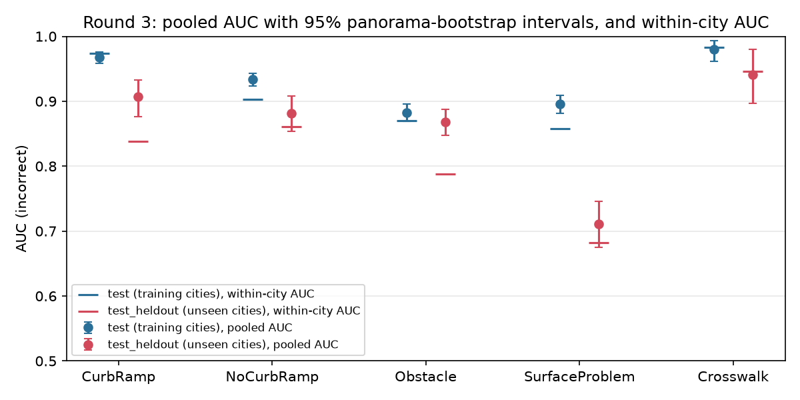
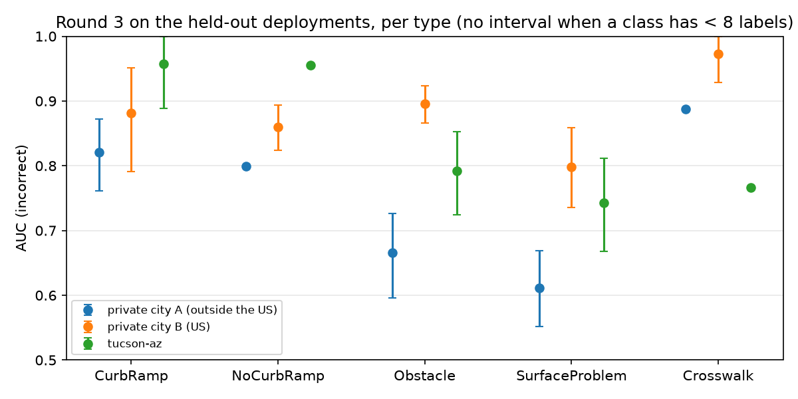

# Round-3 retrain of the validators (October 2026)

The five validator models were retrained on a panorama-grouped split with tilt-corrected, label-centred crops and
three deployments held out of training entirely. This note reports what came out: results on the training
deployments' test share and on the unseen deployments, the comparison with the models in production, the
calibration maps the serving API would use at its 0.92 gate, and a per-type recommendation on what to ship.
It is the first measurement, from one seed. The decisions behind the data are in
[`decisions.md`](decisions.md); the audit that led here is [`audit-2026-10-14.md`](audit-2026-10-14.md); the
deploy chain and its checklist are [#55](https://github.com/ProjectSidewalk/sidewalk-validator-ai/pull/55).

**In short.**

- **On the training deployments, every type ranks held-out labels well** (AUC 0.88 to 0.98). On the three
  unseen deployments, CurbRamp, NoCurbRamp and Crosswalk lose 0.04 to 0.06 of AUC, Obstacle 0.02, and
  **SurfaceProblem 0.19** (0.90 to 0.71). The unseen deployment outside the US is the weakest for every type but
  Crosswalk.
- **Against the production models on the same 1,988 crops, round 3 is level or ahead:** +0.07 AUC on Obstacle in
  the training deployments (the only difference whose interval excludes zero), small positive differences
  elsewhere, and −0.02 on SurfaceProblem in the unseen deployments. Production was trained in 2025-08 on an
  unrecorded label set that overlaps the training-deployment crops, so that half of the comparison flatters
  production; the unseen deployments were not in production's training cities either.
- **Pooled AUC on the unseen deployments overstates discrimination** because the deployments differ so much in
  their incorrect share (15% to 97%). The within-city AUC is what a deployment would see: 0.84 for CurbRamp,
  0.79 for Obstacle and 0.68 for SurfaceProblem on the unseen deployments.
- **At the 0.92 gate, Agree votes clear with precision 0.96 to 0.995 in the training deployments.** In the
  unseen deployments the answer depends on how the rows are weighted: 0.89 (SurfaceProblem) to 0.996
  (Crosswalk) under the pooled deployment prior that the maps are fitted to, but 0.84 (SurfaceProblem), 0.91
  (NoCurbRamp) and 0.93 (Obstacle) under each deployment's own class mix, which is what that deployment would
  see. The shipped maps hold every Disagree verdict back below the gate
  ([#57](https://github.com/ProjectSidewalk/sidewalk-validator-ai/pull/57)); whether a Disagree map could clear
  it depends on the deployment prior, which is under review
  ([#56](https://github.com/ProjectSidewalk/sidewalk-validator-ai/issues/56)).
- **Obstacle Agree clears the gate only at confidence exactly 1.0**, where 46% of its test Agree verdicts sit
  (float32 softmax saturation); SurfaceProblem at 0.999997 with 29% at 1.0. Any serving-side drift in the
  logits can move those verdicts across the line, so coverage must be checked on the served stack, not assumed.
- **Recommendation:** ship the CurbRamp, NoCurbRamp, Obstacle and Crosswalk models with Agree-only maps in the
  deployments they were trained on; serve SurfaceProblem in shadow mode (both verdicts held back); hold Disagree
  back for every type until the prior question is settled; and let Agree vote in an unseen or new deployment
  only after a per-deployment check, as
  [#52](https://github.com/ProjectSidewalk/sidewalk-validator-ai/issues/52) proposes. Under the conservative
  weighting NoCurbRamp Agree does not clear the gate in any unseen deployment.

**Reproduce.** Every table and figure comes from `analysis/retrain_report.py` on the five `evaluate.py` output
folders (`predictions.csv`, `metrics.json`, `split.csv`), the calibration maps `python -m calibration.calibrate`
wrote next to them (shipped, and the `uncapped/` variants from
[#57](https://github.com/ProjectSidewalk/sidewalk-validator-ai/pull/57)), `deployment_priors.json`, and the
production scores that `analysis/vlm_baseline.py baseline` wrote for
[`vlm-baseline-2026-10.md`](vlm-baseline-2026-10.md):

```
python analysis/retrain_report.py --run-dir ~/Data/sidewalk-validator-ai-retrain-2026-10/round3 \
    --sample .../round3/sample.csv --production-scores ~/Data/sidewalk-validator-ai-vlm-2026-10/scores/production.csv \
    --alt-prior Crosswalk=0.04,CurbRamp=0.06,NoCurbRamp=0.20,Obstacle=0.22,SurfaceProblem=0.15 \
    --out-dir docs/retrain-2026-10
```

The script refits the maps under `--alt-prior` itself (with `calibration.calibrate`) and applies the shipped
maps per deployment (`gate_per_city.csv`). Intervals are 95% percentile intervals from 2,000 resamples of whole
panoramas, seed 20261022, and are left blank when the smaller class has fewer than 8 labels. Deployments are
named only if the live `/v3/api/cities` lists them as public at run time (`--public-cities` overrides; the list
used is in `provenance.json`); the private training deployments are pooled into one row, and the two private
unseen deployments are "private city A (outside the US)" and "private city B (US)".

## What round 3 is

Round 3 is the first full retrain since the audit, on the pipeline as it stands after
[#23](https://github.com/ProjectSidewalk/sidewalk-validator-ai/pull/23) through
[#51](https://github.com/ProjectSidewalk/sidewalk-validator-ai/pull/51). Data generation ran on 2026-10-20 and
training on 2026-10-20/21 on klone; the eval outputs are dated 2026-10-22.

| Setting | Round 3 | Production models (2025-08) |
|---|---|---|
| Deployments | 54 passed to data generation (every deployment with GSV labels, private ones included); 40 to 45 per type have labels in the selected set, three of them held out | 19, hard-coded |
| Labels | human votes only (`validations[].validator_type != "AI"`), margin rule plus two expert accounts' votes (`class_source` margin 7,453 / expert 3,000 for CurbRamp) | `agree_count` / `disagree_count`, which include the AI's own votes |
| View | label-centred, camera yaw and pitch to the label, 90° FOV, 2048² | pitch 0 |
| Tilt | rig-tilt correction from `camera_pitch` / `camera_roll`, β = 0.95 (`sidewalk-panorama-tools` v1.0.0) | none |
| Crop size | depth-sized (`6100 / depth`), Depth Anything V2 ViT-B metric (vKITTI) | depth-sized, ViT-L |
| Split | by panorama, panoramas within 3 m merged, 70 / 15 / 15, seed 42, three deployments held out (`test_heldout`) | by file |
| Targets | soft targets from the vote margin | hard |
| Training | DINOv2-L, 25 epochs, best by val macro-F1, seed 42 | DINOv2-L |
| Calibration | per-verdict isotonic map fitted on `val`, reweighted to the deployment prior, Disagree capped | map from the 55:45 test split |

Split sizes (train / val / test / unseen): CurbRamp 6,925 / 1,487 / 1,479 / 546; NoCurbRamp 12,199 / 2,607 /
2,613 / 743; Obstacle 10,554 / 2,262 / 2,266 / 1,812; SurfaceProblem 10,500 / 2,250 / 2,255 / 847; Crosswalk
2,089 / 448 / 445 / 138. The production models' 19 cities supply 63% to 84% of round 3's rows, depending on
the type. The three unseen deployments are tucson-az, private city A (outside the US) and private city B (US);
none of the three was among those 19 cities either.

## Results: training deployments and unseen deployments

AUC is of the `incorrect` score. "Within-city AUC" is the per-deployment AUC averaged with weights
n_incorrect × n_correct over deployments with both classes and at least 10 labels; it cannot be raised by a
score that only separates deployments with many incorrect labels from deployments with few.

| Type | Deployments | n | correct / incorrect | panoramas | deployments | AUC [95% CI] | within-city AUC | accuracy at 0.5 | training − unseen [95% CI] |
|---|---:|---:|---:|---:|---:|---:|---:|---:|---:|
| CurbRamp | training (`test`) | 1479 | 812 / 667 | 1319 | 36 | 0.968 [0.958, 0.976] | 0.973 | 0.915 | +0.060 [0.034, 0.091] |
|  | unseen (`test_heldout`) | 546 | 318 / 228 | 469 | 3 | 0.907 [0.877, 0.933] | 0.838 | 0.826 |  |
| NoCurbRamp | training (`test`) | 2613 | 1443 / 1170 | 1974 | 34 | 0.934 [0.924, 0.943] | 0.903 | 0.879 | +0.052 [0.023, 0.082] |
|  | unseen (`test_heldout`) | 743 | 359 / 384 | 542 | 3 | 0.881 [0.854, 0.908] | 0.861 | 0.774 |  |
| Obstacle | training (`test`) | 2266 | 1305 / 961 | 1963 | 34 | 0.883 [0.869, 0.896] | 0.870 | 0.814 | +0.015 [-0.010, 0.040] |
|  | unseen (`test_heldout`) | 1812 | 587 / 1225 | 1261 | 3 | 0.868 [0.847, 0.888] | 0.788 | 0.724 |  |
| SurfaceProblem | training (`test`) | 2255 | 1256 / 999 | 1937 | 37 | 0.896 [0.881, 0.910] | 0.858 | 0.832 | +0.185 [0.147, 0.225] |
|  | unseen (`test_heldout`) | 847 | 371 / 476 | 757 | 3 | 0.710 [0.675, 0.745] | 0.682 | 0.658 |  |
| Crosswalk | training (`test`) | 445 | 247 / 198 | 374 | 27 | 0.980 [0.961, 0.993] | 0.983 | 0.957 | +0.039 [-0.004, 0.085] |
|  | unseen (`test_heldout`) | 138 | 65 / 73 | 130 | 3 | 0.941 [0.897, 0.980] | 0.946 | 0.906 |  |



Three things stand out. The training-minus-unseen drop is real for every type but Obstacle and Crosswalk, whose
intervals include zero. SurfaceProblem's drop (0.19) is of a different size from the others (0.04 to 0.06).
And the within-city AUC on the unseen deployments is below the pooled figure for CurbRamp (0.84 against 0.91),
Obstacle (0.79 against 0.87) and SurfaceProblem (0.68 against 0.71), which is the confound discussed below.

### Per deployment, training deployments (test share, at least 50 labels)

**CurbRamp**

| Deployment | n | correct / incorrect | panoramas | AUC [95% CI] | accuracy at 0.5 |
|---|---:|---:|---:|---:|---:|
| seattle-wa | 367 | 141 / 226 | 346 | 0.991 [0.980, 0.998] | 0.962 |
| other (private deployments) | 340 | 201 / 139 | 271 | 0.966 [0.947, 0.982] | 0.900 |
| chicago-il | 220 | 131 / 89 | 207 | 0.960 [0.934, 0.982] | 0.905 |
| spgg | 105 | 22 / 83 | 100 | 0.906 [0.812, 0.979] | 0.886 |
| amsterdam | 68 | 35 / 33 | 48 | 0.943 [0.887, 0.986] | 0.897 |

**NoCurbRamp**

| Deployment | n | correct / incorrect | panoramas | AUC [95% CI] | accuracy at 0.5 |
|---|---:|---:|---:|---:|---:|
| seattle-wa | 964 | 740 / 224 | 734 | 0.914 [0.888, 0.939] | 0.897 |
| chicago-il | 501 | 75 / 426 | 381 | 0.859 [0.797, 0.911] | 0.898 |
| other (private deployments) | 302 | 177 / 125 | 250 | 0.942 [0.914, 0.967] | 0.874 |
| mendota-il | 173 | 17 / 156 | 82 | 0.880 [0.783, 0.960] | 0.913 |
| spgg | 111 | 104 / 7 | 96 | 0.499 — | 0.865 |
| amsterdam | 74 | 11 / 63 | 57 | 0.791 [0.661, 0.908] | 0.824 |
| columbus-oh | 69 | 44 / 25 | 53 | 0.845 [0.730, 0.934] | 0.739 |
| teaneck-nj | 68 | 38 / 30 | 44 | 0.968 [0.909, 1.000] | 0.941 |
| cdmx | 62 | 48 / 14 | 49 | 0.749 [0.551, 0.923] | 0.839 |
| newberg-or | 60 | 35 / 25 | 43 | 0.968 [0.919, 0.997] | 0.900 |
| pittsburgh-pa | 53 | 36 / 17 | 48 | 0.719 [0.562, 0.853] | 0.698 |

**Obstacle**

| Deployment | n | correct / incorrect | panoramas | AUC [95% CI] | accuracy at 0.5 |
|---|---:|---:|---:|---:|---:|
| seattle-wa | 682 | 368 / 314 | 613 | 0.855 [0.825, 0.883] | 0.793 |
| other (private deployments) | 631 | 429 / 202 | 517 | 0.895 [0.867, 0.920] | 0.835 |
| chicago-il | 437 | 240 / 197 | 377 | 0.905 [0.874, 0.933] | 0.815 |
| amsterdam | 68 | 21 / 47 | 52 | 0.862 [0.741, 0.953] | 0.779 |
| st-louis-mo | 53 | 41 / 12 | 51 | 0.926 [0.826, 0.993] | 0.925 |
| spgg | 50 | 32 / 18 | 48 | 0.832 [0.694, 0.939] | 0.760 |

**SurfaceProblem**

| Deployment | n | correct / incorrect | panoramas | AUC [95% CI] | accuracy at 0.5 |
|---|---:|---:|---:|---:|---:|
| other (private deployments) | 584 | 220 / 364 | 406 | 0.926 [0.898, 0.949] | 0.872 |
| seattle-wa | 558 | 247 / 311 | 520 | 0.830 [0.794, 0.865] | 0.771 |
| chicago-il | 314 | 190 / 124 | 291 | 0.882 [0.840, 0.922] | 0.831 |
| amsterdam | 91 | 12 / 79 | 78 | 0.854 [0.730, 0.942] | 0.901 |
| oradell-nj | 82 | 79 / 3 | 59 | 0.869 — | 0.915 |
| columbus-oh | 79 | 64 / 15 | 75 | 0.727 [0.556, 0.865] | 0.747 |
| newberg-or | 71 | 50 / 21 | 64 | 0.855 [0.728, 0.956] | 0.803 |
| pittsburgh-pa | 70 | 61 / 9 | 66 | 0.863 [0.735, 0.964] | 0.886 |
| spgg | 67 | 53 / 14 | 65 | 0.814 [0.669, 0.955] | 0.821 |
| st-louis-mo | 65 | 64 / 1 | 63 | 0.859 — | 0.938 |
| cdmx | 51 | 50 / 1 | 44 | 0.360 — | 0.922 |

**Crosswalk**

| Deployment | n | correct / incorrect | panoramas | AUC [95% CI] | accuracy at 0.5 |
|---|---:|---:|---:|---:|---:|
| other (private deployments) | 171 | 153 / 18 | 150 | 0.882 [0.766, 0.980] | 0.947 |
| seattle-wa | 59 | 25 / 34 | 52 | 1.000 [1.000, 1.000] | 0.983 |
| chicago-il | 57 | 20 / 37 | 47 | 0.946 [0.881, 0.991] | 0.860 |

The pooled private row is four deployments for most types, five for Crosswalk. For CurbRamp, NoCurbRamp,
Obstacle and SurfaceProblem it is at the level of the larger public deployments; for Crosswalk it is below
them (0.88 against 0.95 and 1.00), on 18 incorrect labels.

### Per deployment, unseen deployments

| Type | Deployment | n | correct / incorrect | AUC [95% CI] | accuracy at 0.5 |
|---|---:|---:|---:|---:|---:|
| CurbRamp | private city A (outside the US) | 284 | 116 / 168 | 0.821 [0.761, 0.872] | 0.729 |
| CurbRamp | private city B (US) | 202 | 172 / 30 | 0.881 [0.791, 0.951] | 0.921 |
| CurbRamp | tucson-az | 60 | 30 / 30 | 0.958 [0.888, 1.000] | 0.967 |
| NoCurbRamp | private city A (outside the US) | 125 | 4 / 121 | 0.800 — | 0.704 |
| NoCurbRamp | private city B (US) | 572 | 338 / 234 | 0.860 [0.824, 0.893] | 0.781 |
| NoCurbRamp | tucson-az | 46 | 17 / 29 | 0.955 — | 0.870 |
| Obstacle | private city A (outside the US) | 993 | 83 / 910 | 0.666 [0.596, 0.727] | 0.655 |
| Obstacle | private city B (US) | 628 | 432 / 196 | 0.896 [0.866, 0.924] | 0.844 |
| Obstacle | tucson-az | 191 | 72 / 119 | 0.792 [0.724, 0.853] | 0.691 |
| SurfaceProblem | private city A (outside the US) | 356 | 142 / 214 | 0.612 [0.552, 0.669] | 0.618 |
| SurfaceProblem | private city B (US) | 262 | 185 / 77 | 0.798 [0.736, 0.859] | 0.767 |
| SurfaceProblem | tucson-az | 229 | 44 / 185 | 0.743 [0.668, 0.811] | 0.594 |
| Crosswalk | private city A (outside the US) | 45 | 29 / 16 | 0.888 — | 0.889 |
| Crosswalk | private city B (US) | 77 | 30 / 47 | 0.972 [0.929, 1.000] | 0.935 |
| Crosswalk | tucson-az | 16 | 6 / 10 | 0.767 — | 0.812 |



Private city A is the weakest deployment for every type but Crosswalk, and for Obstacle and SurfaceProblem it
is far below the rest (0.67 and 0.61). Private city B, a US deployment, is at the training deployments' level
for Obstacle and Crosswalk and 0.07 to 0.10 below it otherwise. tucson-az is small for three types; its
CurbRamp and NoCurbRamp are at the training level, its Obstacle and SurfaceProblem are not. With one unseen
deployment outside the US, "outside the US" and "this one deployment" cannot be told apart; that is
[#52](https://github.com/ProjectSidewalk/sidewalk-validator-ai/issues/52)'s point.

### The hard slice

`split_data.py --hard-examples` tags the labels the production AI got wrong against a unanimous crowd or an
expert account ([`analysis/hard_examples_2026-10-17.csv`](../analysis/hard_examples_2026-10-17.csv)). Few of them
landed in the test splits. Intervals are class-stratified label bootstraps, blank below 8 labels of a class:

| Type | n | correct / incorrect | AUC [95% CI] | accuracy at 0.5 |
|---|---:|---:|---:|---:|
| CurbRamp | 23 | 22 / 1 | 0.091 — | 0.478 |
| NoCurbRamp | 90 | 48 / 42 | 0.644 [0.528, 0.749] | 0.633 |
| Obstacle | 11 | 9 / 2 | 0.556 — | 0.455 |
| SurfaceProblem | 40 | 11 / 29 | 0.323 [0.163, 0.503] | 0.475 |
| Crosswalk | 5 | 4 / 1 | 0.750 — | 0.600 |

Round 3 is above chance on NoCurbRamp's hard labels (0.64, interval above 0.5), below chance on
SurfaceProblem's (0.32, 11 correct against 29 incorrect, interval reaching 0.50), and the other three slices are
too small to read.
These are labels whose human majority may itself be contested (the production AI disagreed with it), so a low
score here is not only a model failure.

## The city–class confound

`data_generation.py` keeps every incorrect label and downsamples correct labels globally to 55%, so each
deployment's incorrect share in training follows its own Disagree rate. A model can learn "this streetscape
means incorrect" and score well on a pooled AUC without judging the label. The unseen deployments are the
extreme case: private city A is 92% incorrect for Obstacle and 97% for NoCurbRamp, private city B 15% for
CurbRamp.

| Type | Split | Deployment | n | share of split | incorrect share |
|---|---:|---:|---:|---:|---:|
| CurbRamp | train | seattle-wa | 1722 | 25% | 63% |
| CurbRamp | train | other (private deployments) | 1559 | 23% | 41% |
| CurbRamp | train | chicago-il | 1095 | 16% | 36% |
| CurbRamp | train | spgg | 545 | 8% | 82% |
| CurbRamp | train | teaneck-nj | 258 | 4% | 12% |
| CurbRamp | unseen | private city A (outside the US) | 284 | 52% | 59% |
| CurbRamp | unseen | private city B (US) | 202 | 37% | 15% |
| CurbRamp | unseen | tucson-az | 60 | 11% | 50% |
| NoCurbRamp | train | seattle-wa | 4228 | 35% | 24% |
| NoCurbRamp | train | chicago-il | 2248 | 18% | 87% |
| NoCurbRamp | train | other (private deployments) | 1764 | 14% | 50% |
| NoCurbRamp | train | mendota-il | 500 | 4% | 81% |
| NoCurbRamp | train | newberg-or | 464 | 4% | 24% |
| NoCurbRamp | unseen | private city A (outside the US) | 125 | 17% | 97% |
| NoCurbRamp | unseen | private city B (US) | 572 | 77% | 41% |
| NoCurbRamp | unseen | tucson-az | 46 | 6% | 63% |
| Obstacle | train | other (private deployments) | 3398 | 32% | 37% |
| Obstacle | train | seattle-wa | 2990 | 28% | 44% |
| Obstacle | train | chicago-il | 1839 | 17% | 43% |
| Obstacle | train | amsterdam | 319 | 3% | 57% |
| Obstacle | train | st-louis-mo | 252 | 2% | 18% |
| Obstacle | unseen | private city A (outside the US) | 993 | 55% | 92% |
| Obstacle | unseen | private city B (US) | 628 | 35% | 31% |
| Obstacle | unseen | tucson-az | 191 | 11% | 62% |
| SurfaceProblem | train | seattle-wa | 2691 | 26% | 58% |
| SurfaceProblem | train | other (private deployments) | 2542 | 24% | 61% |
| SurfaceProblem | train | chicago-il | 1361 | 13% | 45% |
| SurfaceProblem | train | oradell-nj | 543 | 5% | 7% |
| SurfaceProblem | train | amsterdam | 438 | 4% | 85% |
| SurfaceProblem | unseen | private city A (outside the US) | 356 | 42% | 60% |
| SurfaceProblem | unseen | private city B (US) | 262 | 31% | 29% |
| SurfaceProblem | unseen | tucson-az | 229 | 27% | 81% |
| Crosswalk | train | other (private deployments) | 852 | 41% | 10% |
| Crosswalk | train | seattle-wa | 274 | 13% | 69% |
| Crosswalk | train | chicago-il | 222 | 11% | 60% |
| Crosswalk | train | mendota-il | 171 | 8% | 90% |
| Crosswalk | train | teaneck-nj | 142 | 7% | 61% |
| Crosswalk | unseen | private city A (outside the US) | 45 | 33% | 36% |
| Crosswalk | unseen | private city B (US) | 77 | 56% | 61% |
| Crosswalk | unseen | tucson-az | 16 | 12% | 62% |

This is why the tables above carry a within-city AUC next to the pooled one, and why the pooled AUC on the
unseen split is not the number to quote. The decision to run round 3 as is, rather than re-cut the correct
labels per deployment, was taken on 2026-10-21; per-deployment stratification is the first thing to try if the
within-city gap persists in the next round.

## Against the production models

[`vlm-baseline-2026-10.md`](vlm-baseline-2026-10.md) scored the five production validators (the 2025-08-16
revisions `sidewalk-ai-api` pins) on a 1,988-crop sample of the round-3 `test` and `test_heldout` splits,
balanced by class, built from the round-3 crops. Round 3's predictions on the same crops give a paired
comparison. Two intervals are shown: resampling labels within class, and resampling whole panoramas.

| Type | Deployments | n | round 3 AUC | production AUC | Δ [label CI] | Δ [panorama CI] | within-city, round 3 | within-city, production | deployments |
|---|---:|---:|---:|---:|---:|---:|---:|---:|---:|
| CurbRamp | training | 250 | 0.948 | 0.945 | +0.003 [-0.025, 0.031] | [-0.023, 0.030] | 0.968 | 0.950 | 8 |
|  | unseen | 150 | 0.919 | 0.890 | +0.029 [-0.003, 0.064] | [-0.003, 0.062] | 0.857 | 0.834 | 3 |
| NoCurbRamp | training | 250 | 0.903 | 0.899 | +0.005 [-0.027, 0.037] | [-0.028, 0.039] | 0.897 | 0.919 | 6 |
|  | unseen | 150 | 0.936 | 0.936 | -0.000 [-0.039, 0.037] | [-0.040, 0.037] | 0.917 | 0.933 | 2 |
| Obstacle | training | 250 | 0.895 | 0.821 | +0.074 [0.024, 0.124] | [0.028, 0.126] | 0.883 | 0.820 | 4 |
|  | unseen | 150 | 0.856 | 0.838 | +0.018 [-0.038, 0.077] | [-0.039, 0.073] | 0.705 | 0.718 | 3 |
| SurfaceProblem | training | 250 | 0.913 | 0.899 | +0.014 [-0.028, 0.057] | [-0.027, 0.055] | 0.889 | 0.845 | 6 |
|  | unseen | 150 | 0.639 | 0.659 | -0.020 [-0.081, 0.049] | [-0.083, 0.044] | 0.601 | 0.675 | 3 |
| Crosswalk | training | 250 | 0.980 | 0.979 | +0.000 [-0.013, 0.014] | [-0.013, 0.015] | 0.985 | 0.985 | 7 |
|  | unseen | 138 | 0.941 | 0.919 | +0.021 [-0.024, 0.067] | [-0.020, 0.065] | 0.946 | 0.942 | 3 |
| all (pooled) | training | 1250 | 0.926 | 0.912 | +0.014 [-0.002, 0.029] | [-0.002, 0.030] | 0.921 | 0.917 | 17 |
|  | unseen | 738 | 0.847 | 0.844 | +0.003 [-0.019, 0.025] | [-0.020, 0.027] | 0.844 | 0.844 | 3 |

Round 3 is ahead on Obstacle in the training deployments by 0.07, with both intervals excluding zero, and level
or slightly ahead everywhere else except SurfaceProblem in the unseen deployments (−0.02, interval includes
zero). Two caveats cut in opposite directions. **Production was trained in 2025-08 on an unrecorded label set**
drawn from the 19 cities that supply 63% to 84% of round 3's rows, so many of the training-deployment crops are
in its training data; that flatters production on the `test` rows. On the unseen rows the comparison is clean
for both models, since neither trained on those deployments. And the crops are round 3's, tilt-corrected and
label-centred; production was trained on pitch-0, uncorrected crops, so it is being scored slightly off its own
distribution ([`serving-parity-2026-10.md`](serving-parity-2026-10.md) measures how much that matters for
serving). The sample is class-balanced, so the pooled figures in this table are not comparable with the
full-split AUCs above; the VLM note has production only on this sample, not on the full held-out split.

## The fixed-crop ablation

[#51](https://github.com/ProjectSidewalk/sidewalk-validator-ai/pull/51) trained a second CurbRamp model on
fixed 238 px crops (the median depth-sized half-width) on the same split, to ask whether sizing crops by depth
helps. On identical rows, with a paired panorama bootstrap: depth-sized is ahead by +0.014 AUC
[+0.007, +0.021] in the training deployments and +0.009 [−0.006, +0.025] in the unseen ones, where one of the
three deployments goes the other way. Depth sizing stays; the depth-source arms of
[#21](https://github.com/ProjectSidewalk/sidewalk-validator-ai/issues/21) are not run.

## Calibration at the 0.92 gate

`calibration/calibrate.py` fits one isotonic curve per verdict on the `val` split, reweighted to the
deployment prior (`deployment_priors.json`: the class mix, under the training margin rule, of the labels in the
54 deployments' `rawLabels` on 2026-10-20), and writes the map in `sidewalk-ai-api`'s format. The gate is
SidewalkWebpage's `ai-validation-min-accuracy`, 0.92 in every deployment. The shipped maps are the ones
[#57](https://github.com/ProjectSidewalk/sidewalk-validator-ai/pull/57) regenerated with `--hold-back incorrect`,
which caps every Disagree value at 0.9199 (`HOLD_BACK_CAP`) so no Disagree verdict votes; they are the maps in
[sidewalk-ai-api#19](https://github.com/ProjectSidewalk/sidewalk-ai-api/pull/19). The "uncapped" columns show
what the fitted Disagree curves would do without the cap.

Coverage and precision are prior-weighted, as the map is: `calibrate.py` weights each eval row by the prior's
class share over the split's. Applied to the unseen split, whose own incorrect share is 42% to 68%, that
weighting imposes the pooled prior on deployments whose mix is nothing like it. A second column therefore gives
the precision under **each deployment's own mix**: because `select_training_labels` keeps correct labels by one
global hash-rank cutoff, every deployment lost the same share of its correct labels, so weighting every correct
row by the prior's correct share over the selected set's (the whole `split.csv`) and every incorrect row by the
incorrect counterpart restores each deployment's own class mix under the margin rule. `n` is the unweighted
count of gated verdicts.

| Type | file prior, incorrect share | Agree clears at confidence | Agree, training: coverage / precision pooled / precision own mix (n) | Agree, unseen: coverage / precision pooled / precision own mix (n) | Disagree map max, uncapped | Disagree uncapped, training: coverage / precision (n) | Disagree uncapped, unseen |
|---|---:|---:|---:|---:|---:|---:|---:|
| CurbRamp | 11.8% | 0.99992 | 0.88 / 0.994 / 0.994 (692) | 0.75 / 0.991 / 0.992 (198) | 0.802 | never clears | never clears |
| NoCurbRamp | 37.4% | 0.9999 | 0.44 / 0.973 / 0.973 (627) | 0.37 / 0.933 / 0.914 (158) | 0.940 | 0.21 / 0.978 (249) | 0.06 / 1.000 (17) |
| Obstacle | 35.8% | 1.0 | 0.48 / 0.959 / 0.963 (631) | 0.49 / 0.970 / 0.926 (325) | 0.892 | never clears | never clears |
| SurfaceProblem | 32.0% | 0.999997 | 0.68 / 0.957 / 0.958 (819) | 0.53 / 0.890 / 0.837 (178) | 0.903 | never clears | never clears |
| Crosswalk | 6.1% | 0.9925 | 0.99 / 0.995 / 0.995 (255) | 0.86 / 0.996 / 0.994 (56) | 0.977 | 0.42 / 1.000 (98) | 0.32 / 0.643 (32) |

The pooled prior and the own-mix weighting agree on the training deployments and disagree on the unseen ones:
NoCurbRamp Agree drops from 0.933 to 0.914, below the gate; Obstacle from 0.970 to 0.926; SurfaceProblem from
0.890 to 0.837. Those are the numbers a deployment would see, and the recommendation below uses the lower of the
two.

The maps are fitted on `val`, which is also the split that chose each model's checkpoint (best macro-F1), so the
fit split is not independent of the model. The `uncapped/fit-test` variant fits on `test` instead and evaluates
on the unseen split; it moves the Agree gate by a few points of coverage and little precision, and Crosswalk's
uncapped Disagree the other way:

| Type | Agree on unseen, map fit on `val` | Agree on unseen, map fit on `test` | Disagree uncapped on unseen, fit on `val` | Disagree uncapped on unseen, fit on `test` |
|---|---:|---:|---:|---:|
| CurbRamp | 0.75 / 0.991 (198) | 0.69 / 0.991 (181) | never clears | never clears |
| NoCurbRamp | 0.37 / 0.933 (158) | 0.52 / 0.923 (224) | 0.06 / 1.000 (17) | 0.02 / 1.000 (6) |
| Obstacle | 0.49 / 0.970 (325) | 0.49 / 0.970 (325) | never clears | never clears |
| SurfaceProblem | 0.53 / 0.890 (178) | 0.47 / 0.890 (159) | never clears | never clears |
| Crosswalk | 0.86 / 0.996 (56) | 0.80 / 0.996 (51) | 0.32 / 0.643 (32) | 0.75 / 0.541 (64) |

For comparison, the Phase 0 maps live in production since
[sidewalk-ai-api#16](https://github.com/ProjectSidewalk/sidewalk-ai-api/pull/16) also hold every Disagree back,
and let Agree vote at confidence 0.855 (CurbRamp), 0.8825 (Crosswalk), 0.999 (NoCurbRamp), 0.999996 (Obstacle)
and 0.999987 (SurfaceProblem). Thresholds are not comparable across models; coverage is. On production
outcomes the Phase 0 Agree coverage is 0.95 CurbRamp, 0.97 Crosswalk, 0.43 NoCurbRamp, 0.08 Obstacle and 0.29
SurfaceProblem ([`calibration-2026-10.md`](calibration-2026-10.md)); round 3's Agree coverage on its test split
is 0.88, 0.99, 0.44, 0.48 and 0.68. The populations differ (production traffic against a 55:45 test split), so
read this as direction only: **Obstacle and SurfaceProblem Agree would vote far more often, CurbRamp Agree a
little less.**

### Saturated confidences

Round 3's Agree maps reach the gate only at the top of the confidence scale, and for two types only at its very
end:

| Type | Agree clears the gate at confidence | map value at 0.999999 | test Agree verdicts | share at exactly 1.0 | share ≥ 0.999999 | test Disagree verdicts at 1.0 |
|---|---:|---:|---:|---:|---:|---:|
| CurbRamp | 0.99992 | 0.943 | 814 | 51% | 52% | 52% |
| NoCurbRamp | 0.9999 | 0.961 | 1454 | 1% | 1% | 1% |
| Obstacle | 1.0 | 0.788 | 1370 | 46% | 34% | 34% |
| SurfaceProblem | 0.999997 | 0.923 | 1254 | 29% | 36% | 36% |
| Crosswalk | 0.9925 | 0.966 | 258 | 0% | 2% | 2% |

Obstacle Agree votes only when the softmax is exactly 1.0 in float32, which 46% of its test Agree verdicts are;
one grid step below (0.999999) the map is 0.788, far under the gate. SurfaceProblem clears at 0.999997 with 29%
of its Agree verdicts at 1.0 and 58% at or above 0.999999. CurbRamp is less brittle (the map is 0.943 at
0.999999, and it clears at 0.99992), NoCurbRamp and Crosswalk clear well below saturation. Production's Obstacle
threshold was 0.999996, so round 3 is no less saturated than the model it replaces; the earlier expectation
that soft targets would spread the confidences does not hold at the top of the scale.

What this means for serving: the gate for Obstacle and SurfaceProblem is a test of whether a logit margin
survives into a saturated softmax, and anything that perturbs the logits on the served stack moves verdicts
across it in either direction: the int8 ONNX variants of
[#43](https://github.com/ProjectSidewalk/sidewalk-validator-ai/pull/43), fp16 inference, or the opencv and WebP
input differences measured in [`serving-parity-2026-10.md`](serving-parity-2026-10.md) and fixed in
[sidewalk-ai-api#19](https://github.com/ProjectSidewalk/sidewalk-ai-api/pull/19). A precision figure survives
that (the map is monotone), a coverage figure does not. Two serving-side checks follow: the deploy smoke test in
sidewalk-ai-api#19 must include rows whose training-pipeline confidence is exactly 1.0 and assert that the
served confidence is too (a tolerance on p alone does not catch a verdict that lands at 0.999999); and the
first 48 hours of production should compare the per-type share of gated Agree verdicts with the coverage above,
with a drop of more than a few points treated as a serving defect, not as a property of the traffic.

### The prior is under review

[#56](https://github.com/ProjectSidewalk/sidewalk-validator-ai/issues/56) found that `deployment_priors.json`
inherits the training margin rule, which is asymmetric: a label is `incorrect` at net Disagree > 1 but
`correct` only at net Agree > 2. Under that rule the incorrect shares are 6% Crosswalk, 12% CurbRamp, 37%
NoCurbRamp, 36% Obstacle and 32% SurfaceProblem, while the ≥ 2-vote human majority on the labels the
production AI assessed in the 2026-10-17 pull gives about 4 / 6 / 20 / 22 / 15%. The gap is the rule, not the
population: applying the asymmetric rule to the production rows reproduces the file prior. Which prior
calibration should use is #56's open question (`calibrate.py` reweights classes as the margin rule defines
them, so neither is fully right, and the sound map is one fitted on production outcomes for the new revision
after a shadow period); this note does not settle it. The dependence is not small, so the same maps were
refitted under the production-side estimate:

| Type | production-side prior, incorrect share | Agree, training: coverage / precision (n) | Agree, unseen | Disagree uncapped, training | Disagree uncapped, unseen |
|---|---:|---:|---:|---:|---:|
| CurbRamp | 6% | 0.89 / 0.997 (692) | 0.76 / 0.996 (198) | never clears | never clears |
| NoCurbRamp | 20% | 0.71 / 0.985 (984) | 0.63 / 0.957 (260) | never clears | never clears |
| Obstacle | 22% | 0.50 / 0.979 (631) | 0.53 / 0.984 (325) | never clears | never clears |
| SurfaceProblem | 15% | 0.70 / 0.983 (819) | 0.56 / 0.956 (178) | never clears | never clears |
| Crosswalk | 4% | 0.99 / 0.997 (255) | 0.86 / 0.997 (56) | 0.38 / 1.000 (98) | 0.29 / 0.535 (32) |

A lower incorrect share raises Agree precision and coverage (NoCurbRamp Agree coverage 0.44 to 0.71) and lowers
Disagree precision at every confidence: NoCurbRamp Disagree no longer clears the gate at all, and Crosswalk
Disagree on the unseen deployments is 0.54 precise on 32 votes. **Every Disagree map should stay held back until
the prior is settled**, whichever way it goes: under the file prior only NoCurbRamp and Crosswalk Disagree would
clear, on 17 and 32 unseen-deployment votes, and Crosswalk's at 0.64 precision.

### Agree votes per deployment

The shipped maps applied per deployment (file prior; training deployments with at least 50 Agree verdicts, the
private ones pooled), with the precision three ways: under the pooled prior, as the gate promises it; under the
deployment's own mix; and raw. Gated counts below 30 are flagged:

| Type | Deployments | Deployment | incorrect share | Agree verdicts | gated | wrong | coverage | precision, pooled prior | precision, own mix | precision, raw |
|---|---:|---:|---:|---:|---:|---:|---:|---:|---:|---:|
| CurbRamp | training | other (private deployments) | 41% | 195 | 168 | 4 | 0.90 | 0.996 | 0.996 | 0.976 |
| CurbRamp | training | seattle-wa | 62% | 149 | 135 | 4 | 0.94 | 0.995 | 0.995 | 0.970 |
| CurbRamp | training | chicago-il | 40% | 136 | 120 | 7 | 0.91 | 0.990 | 0.990 | 0.942 |
| CurbRamp | unseen | private city B (US) | 15% | 176 | 157 | 7 | 0.90 | 0.991 | 0.992 | 0.955 |
| CurbRamp | unseen | private city A (outside the US) | 59% | 71 | 17 ⚠ n<30 | 2 | 0.27 | 0.976 | 0.979 | 0.882 |
| CurbRamp | unseen | tucson-az | 50% | 28 | 24 ⚠ n<30 | 0 | 0.86 | 1.000 | 1.000 | 1.000 |
| NoCurbRamp | training | seattle-wa | 23% | 761 | 294 | 8 | 0.39 | 0.980 | 0.980 | 0.973 |
| NoCurbRamp | training | other (private deployments) | 41% | 193 | 123 | 5 | 0.65 | 0.970 | 0.970 | 0.959 |
| NoCurbRamp | training | spgg | 6% | 99 | 50 | 4 | 0.50 | 0.940 | 0.940 | 0.920 |
| NoCurbRamp | training | chicago-il | 85% | 66 | 14 ⚠ n<30 | 1 | 0.23 | 0.946 | 0.947 | 0.929 |
| NoCurbRamp | training | cdmx | 23% | 54 | 32 | 3 | 0.60 | 0.929 | 0.930 | 0.906 |
| NoCurbRamp | unseen | private city B (US) | 41% | 407 | 150 | 15 | 0.39 | 0.942 | 0.925 | 0.900 |
| NoCurbRamp | unseen | private city A (outside the US) | 97% | 39 | 3 ⚠ n<30 | 3 | 0.07 | 0.000 | 0.000 | 0.000 |
| NoCurbRamp | unseen | tucson-az | 63% | 17 | 5 ⚠ n<30 | 0 | 0.32 | 1.000 | 1.000 | 1.000 |
| Obstacle | training | other (private deployments) | 32% | 437 | 204 | 6 | 0.48 | 0.978 | 0.980 | 0.971 |
| Obstacle | training | seattle-wa | 46% | 387 | 189 | 16 | 0.50 | 0.935 | 0.941 | 0.915 |
| Obstacle | training | chicago-il | 45% | 259 | 125 | 3 | 0.50 | 0.982 | 0.984 | 0.976 |
| Obstacle | unseen | private city B (US) | 31% | 460 | 269 | 11 | 0.63 | 0.989 | 0.972 | 0.959 |
| Obstacle | unseen | private city A (outside the US) | 92% | 350 | 21 ⚠ n<30 | 12 | 0.10 | 0.738 | 0.524 | 0.429 |
| Obstacle | unseen | tucson-az | 62% | 109 | 35 | 11 | 0.36 | 0.891 | 0.762 | 0.686 |
| SurfaceProblem | training | seattle-wa | 56% | 247 | 128 | 19 | 0.54 | 0.907 | 0.909 | 0.852 |
| SurfaceProblem | training | other (private deployments) | 62% | 235 | 137 | 13 | 0.61 | 0.942 | 0.943 | 0.905 |
| SurfaceProblem | training | chicago-il | 39% | 187 | 133 | 10 | 0.73 | 0.954 | 0.955 | 0.925 |
| SurfaceProblem | training | oradell-nj | 4% | 76 | 62 | 1 | 0.82 | 0.990 | 0.991 | 0.984 |
| SurfaceProblem | training | st-louis-mo | 2% | 62 | 58 | 1 | 0.94 | 0.990 | 0.990 | 0.983 |
| SurfaceProblem | training | columbus-oh | 19% | 60 | 32 | 2 | 0.55 | 0.962 | 0.963 | 0.938 |
| SurfaceProblem | training | spgg | 21% | 59 | 42 | 3 | 0.74 | 0.957 | 0.958 | 0.929 |
| SurfaceProblem | training | pittsburgh-pa | 13% | 57 | 45 | 2 | 0.79 | 0.973 | 0.974 | 0.956 |
| SurfaceProblem | training | newberg-or | 30% | 52 | 36 | 2 | 0.72 | 0.966 | 0.967 | 0.944 |
| SurfaceProblem | unseen | private city B (US) | 29% | 190 | 119 | 9 | 0.67 | 0.971 | 0.955 | 0.924 |
| SurfaceProblem | unseen | tucson-az | 81% | 123 | 54 | 34 | 0.47 | 0.616 | 0.506 | 0.370 |
| SurfaceProblem | unseen | private city A (outside the US) | 60% | 64 | 5 ⚠ n<30 | 2 | 0.08 | 0.804 | 0.723 | 0.600 |
| Crosswalk | training | other (private deployments) | 11% | 160 | 160 | 8 | 1.00 | 0.996 | 0.996 | 0.950 |
| Crosswalk | unseen | private city B (US) | 61% | 33 | 27 ⚠ n<30 | 1 | 0.89 | 0.998 | 0.997 | 0.963 |
| Crosswalk | unseen | private city A (outside the US) | 36% | 32 | 26 ⚠ n<30 | 3 | 0.82 | 0.992 | 0.990 | 0.885 |
| Crosswalk | unseen | tucson-az | 62% | 3 | 3 ⚠ n<30 | 0 | 1.00 | 1.000 | 1.000 | 1.000 |

In the training deployments every stratum with at least 50 Agree verdicts is at or above 0.92 under either
weighting except seattle-wa SurfaceProblem (0.907); cdmx NoCurbRamp (0.929) and spgg NoCurbRamp (0.940) are
the closest to the line. (Smaller strata are not shown; a few of them are below, on 6 to 14 votes.) In the
unseen deployments, private city B is at or above 0.95 under its own mix for every type except NoCurbRamp
(0.925, 15 of 150 gated votes wrong); tucson-az is below the gate for Obstacle (0.76 under its own mix, 11 of
35 wrong) and far below for SurfaceProblem (0.51); private city A clears for CurbRamp and Crosswalk on 17 and
26 votes, and fails for the rest, with NoCurbRamp's three gated Agree votes all wrong. The 0.92 promise holds in
the deployments the model trained on and does not transfer by itself.

Under the production-side prior the same cells move up, and two of them cross the gate under the pooled
weighting but not under the deployment's own mix:

| Type | Deployment | gated, file → production-side prior | precision pooled, file → production-side | precision own mix, file → production-side |
|---|---:|---:|---:|---:|
| CurbRamp | private city A (outside the US) | 17 → 17 | 0.976 → 0.988 | 0.979 → 0.990 |
| CurbRamp | private city B (US) | 157 → 157 | 0.991 → 0.996 | 0.992 → 0.996 |
| CurbRamp | tucson-az | 24 → 24 | 1.000 → 1.000 | 1.000 → 1.000 |
| NoCurbRamp | private city A (outside the US) | 3 → 7 | 0.000 → 0.000 | 0.000 → 0.000 |
| NoCurbRamp | private city B (US) | 150 → 247 | 0.942 → 0.963 | 0.925 → 0.952 |
| NoCurbRamp | tucson-az | 5 → 6 | 1.000 → 1.000 | 1.000 → 1.000 |
| Obstacle | private city A (outside the US) | 21 → 21 | 0.738 → 0.847 | 0.524 → 0.685 |
| Obstacle | private city B (US) | 269 → 269 | 0.989 → 0.994 | 0.972 → 0.986 |
| Obstacle | tucson-az | 35 → 35 | 0.891 → 0.942 | 0.762 → 0.864 |
| SurfaceProblem | private city A (outside the US) | 5 → 5 | 0.804 → 0.916 | 0.723 → 0.874 |
| SurfaceProblem | private city B (US) | 119 → 119 | 0.971 → 0.989 | 0.955 → 0.983 |
| SurfaceProblem | tucson-az | 54 → 54 | 0.616 → 0.810 | 0.506 → 0.732 |
| Crosswalk | private city A (outside the US) | 26 → 26 | 0.992 → 0.995 | 0.990 → 0.993 |
| Crosswalk | private city B (US) | 27 → 27 | 0.998 → 0.999 | 0.997 → 0.998 |
| Crosswalk | tucson-az | 3 → 3 | 1.000 → 1.000 | 1.000 → 1.000 |

## Ship recommendation

Per type, for the retrained model served with the maps above. "Ship Agree" means the capped map as fitted
(Disagree held back). "Shadow" means the API scores and `label_ai_assessment` records the raw verdict, but the
map caps both classes so nothing votes, as [#52](https://github.com/ProjectSidewalk/sidewalk-validator-ai/issues/52)
proposes for new deployments. Each cell carries the gated Agree votes it rests on; fewer than 30 is flagged.
The unseen-deployment calls use the lower of the pooled-prior and own-mix precisions. **Agree does not ship in
a new deployment without a per-deployment check** (#52's gate: a precision lower bound of 0.92 on that
deployment's own validated labels); the unseen-deployment column says what that check would conclude today.
Every row assumes the prior question is open; the two cells that would change under the production-side prior
are named.

| Type | Training deployments | Unseen deployments (per-deployment check applied) | New deployments | Disagree | Why |
|---|---|---|---|---|---|
| CurbRamp | **Ship Agree** (692 gated, 0.994) | Agree in private city B (157, 0.99) and tucson-az (24 ⚠ n<30, 1.00); shadow private city A (17 ⚠ n<30, 0.98 but AUC 0.82) | Shadow until checked | Hold back | The Disagree curve tops out at 0.80. |
| NoCurbRamp | **Ship Agree** (627 gated, 0.973) | **Shadow all three**: pooled unseen precision 0.933 but 0.914 under own mix; private city B 0.925 own mix (150, 15 wrong); private city A 0 of 3 right; tucson-az 5 ⚠ n<30 | Shadow until checked | Hold back | Disagree would clear under the file prior only (17 unseen votes), never under the production-side prior. |
| Obstacle | **Ship Agree** (631 gated, 0.959; Phase 0 lets 8% vote) | Agree in private city B (269, 0.97 own mix); shadow tucson-az (35, 0.76) and private city A (21 ⚠ n<30, 0.52) | Shadow until checked | Hold back | Disagree never clears. tucson-az would reach 0.94 under the production-side prior pooled, 0.86 under its own mix. Gate sits at confidence 1.0 exactly (saturation above). |
| SurfaceProblem | **Shadow** (both verdicts held back) | Shadow | Shadow | Hold back | Unseen AUC 0.71; Agree 0.89 pooled / 0.84 own mix; tucson-az 0.51 (54 gated, 34 wrong); seattle-wa 0.907 even in training; private city B alone is fine (119, 0.96). Private city A would reach 0.92 pooled under the production-side prior on 5 votes, 0.87 own mix. Shadow keeps one tilt path for all types and accumulates per-deployment outcomes. |
| Crosswalk | **Ship Agree** (255 gated, 0.995) | Agree in private city B (27 ⚠ n<30, 1.00) and private city A (26 ⚠ n<30, 0.99, raw 0.885); tucson-az 3 ⚠ n<30 | Shadow until checked | Hold back | Disagree on the unseen deployments is 0.54 to 0.64 precise. All unseen strata are under 30 votes. |

Two serving conditions go with this. The API must apply the same tilt correction training used
([sidewalk-ai-api#17](https://github.com/ProjectSidewalk/sidewalk-ai-api/pull/17), with
[sidewalk-ai-api#19](https://github.com/ProjectSidewalk/sidewalk-ai-api/pull/19)'s opencv pin, WebP round
trip, held-back maps and smoke test), since the models were trained on corrected crops and
[`serving-parity-2026-10.md`](serving-parity-2026-10.md) shows the uncorrected path is a different input. And
the per-deployment gate is a SidewalkWebpage change that does not exist yet; until it does, "shadow in
deployment X" can only be approximated by not enabling AI validation there, and the saturation check above
belongs in the first 48 hours ([#55](https://github.com/ProjectSidewalk/sidewalk-validator-ai/pull/55)'s list).

## What this does not establish

- One seed, one retrain. The fixed-crop ablation's two runs differ by 0.006 in best validation macro-F1 for a
  change that is itself small, so differences of that size between settings are within what one seed can show.
- One unseen deployment outside the US. Whether SurfaceProblem's and Obstacle's drop there is about that
  deployment, about its imagery, or about transfer in general needs leave-one-country-out retrains
  ([#52](https://github.com/ProjectSidewalk/sidewalk-validator-ai/issues/52), option 3).
- The production comparison on the training deployments is contaminated in production's favour and off
  distribution for it in the other direction; only the unseen rows are clean.
- The calibration is evaluated on a 55:45 split reweighted to a prior, not on production traffic, and the fit
  split also chose the checkpoint. The first weeks of production outcomes under the new maps are the real test,
  and `calibration/calibrate_from_production.py` plus `calibration/per_city.py` are the tools for it.
- The own-mix weighting assumes the global correct-class downsample removed the same share of correct labels in
  every deployment, which holds in expectation for a hash-rank cutoff but not exactly in any one deployment.
- AI-placed labels (`include_ai_labels: true` in `generation_run.json`) are in the training set under the same
  vote margins as human-placed ones; nothing here separates them.
