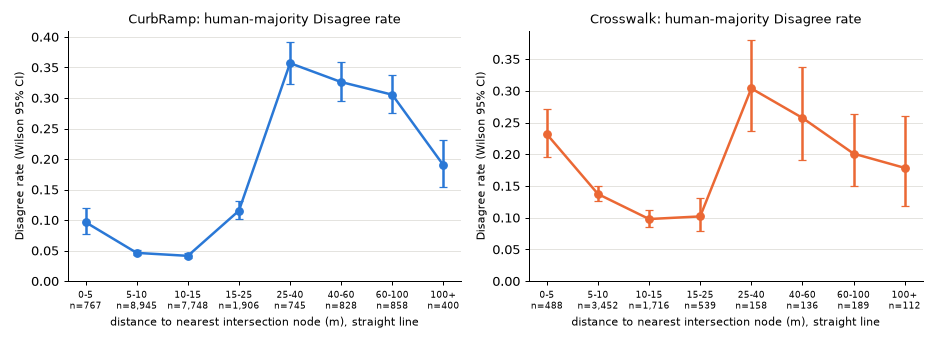
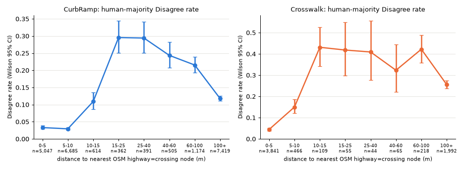

# Road-network prior for CurbRamp: first measurement (October 2026)

Issue #45 asks whether road-network context can tell driveway aprons mislabelled as CurbRamp from real curb ramps,
and whether it adds anything over the production confidence. This is the first measurement. It uses no GPU, no
imagery and no retraining. The code is `analysis/road_prior.py`; every number below comes from its `evaluate`,
`stratify` and `routing` stages, and `road-prior-2026-10/provenance.json` pins their inputs, outputs and commit.

## Recommendation

**Do not add road context as a model feature. Keep it as a candidate routing signal for cast CurbRamp Disagree
votes, and decide after the hand-coding packet is coded.**

- **As a feature it adds nothing.** Distance to an intersection predicts the human verdict on its own (AUC 0.69),
  but the production confidence already carries it. Leave-one-city-out, adding the road features to the
  recalibrated confidence changes AUC by -0.0001 (streets) and +0.0019 (streets + OSM), with CIs that include 0.
- **On cast Disagree votes it separates, and the separation transfers modestly.** At the same confidence, a cast
  Disagree near both an intersection and a crossing is confirmed by humans 10 to 27 points less often than one far
  from both, in three of the four confidence quartiles. With city fixed effects the near-both coefficient is
  -0.69 log-odds (SE 0.14, >= 3 votes; SE 0.05 at >= 1 vote). Leave-one-city-out, adding two context flags to the
  confidence raises AUC by +0.008 (CI 0.002–0.015) across 24 cities, with gains in Seattle, Chicago and SPGG and a
  loss in Amsterdam. The finer binned feature model in the lift table dilutes this and shows no significant gain.
- **The OSM driveway layer is too sparse to use.** Only 9.6% of the CurbRamp analysis set (16.2% of all CurbRamp
  labels with a human vote) has any mapped `service=driveway` way within 50 m, and the driveway features sit at
  AUC 0.50.

The routing use would be: a cast CurbRamp Disagree near both an intersection and a crossing is a weak Disagree, so
it should not hide a label on its own and should go to a human first. That is a rule on top of the routing in
PR #39, not a change to the classifier. It covers 28% of cast CurbRamp Disagrees overall, but the share follows
OSM crossing coverage: 44% in Seattle and 25% in Chicago, under 10% in SPGG, Amsterdam and CDMX. Seattle alone
casts 45% of these votes, so the pooled 28% is mostly a Seattle number. The mirror reading, that a cast Disagree
far from both is a strong one (confirmed 68% of the time), is just as well supported.

## Data

| | |
|---|---|
| Labels | 2026-10-17 private pull, public cities only in every table (41 public cities) |
| Streets | `/v3/api/streets?filetype=csv`, pulled 2026-10-20 |
| OSM | Overpass, `highway=crossing` nodes and `highway=service` ways, pulled 2026-10-20, all 41 cities ok |
| Production verdict | `labels_oof.csv` (recalibrated `oof_accuracy`, Phase 0). The routing stage falls back to `new_accuracy` for labels not in the calibration fit, which is out-of-sample for them |
| Human verdict | strict majority of human votes, AI excluded, ties dropped |
| CurbRamp analysis set | 22,197 labels with >= 3 human votes, 34 cities, human-majority Disagree rate 8.6% |
| Crosswalk analysis set | 6,790 labels, 28 cities, Disagree rate 14.0% |

Intersection nodes are street-edge endpoints shared by two or more edges, because Project Sidewalk splits edges at
intersections. `d_junction3_m` uses three or more edges and behaves the same.

## Results

### Each feature alone (CurbRamp, pooled)

| Feature | AUC | 95% CI |
|---|---|---|
| Distance to nearest intersection node | 0.691 | 0.676–0.705 |
| Distance to nearest OSM crossing | 0.644 | 0.634–0.655 |
| Driveways within 20 m | 0.503 | 0.498–0.507 |
| Driveways within 50 m | 0.493 | 0.486–0.499 |
| Own street is a service road | 0.500 | flat: the streets API has almost no service edges |
| Own OSM way is a driveway | 0.500 | flat: labels sit on street ways, never on driveways |

The intersection AUC is 0.78 in Chicago and 0.80 in Seattle, and lower elsewhere. Walla Walla is the one city below
0.5. The relation is not monotone. The Disagree rate is 4–5% from 5 to 15 m, rises to 31–36% from 25 to 100 m,
and falls to 19% beyond 100 m.

### Lift over the production confidence (leave-one-city-out)

Baseline is a logistic model on the logit of the production P(Agree). The full model adds the road features, with
distances as bins. Each city is predicted by a model fitted on the others. ΔAUC and Δlog-loss have paired bootstrap
95% CIs.

| Subset | Features | n | ΔAUC (CI) | Δlog-loss (CI) |
|---|---|---|---|---|
| All verdicts | streets | 21,840 | -0.0001 (-0.0013, 0.0010) | -0.0002 (-0.0010, 0.0006) |
| All verdicts | streets + OSM | 21,840 | +0.0019 (-0.0002, 0.0038) | -0.0019 (-0.0032, -0.0007) |
| AI Agree | streets + OSM | 18,087 | -0.0122 (-0.0284, 0.0061) | +0.0001 (-0.0009, 0.0011) |
| AI Disagree assessments | streets + OSM | 3,753 | +0.0093 (0.0034, 0.0154) | -0.0042 (-0.0104, 0.0012) |
| Cast AI Disagree votes | streets + OSM | 2,359 | +0.0060 (-0.0052, 0.0161) | +0.0031 (-0.0052, 0.0111) |

Two CIs clear zero: log-loss on all verdicts with OSM, about 1% of the baseline log-loss, and AUC on AI Disagree
assessments. On AI Agrees there is no gain, so this does not help catch the contested Agrees.

### Cast Disagree votes by road context

"Far from both" means at least 25 m from the nearest intersection node and the nearest OSM crossing. The rate is how
often the human majority confirms the Disagree. Quartiles are of `oof_accuracy` among cast Disagrees with >= 3 human
votes. The 25 m threshold was fixed in the first commit, before any of these tables existed.

| oof_accuracy quartile | Far from both | Far from one | Near both |
|---|---|---|---|
| 0.23–0.35 | 0.40 (n 136) | 0.38 (335) | 0.24 (125) |
| 0.35–0.55 | 0.65 (177) | 0.46 (309) | 0.38 (116) |
| 0.55–0.67 | 0.74 (309) | 0.65 (321) | 0.63 (103) |
| 0.67–0.72 | 0.80 (233) | 0.74 (147) | 0.83 (48) |
| All | 0.68 (855) | 0.52 (1,112) | 0.46 (392) |

By city, near-both versus far-from-both is 0.33 vs 0.68 in Chicago, 0.51 vs 0.85 in Seattle, 0.51 vs 0.69 in SPGG
and 0.56 vs 0.56 in Amsterdam. Amsterdam's flat result rests on only 16 validated near-both votes. The Wilson CIs
are in `stratify.md`.

Of all 16,263 cast CurbRamp Disagrees in the public cities, 28% are near both, 38% far from one and 33% far from
both. The same pattern holds for all AI Disagree assessments, including the ones cast as Unsure: near-both is 0.27
and far-from-both 0.61.

### Is the routing signal robust?

From the `routing` stage, on cast CurbRamp Disagrees:

| Check | Result |
|---|---|
| City fixed effects, >= 3 votes (n 2,346, 18 cities) | near-both -0.69 (SE 0.14), far-from-one -0.36 (SE 0.10) |
| Same, >= 1 vote (n 14,911, 31 cities) | near-both -0.69 (SE 0.05), far-from-one -0.40 (SE 0.04) |
| Threshold 15 m / 40 m, >= 3 votes | near-both -0.90 / -0.34, both p < 0.02 |
| Leave-one-city-out, confidence + two context flags | ΔAUC +0.008 (0.002–0.015); Δlog-loss -0.003 (-0.007, +0.001) |
| Held-out city ΔAUC | Chicago +0.020, Seattle +0.015, SPGG +0.011, Amsterdam -0.022 |

The >= 1-vote quartile table shows the same ordering in every quartile but the top one. Six cities in the >= 3-vote
fit (two at >= 1 vote) have validated votes with a single outcome and are dropped, because they make the fit
singular. Only 3.9% of the validated far-from-both votes have a dead end within 15 m, so audit-area edges, where a
corner ramp can sit far from any intersection node, do not drive the result.

### Crosswalk sanity check

Distance to an OSM crossing predicts Crosswalk Disagrees with AUC 0.71, the strongest single signal in the study,
as it should be. Distance to an intersection node is slightly reversed for Crosswalk (AUC 0.46), plausibly because
a crosswalk spans the roadway away from the centreline node. Leave-one-city-out on top of the confidence, the
streets + OSM features improve Crosswalk log-loss by 0.0058 (CI 0.0016–0.0100), about 5% of the baseline, with
no significant AUC change. Crosswalk is already at AUC 0.98, so this is not worth pursuing either.

## Caveats

- **Selection.** Only 14.5% of cast CurbRamp Disagrees have a validated majority from three or more human votes, and
  the share varies by city: 6.7% in Seattle, 14.2% in Chicago, 44% in SPGG. The context effect is the same size at
  >= 1 vote, where most cast Disagrees are included, so selection does not explain it.
- **The human majority is the reference, not ground truth.** The hand-coding packet exists to check whether
  near-intersection Disagrees that humans overturn are real ramps, and whether far ones are driveways.
- **OSM coverage varies by city.** Crossing mapping is dense in some cities and sparse in others, which may explain
  why Amsterdam is flat. Driveway mapping is sparse almost everywhere.
- **The transfer is modest and city-dependent.** The held-out gain is small and negative in Amsterdam, and the rule
  fires rarely where crossings are poorly mapped. A routing rule should be validated per city before it ships.

## Hand-coding packet

200 contested public CurbRamp labels from 36 cities: 115 AI Disagrees and 85 Agrees overturned by the crowd or an
expert, stratified by distance to the nearest intersection (0–15, 15–25, 25–40 and 40+ m). The packet holds only
an item number and a Street View link. The label id, city, share-page link and verdicts are in the key, which is
kept with the seed outside the repo. The share page is left out of the packet because it shows earlier validations to
admins and offers a vote, so it would unblind the item.
- **Codes:** `driveway`, `real_ramp`, `other`, `cant_tell`.
- Key sha256: `b281eb1d76367c65d36ea4f7803c4e485409e694b774ac50d045f0d4b34b01c1`

## Reproduce

`analysis/road_prior_reproduce.sh <pull dir> <output root>` reruns every stage and checks each output against
the digests in `road-prior-2026-10/provenance.json`; the commands for single stages are in the module docstring of
`analysis/road_prior.py`. Inputs and the label-level features CSV are private and stay outside the repo. The figures in `docs/road-prior-2026-10/` show public cities only.
