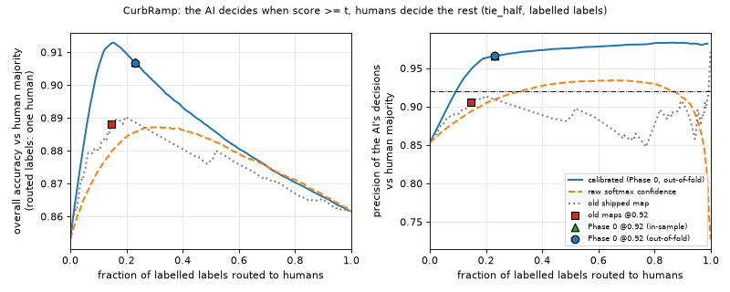
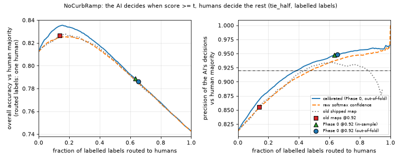
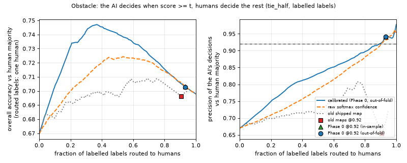
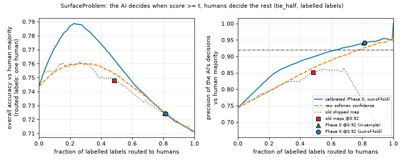
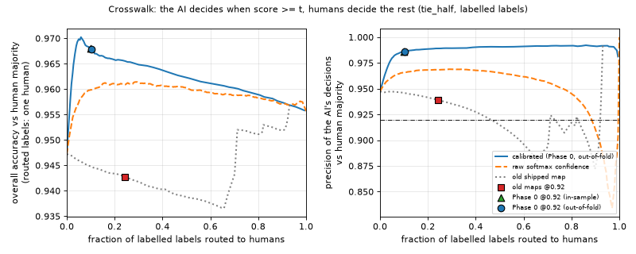

# Human–AI routing by calibrated accuracy, simulated on production outcomes (October 2026)

Part of [#18](https://github.com/ProjectSidewalk/sidewalk-validator-ai/issues/18). The question: if the AI decides
a label whenever its score clears a threshold and humans decide the rest, what does each threshold cost (labels sent
to humans) and buy (accuracy)? And where does today's 0.92 gate sit on that curve?

**Inputs.** The production pull of 2026-10-17 and the Phase 0 calibration run on it
([calibration-2026-10.md](calibration-2026-10.md)): `labels_oof.csv` (996,774 AI assessments in 52 schemas,
2025-08-16 .. 2026-10-17; 273,169 labelled) and `ai_assessments.csv` for two expert validators' votes. Both include
private cities and stay outside the repo; only aggregates are here.

**Every number below** comes from one run, made 2026-10-20:

```
python analysis/routing.py --labels-oof ~/Data/<pull>/phase0/labels_oof.csv \
    --assessments ~/Data/<pull>/ai_assessments.csv --cities-json ~/Data/<pull>/cities.json \
    --out-dir ~/Data/<pull>/routing --seed 42
```

It writes `summary.md` (the tables here), CSVs of every curve point, and the figures. Numbers marked "≥ 3 votes" come
from the same command with `--min-human-votes 3 --no-plots`. The script names public deployments only. It counted 52
deployments, 13 of them private.

**Definitions, identical to the calibration run.**
- *Labelled* means at least 2 human Agree/Disagree votes, with the AI's own vote excluded.
- The outcome is `tie_half`: 1 if the strict human majority matches the AI's verdict, 0 if it opposes it, and 0.5 on
  a tie.
- The *calibrated score* is `oof_accuracy`, the Phase 0 map's out-of-fold served value. The script recomputes the
  outcome and asserts that it matches the calibration run's `correct` column row for row.

## What "routed" and "accuracy" mean here

- **Routed** is the share of labelled labels the AI does not decide. Those labels go to humans. Every curve is drawn
  on the labelled subset, because the outcome exists only there. The "all assessed" column gives the same share over
  every assessed label, which needs a served value on unlabelled rows. That works for the shipped maps but not for
  the out-of-fold score.
- **AI precision** is the mean outcome of the AI's decisions against the human majority.
- **Overall accuracy** depends on who decides the routed labels. The script reports three human models:
  - **oracle:** humans get every routed label right. Then every AI decision below 100% precision costs accuracy, and
    the only question is how much AI error is acceptable. This is the right model when a routed label gets a full
    crowd, because the crowd majority *is* the reference.
  - **constant `p_h`:** one human per routed label, with accuracy `p_h` per type.
  - **routed `p_h`:** one human per routed label, with `p_h` measured on the routed labels themselves. The figures
    use this model, because humans are much less accurate on exactly the labels the AI is unsure about (next table).

**Single-human accuracy, derived from the vote counts.** On a label with `a` Agree and `d` Disagree votes, take a
random voter and score their vote against the majority of the other votes (`tie_half`). This needs at least 3 votes,
so that the others are themselves a labelled crowd. The vote arrival order is not exported, so this is a random
voter, not the first one.

"AI (same others)" scores the AI's raw verdict against the same remaining votes, so the two numbers are like for
like.

| type | labels (≥ 3 votes) | one human `p_h` | `p_h`, calibrated < 0.92 | `p_h`, ≥ 0.92 | AI (same others) | AI, < 0.92 | AI, ≥ 0.92 |
|---|---:|---:|---:|---:|---:|---:|---:|
| CurbRamp | 38,548 | 0.861 | 0.711 | 0.913 | 0.838 | 0.479 | 0.961 |
| NoCurbRamp | 28,874 | 0.743 | 0.700 | 0.841 | 0.797 | 0.739 | 0.931 |
| Obstacle | 26,115 | 0.698 | 0.686 | 0.840 | 0.673 | 0.650 | 0.932 |
| SurfaceProblem | 28,688 | 0.711 | 0.675 | 0.862 | 0.735 | 0.686 | 0.935 |
| Crosswalk | 20,571 | 0.956 | 0.806 | 0.971 | 0.958 | 0.671 | 0.988 |
| all | 142,796 | 0.791 | 0.692 | 0.913 | 0.796 | 0.662 | 0.962 |

- **On these labels, the AI's raw verdict agrees with the rest of the crowd as often as one random human does**
  (0.796 vs 0.791 pooled).
- **Above the gate the AI is clearly better** than one human (0.962 vs 0.913). Below it the AI is worse (0.662 vs
  0.692), but humans are weak there too.
- **Caveat: labels with ≥ 3 votes are not a random sample.** Triage sends contested labels to more voters, so these
  are harder than the average labelled label, and both columns are lower than they would be on a random label.
- `--human-accuracy` overrides `p_h` with one number for every type. An earlier plan quoted a pooled 0.81; its source
  could not be found in the repo, and the derived pooled value is 0.791 (0.804 at ≥ 4 votes).

## The curves

Each figure has two panels. Left: overall accuracy (routed `p_h` model) against the fraction routed. Right: the
precision of the AI's own decisions, with the 0.92 line. Each panel has one line per score: calibrated out-of-fold,
raw softmax, and old shipped map. The three 0.92 operating points are marked.







**The calibrated curve dominates or equals the raw-confidence curve for every type.** Compared as the best
accuracy reachable at each routing level, the calibrated curve is never below the raw one. The gap reaches +0.03 for
CurbRamp, Obstacle and SurfaceProblem, and +0.01 for NoCurbRamp and Crosswalk. The reason is that a single threshold on raw confidence pools both verdicts, and a Disagree
verdict at confidence 0.99 is right only about half the time. The calibrated score puts both verdicts on one scale.

## The 0.92 operating points

- **old maps @0.92** is what production did until now: `ai_accuracy ≥ 0.92`.
- **Phase 0 @0.92** is the new maps: `new_accuracy ≥ 0.92` in-sample, and `oof_accuracy ≥ 0.92` out-of-fold. They
  cast no Disagree votes, except 12 NoCurbRamp Disagree out-of-fold.
- The last two columns compare each point with the calibrated curve. "Curve acc at same routing" is the best accuracy
  any calibrated threshold reaches with no more routing. "Curve routing at same acc" is the least routing that
  matches the point's accuracy.

| type | operating point | routed (labelled) | routed (all assessed) | AI decisions | AI precision | acc, oracle | acc, routed `p_h` | curve acc at same routing | curve routing at same acc |
|---|---|---:|---:|---:|---:|---:|---:|---:|---:|
| CurbRamp | old maps | 0.146 | 0.143 | 72,994 | 0.905 | 0.919 | 0.888 | 0.913 | 0.064 |
| CurbRamp | Phase 0 (out-of-fold) | 0.232 | 0.203 (in-sample) | 65,698 | 0.966 | 0.974 | 0.907 | 0.913 | 0.110 |
| NoCurbRamp | old maps | 0.138 | 0.162 | 41,148 | 0.855 | 0.875 | 0.826 | 0.835 | 0.072 |
| NoCurbRamp | Phase 0 (out-of-fold) | 0.653 | 0.682 (in-sample) | 16,588 | 0.948 | 0.982 | 0.786 | 0.835 | 0.000 |
| Obstacle | old maps | 0.907 | 0.922 | 3,943 | 0.654 | 0.968 | 0.696 | 0.747 | 0.089 |
| Obstacle | Phase 0 (out-of-fold) | 0.933 | 0.952 (in-sample) | 2,834 | 0.942 | 0.996 | 0.703 | 0.747 | 0.103 |
| SurfaceProblem | old maps | 0.485 | 0.480 | 32,674 | 0.851 | 0.923 | 0.748 | 0.789 | 0.015 |
| SurfaceProblem | Phase 0 (out-of-fold) | 0.814 | 0.779 (in-sample) | 11,780 | 0.941 | 0.989 | 0.724 | 0.789 | 0.000 |
| Crosswalk | old maps | 0.242 | 0.237 | 25,788 | 0.939 | 0.954 | 0.943 | 0.970 | 0.000 |
| Crosswalk | Phase 0 (out-of-fold) | 0.102 | 0.124 (in-sample) | 30,548 | 0.986 | 0.988 | 0.968 | 0.970 | 0.040 |

The in-sample Phase 0 rows differ from the out-of-fold ones by at most 0.02 routed and 0.004 accuracy; they are in
`summary.md`.

**Consistency with the calibration doc.** The Agree subsets reproduce the calibration doc's gate rows exactly:
- out-of-fold n and precision: CurbRamp 65,698 at 0.966, Obstacle 2,834 at 0.942, SurfaceProblem 11,780 at 0.941,
  Crosswalk 30,548 at 0.986;
- NoCurbRamp 16,576 Agree plus the 12 Disagree = 16,588;
- old-map CurbRamp Agree 63,111 at 0.968.

**What the table says.**
- **Phase 0 trades coverage for precision on every type.** Every Phase 0 point clears 0.92 precision out-of-fold.
  Every old-map point except Crosswalk misses it, because the old maps let Disagree verdicts at 0.51–0.69 vote.
- **Under the oracle model, Phase 0 is strictly better** than the old maps. Fewer wrong AI decisions means higher
  accuracy, at the cost of more routing: NoCurbRamp goes from 14% to 65% routed, SurfaceProblem from 49% to 81%.
- **Under a one-human model the picture flips** for NoCurbRamp and SurfaceProblem. The calibrated curve peaks at a
  much lower threshold (next table), because a single human is right only about 0.70 of the time on the labels Phase
  0 hands back.
  - "Curve routing at same acc = 0.000" means that letting the AI decide *every* labelled label of that type matches
    Phase 0's accuracy when one random human decides the rest.
  - That is a statement about how weak a single human is on those labels. It is not a case for lowering the vote
    gate (see the recommendation).

**Accuracy-maximizing single threshold (routed `p_h` model).** This is where the left panel peaks:

| type | best calibrated threshold | routed | AI precision | acc | acc with every label routed |
|---|---:|---:|---:|---:|---:|
| CurbRamp | 0.656 | 0.155 | 0.951 | 0.913 | 0.861 |
| NoCurbRamp | 0.592 | 0.159 | 0.874 | 0.835 | 0.743 |
| Obstacle | 0.650 | 0.368 | 0.807 | 0.747 | 0.698 |
| SurfaceProblem | 0.516 | 0.223 | 0.845 | 0.789 | 0.711 |
| Crosswalk | 0.723 | 0.059 | 0.982 | 0.970 | 0.956 |

At ≥ 3 votes (`--min-human-votes 3`), the peak thresholds move by at most 0.18 (Crosswalk 0.72 → 0.54), and every
peak stays far below 0.92.

## Per-verdict thresholds

Today's gate is applied per verdict map, so the script also sweeps every pair `(t_agree, t_disagree)` on a quantile
grid of the calibrated score within each verdict. The table gives the least-routing point on the oracle Pareto front
whose **pooled** AI precision reaches each target. "none" means no Disagree votes: the calibrated Disagree score never
reaches 0.92.

| type | target | t_agree | t_disagree | routed | AI decisions | pooled precision |
|---|---:|---:|---:|---:|---:|---:|
| CurbRamp | 0.92 | 0 (all) | 0.304 | 0.097 | 77,227 | 0.923 |
| CurbRamp | 0.95 | 0 (all) | 0.656 | 0.154 | 72,324 | 0.951 |
| NoCurbRamp | 0.92 | 0.825 | 0.826 | 0.393 | 28,999 | 0.921 |
| NoCurbRamp | 0.95 | 0.933 | none | 0.691 | 14,734 | 0.951 |
| Obstacle | 0.92 | 0.891 | none | 0.902 | 4,176 | 0.922 |
| SurfaceProblem | 0.92 | 0.873 | 0.818 | 0.640 | 22,846 | 0.920 |
| SurfaceProblem | 0.95 | 0.939 | none | 0.920 | 5,073 | 0.951 |
| Crosswalk | 0.92 | 0 (all) | 0 (all) | 0.000 | 34,023 | 0.947 |

The 0.90 rows are in `summary.md`.

- **A pooled target is not a per-label gate.** These points hit the target by mixing very precise Agree votes with
  Disagree votes far below it. CurbRamp at 0.92 pooled admits Disagree verdicts with calibrated accuracy 0.30.
- This is the same "per-label semantics" problem the calibration doc found with the old NoCurbRamp Agree votes. It is
  why the recommendation below keeps a **per-label** threshold, the single-threshold curve, rather than a pooled
  Pareto point.

## Does the calibrated score predict errors better than raw confidence?

The AUC of each score for ranking the AI's right verdicts above its wrong ones. Ties are excluded. The CI is a
100-resample bootstrap of the calibrated-minus-raw difference (`--seed 42`).

| type | verdict | n | errors | calibrated | raw confidence | old map | calibrated − raw [95% CI] |
|---|---|---:|---:|---:|---:|---:|---|
| CurbRamp | Agree | 65,769 | 773 | 0.775 | 0.778 | 0.641 | −0.003 [−0.005, −0.002] |
| CurbRamp | Disagree | 13,332 | 8,586 | 0.792 | 0.795 | 0.746 | −0.003 [−0.004, −0.002] |
| CurbRamp | both | 79,101 | 9,359 | 0.964 | 0.772 | 0.695 | +0.192 [+0.187, +0.197] |
| NoCurbRamp | Agree | 30,304 | 1,955 | 0.789 | 0.793 | 0.791 | −0.003 [−0.005, −0.002] |
| NoCurbRamp | Disagree | 12,155 | 4,358 | 0.731 | 0.734 | 0.732 | −0.004 [−0.005, −0.003] |
| NoCurbRamp | both | 42,459 | 6,313 | 0.848 | 0.799 | 0.796 | +0.049 [+0.046, +0.054] |
| Obstacle | Agree | 22,467 | 3,329 | 0.665 | 0.669 | 0.665 | −0.003 [−0.005, −0.002] |
| Obstacle | Disagree | 13,722 | 7,567 | 0.671 | 0.676 | 0.675 | −0.005 [−0.007, −0.003] |
| Obstacle | both | 36,189 | 10,896 | 0.793 | 0.704 | 0.615 | +0.089 [+0.085, +0.094] |
| SurfaceProblem | Agree | 37,881 | 2,820 | 0.727 | 0.729 | 0.724 | −0.002 [−0.003, −0.001] |
| SurfaceProblem | Disagree | 14,909 | 8,101 | 0.702 | 0.706 | 0.703 | −0.003 [−0.004, −0.003] |
| SurfaceProblem | both | 52,790 | 10,921 | 0.863 | 0.764 | 0.710 | +0.099 [+0.096, +0.104] |
| Crosswalk | Agree | 30,783 | 202 | 0.744 | 0.754 | 0.725 | −0.010 [−0.018, −0.002] |
| Crosswalk | Disagree | 2,327 | 1,137 | 0.856 | 0.862 | 0.658 | −0.006 [−0.008, −0.004] |
| Crosswalk | both | 33,110 | 1,339 | 0.952 | 0.699 | 0.289 | +0.254 [+0.234, +0.270] |

- **Within one verdict, calibration cannot help, and it costs slightly.** An isotonic map is monotone in confidence,
  so it cannot change the ranking. Its flat blocks create ties, and the per-fold maps add a little noise; that is the
  −0.002 to −0.010.
- **Across verdicts, calibration helps a lot** (+0.05 to +0.25), because it puts Agree and Disagree on one scale.
- **Ranking errors within a verdict needs new information.** The within-verdict AUCs are the bar for an
  uncertainty estimate to beat: 0.67–0.79 for Agree and 0.67–0.86 for Disagree. Obstacle Agree is the weakest at
  0.665. That is the ensemble / MC-dropout follow-up below.

## Complementarity: when the AI and the crowd disagree, who is right?

Two expert validators' own votes (role-keyed `expert1`, `expert2` by column position) are taken from
`ai_assessments.csv`.

- **Method.** The expert's vote is removed from the counts, which the pull includes because it excludes only the AI.
  Then, on labels where the remaining crowd (≥ 2 votes, strict majority) opposes the AI's raw verdict, the table
  shows how often the expert sides with the AI.
- **Baseline.** "Agreements" are labels where the crowd and the AI agree. There the expert sides with both 94% /
  91% of the time.

| expert | AI verdict | AI-vs-crowd disagreements | expert sides with AI | of those, calibrated ≥ 0.92 | expert sides with AI there | AI-crowd agreements | expert sides with both |
|---|---|---:|---:|---:|---:|---:|---:|
| expert1 | Agree | 769 | 0.592 | 104 | 0.798 | 13,838 | 0.974 |
| expert1 | Disagree | 1,869 | 0.251 | 0 | — | 2,478 | 0.778 |
| expert2 | Agree | 427 | 0.431 | 46 | 0.717 | 5,924 | 0.919 |
| expert2 | Disagree | 950 | 0.423 | 0 | — | 1,349 | 0.861 |

Per type, see `summary.md`; the cells are small.

- **When the AI says Disagree and the crowd says Agree, the experts usually side with the crowd** (75% / 58%). The
  exception is Obstacle, where `expert2` sides with the AI's Disagree 69% of the time (n = 244).
- **On the labels Phase 0 would vote on, a contested AI Agree is usually right.** Where the calibrated score is ≥ 0.92
  and the crowd says Disagree, the experts side with the AI 80% (n = 104) and 72% (n = 46) of the time. The crowd
  majority therefore *understates* the precision of the gated Agree votes.
  - This is the Tohme-style complementarity: on the AI's confident side, the AI tends to be right where the crowd and
    the AI conflict.
  - **Caveat:** the n is small, and the experts' votes are not a random sample. They often vote in Triage, which is
    where AI-contested labels go.

**Gold subset (≥ 3 human votes, all on one side).** The precision of the Phase 0 Agree votes is 0.996–0.999 on gold
labels, against 0.941–0.986 on the `tie_half` majority:

| type | Phase 0 Agree, majority (n) | Phase 0 Agree, gold (n) |
|---|---:|---:|
| CurbRamp | 0.966 (65,698) | 0.999 (22,852) |
| NoCurbRamp | 0.948 (16,576) | 0.998 (5,640) |
| Obstacle | 0.942 (2,834) | 0.996 (1,210) |
| SurfaceProblem | 0.941 (11,780) | 0.998 (3,920) |
| Crosswalk | 0.986 (30,548) | 0.999 (17,106) |

- Unanimous labels are the easy ones, so gold precision is an upper bound, just as the `tie_half` majority is a
  noisy reference.
- On gold, the old maps' Disagree votes are right only 0.495–0.78 of the time: CurbRamp 0.495 (n = 1,694) and
  Crosswalk 0.500 (n = 726) at the bottom.

## DRAFT recommendation for the SidewalkWebpage validation-queue policy

*Draft for Jon to review and file in SidewalkWebpage. It is not filed. All numbers come from the 2026-10-17 pull,
`tie_half`, out-of-fold, with the caveats below.*

1. **Keep a per-label gate of 0.92 on the calibrated (Phase 0) accuracy,** per type and per verdict. Only Agree
   verdicts clear it today. No shipped Disagree map reaches 0.92. Their highest served values are 0.90 (NoCurbRamp), 0.85
   (Crosswalk) and 0.71–0.81 for the others. Do not replace the gate with a pooled-precision target. The per-verdict Pareto points above reach
   their targets only by admitting Disagree votes at 0.30–0.83.

   | type | AI votes (Agree) at | expected precision (out-of-fold, majority) | AI-voted share of assessed labels | sent to humans (all assessed) |
   |---|---|---:|---:|---:|
   | CurbRamp | calibrated ≥ 0.92 | 0.966 | 0.797 | 0.203 |
   | NoCurbRamp | calibrated ≥ 0.92 | 0.948 | 0.318 | 0.682 |
   | Obstacle | calibrated ≥ 0.92 | 0.942 | 0.048 | 0.952 |
   | SurfaceProblem | calibrated ≥ 0.92 | 0.941 | 0.221 | 0.779 |
   | Crosswalk | calibrated ≥ 0.92 | 0.986 | 0.876 | 0.124 |

   The "sent to humans" shares use the shipped Phase 0 map over every assessed label, so they include labels that
   never got human votes.

2. **Route human effort by the calibrated score, not by the AI's vote alone.** A label whose AI vote cleared 0.92 is
   the lowest-value place for a human vote. On those labels one random human agrees with the others 0.84–0.97 of the
   time, while the AI agrees 0.93–0.99 of the time. Such labels could be marked validated after **one** confirming
   human vote, or none, rather than waiting for the usual number of votes. Human validations should go first to labels
   the AI did not vote on.
3. **Do not lower the vote gate to the accuracy-maximizing thresholds** (0.52–0.72 above). Those maximize accuracy
   only when the alternative is *one* random human. An AI vote is one vote in a crowd, and the oracle model (a full
   crowd on routed labels) loses accuracy with every AI decision below 100% precision. The 0.92 gate is a precision
   floor for a vote, and the routing curves do not argue for moving it.
4. **Keep Disagree verdicts as a routing signal, not as votes.** A raw Disagree verdict is right only 0.38–0.62 of the
   time against the majority, and the experts side with the crowd over the AI's Disagree 58–75% of the time. Triage
   could key on the raw `ai_result` (the calibration doc's Triage note) to send AI-Disagree labels to humans sooner,
   without the AI casting the vote.
5. **Treat contested gated Agree votes as likely AI-correct** when breaking ties in Triage. Experts side with the AI
   in 72–80% of these cases (n = 150 across both experts), but this needs a larger expert sample before it becomes a
   rule.

The AI-voted shares in item 1 are the calibration doc's "new coverage" for Agree, re-weighted over both verdicts
(1 − routed, all assessed).

## Caveats

- **Selection.** Humans do not vote on a random sample of AI-assessed labels: Triage routes AI-contested labels to
  them, and labels collect votes at different rates. Every curve is drawn on the labelled subset. Its routed fractions
  differ from the all-assessed ones by up to 0.05 (table above).
- **The single-human models are simplifications.**
  - The leave-one-vote-out `p_h` uses a random voter, scored against a crowd one vote smaller than the AI's.
  - The labels with ≥ 3 votes it is measured on are harder than average.
  - A real routed label usually gets more than one human vote, which is what the oracle model stands for.
- **Out-of-fold, per label, not per panorama.** These are the same folds as the calibration run (a hash of
  `schema:label_id`). Labels on the same panorama can fall in different folds, so the out-of-fold numbers are
  somewhat optimistic.
- **One model generation.** This covers the model revisions in production (training_date 08-16-2025). A retrain needs
  its own map, and this script re-runs on the new `labels_oof.csv` in about 15 seconds.

## Follow-up: an uncertainty estimate (out of scope here; needs retrained checkpoints and a GPU)

The issue's first experiment asks whether ensemble disagreement or MC-dropout predicts errors better than softmax
confidence. This pull cannot answer that: it records one model's verdict and confidence per label. What it would take:

1. **Checkpoints.** Train five members on the grouped split with different seeds (`fine_tune_classifier.py` as the
   retrain session runs it on klone), or enable dropout at inference on one checkpoint (MC-dropout, about 20 passes).
2. **Scoring.** Score the labelled production labels with each member: about 273k crops, a GPU job. Record the per-
   member softmax, then the mean, the variance and the vote entropy.
3. **The test.** Compare the within-verdict AUC against the table above (0.67–0.86) and fit a calibration map on the
   ensemble mean. Then rerun this script with the ensemble score added to `SCORES`; a new score is one dict entry.
4. **The bar.** An uncertainty estimate pays off only if it raises the *within-verdict* AUC. Across verdicts,
   calibration already does what a better scale can do.
