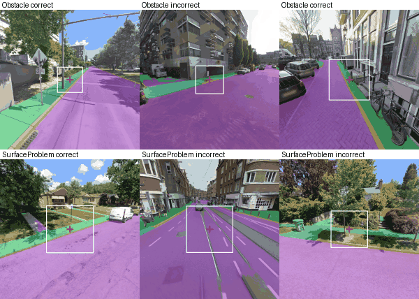

# Sidewalk segmentation as a localisation prior for Obstacle and SurfaceProblem: first experiment (October 2026)

Issue [#44](https://github.com/ProjectSidewalk/sidewalk-validator-ai/issues/44) asks whether an explicit sidewalk mask
(is the label point on the pedestrian path?) tells correct Obstacle and SurfaceProblem labels from incorrect ones,
and whether it adds anything to the production validators. This is the issue's first experiment: an off-the-shelf
segmenter on the label-centred views the training crops are cut from, a dozen point-vs-sidewalk features, no
retraining. The code is `analysis/sidewalk_seg.py`; every number below comes from its `report` stage, whose full
tables are in `segmentation-prior-2026-10/` (`report.md` and the CSVs), pinned by `provenance.json`.

**The segmenter's sidewalk IoU on GSV has not been measured yet.** That needs Jon's hand-check of the contact
sheets (below); until then, every result here is conditional on a mask that looks right on inspection but is
unverified.

## Recommendation

**Drop it as a model feature. Do not route on it yet. Do not spend a GPU run on the fourth-channel experiment.**

- **No lift.** Adding the twelve features to a head on the frozen production features changes out-of-fold AUC by
  -0.002 (CI -0.019 to 0.013) for Obstacle and +0.008 (-0.009 to 0.025) for SurfaceProblem. On top of the production
  score itself the change is +0.003 and +0.000. No CI clears zero, on either split.
- **The signal does not transfer between cities.** A model fitted on the `test` split and applied to the three
  held-out cities gets worse with the features: Obstacle CLS + features is 0.049 below CLS alone (CI -0.083 to
  -0.016), and the features alone score AUC 0.37 there, i.e. they point the wrong way. Several single features flip
  direction between the two splits (Obstacle `sidewalk_frac_crop`: 0.44 on `test`, 0.70 on `test_heldout`).
- **Alone, the features are weak.** The best single feature is SurfaceProblem distance to the nearest sidewalk,
  AUC 0.615 (0.565–0.664) pooled, 0.67 on `test` but 0.53 on `test_heldout`. Nothing for Obstacle beats 0.55 pooled.
- **"Not on any sidewalk" separates for SurfaceProblem only, and only weakly.** Among AI Disagrees, 59% of the labels
  the crowd rejected are off the sidewalk, against 41% of those it accepted (Wilson CIs 50–67% and 28–57%, overlapping).
  For Obstacle the label sits on the obstacle, so 80–92% of every pool is "not on sidewalk" whatever the verdict,
  and the 1 m "near the path" version does not separate either (39% vs 48% not near).
- **Serving cost is not small.** Mask2Former Swin-L is 216M parameters (866 MB) and segments 3.3 views/s on an L40 at
  1024 px. That is a second model as large as the validator for no measured gain.

What would change this: the hand-check showing the mask is wrong often enough to explain the null (then a better
segmenter, not this one), or a production-wide sample of AI Disagrees, rather than this class-balanced held-out
sample, showing the SurfaceProblem gap above is real.

## How the numbers were made

| Step | Where | What |
|---|---|---|
| Sample | Mac | 800 rows of the round-3 held-out sample: Obstacle and SurfaceProblem, 125 + 125 `test` and 75 + 75 `test_heldout` per type, correct / incorrect balanced; 32 deployments, 768 panoramas. All human-authored, all tilt-corrected, none clipped |
| Stage | klone job 42112597 (`analysis/seg_prior_stage.slurm`) | 768 of 768 panoramas from the pano store in one rsync connection (read-only key), 7.4 GB, exit 0, 2.6 min. None needed the fallback copy |
| Render, check, segment | klone job 42113381 (`analysis/seg_prior.slurm`, commit b1a7761), NVIDIA L40, 51.8 min | `read_store_panorama` → `render_label_view` (GPU torch path, the label's pitch/roll, β 0.95, tilt for human labels) on the conda env with sidewalk-panorama-tools at 7ce25ff, the same commit the round-3 generation recorded. Crop re-cut at the manifest's `depth_m`; 800 of 800 match the training crop: same `crop_half_px`, mean absolute difference 1.33 grey levels (max 2.47, 99th-percentile pixel 5.4), i.e. WebP noise |
| Segmenter | same job | `facebook/mask2former-swin-large-mapillary-vistas-semantic` @ `4772b6bf`, view resized to 1024² (INTER_AREA), processor size 1024×1024 (its default is 384), semantic post-processing at 1024². Class-id masks saved at 1024 (features) and 512 (sheets). 243.5 s of segmentation for 800 views (0.30 s/view, including pre- and post-processing) |
| Coordinates | klone job 42113822 | `pano_y` for the horizon check, from the retrain's rawLabels exports (the render job's `views.csv` predates that column) |
| Features | Mac | `mask_features` on the 1024 masks (below) |
| Frozen production features | Mac, M1 Max, MPS | the production validators at their serving revisions (Obstacle `8f0fe8fc`, SurfaceProblem `0e1439da`), preprocessed as `evaluate.py` does; saved the 2048-d `[CLS ; mean(patch tokens)]` that DINOv2's classification head sees (checked: the head applied to it reproduces the logits) and `p_incorrect` |
| Report | Mac, Python 3.12.14, numpy 2.5.4, pandas 3.0.6, scikit-learn 1.9.1, 4 min | single-feature AUC with 2,000-sample bootstrap CIs; 5-fold `StratifiedGroupKFold` by `pano_id` (seed 20261021); logistic regression with C picked by inner 3-fold grouped CV; the 2048-d block reduced to 64 PCA components inside each fold so the 12 features are not drowned by 2048 coefficients under one penalty; paired bootstrap for ΔAUC |

```
R=~/Data/sidewalk-validator-ai-retrain-2026-10/round3 O=~/Data/sidewalk-validator-ai-seg-2026-10 P=~/Data/sidewalk-validator-ai-prod-2026-10-17
python analysis/sidewalk_seg.py filelist --sample $R/sample.csv --out-dir $O
# klone, W=/gscratch/scrubbed/jfroehli/seg-prior-2026-10 holding labels.csv, stage_files.txt, crops/ and a clone:
#   cd $W && sbatch sidewalk-validator-ai/analysis/seg_prior_stage.slurm
#   (login node) HF_HUB_DISABLE_XET=1 HF_HOME=$W/hf python -c "...snapshot_download(...)"   # see seg_prior.slurm
#   cd $W && sbatch sidewalk-validator-ai/analysis/seg_prior.slurm
#   python analysis/sidewalk_seg.py coords --labels $W/labels.csv --rawlabels-dir <rawlabels> --out $W/coords.csv  # CPU sbatch
# pull $W/out -> $O/klone and $W/coords.csv -> $O
python analysis/sidewalk_seg.py features --labels $O/labels.csv --run-dir $O/klone --coords $O/coords.csv --out $O/features.csv
python analysis/sidewalk_seg.py cls --labels $O/labels.csv --crops-dir $R/crops --out $O/cls.npz
python analysis/sidewalk_seg.py report --features $O/features.csv --cls $O/cls.npz \
    --assessments $P/ai_assessments_rounded4.csv --cities-json $P/cities.json --run-dir $O/klone \
    --out-dir docs/segmentation-prior-2026-10 --private-dir $O/private --extra-provenance $O/klone_provenance.json
python analysis/sidewalk_seg.py sheets --features $O/features.csv --run-dir $O/klone --cities-json $P/cities.json \
    --out-dir $O/sheets --doc-fig docs/segmentation-prior-2026-10/sample_views.png
```

### Features

The label point is the view centre; "sidewalk" is the Mapillary classes Sidewalk, Curb Cut and Pedestrian Area;
"road" is Road, Service Lane, Bike Lane, Parking, Crosswalk - Plain and the two lane-marking classes; "curb" is Curb.

| Feature | Definition |
|---|---|
| `point_on_sidewalk` | centre pixel is sidewalk; `_disc`: sidewalk share of a 15 px (view) disc > 0.5; `sidewalk_frac_disc` that share |
| `dist_px_to_sidewalk` | view pixels to the nearest sidewalk pixel (0 on it; none in view scored as the view diagonal) |
| `dist_m_to_sidewalk` | `dist_px × depth_m / 1024`: f = 1024 px for 90° over 2048 px. A small-angle, same-depth approximation: it puts the nearest sidewalk pixel at the label's depth |
| `near_sidewalk_1m` | `dist_m_to_sidewalk ≤ 1`, the issue's "near the path" reading for Obstacle |
| `sidewalk_frac_crop`, `road_frac_crop`, `curb_frac_crop` | shares inside the depth-sized crop square |
| `sidewalk_frac_view` | share of the whole view |
| `on_road` | centre pixel is road |
| `connected_to_bottom` | the sidewalk component holding (or nearest to) the point reaches the bottom 10% of the view: "the path continues to the camera" |

## Results

### Segmenter sanity (no ground truth yet)

| | All | Obstacle | SurfaceProblem |
|---|---|---|---|
| Views with any sidewalk | 98.1% | 97.5% | 98.8% |
| Median sidewalk share of the view | 3.9% | 3.8% | 4.2% |
| Views with > 5% of their sidewalk above the horizon | 0.5% | 0.3% | 0.7% |
| Sidewalk pixels above the horizon | 0.1% | 0.0% | 0.3% |
| Label point on sidewalk | 36.5% | 17.2% | 55.7% |
| Label point on road | 11.3% | 4.8% | 17.7% |
| Within 1 m of sidewalk | 70.4% | 65.7% | 75.0% |

The class at an Obstacle label point is Sidewalk 16%, Vegetation 13%, Trash Can 12%, Pole 10%, Car 10%: the
segmenter sees the obstacle, as the issue predicted. At a SurfaceProblem point it is Sidewalk 52%, Road 16%, Terrain 8%.



**Hand-check packet (Jon).** Four contact sheets of 40 views each, two per type, public deployments only, with the
mask overlay, the crop square, the centre mark, the `label_uid`, class and the sidewalk flag, are in
`~/Data/sidewalk-validator-ai-seg-2026-10/sheets/` (about 580 KB each). The masks behind them are in `klone/masks_512/`.

### Each feature alone

AUC for `incorrect` as the positive class, both splits pooled (n 400 per type, 2,000 bootstrap resamples). Below
0.5 means a higher value goes with a correct label. Per split in `feature_auc.csv`.

| Feature | Obstacle AUC (CI) | SurfaceProblem AUC (CI) |
|---|---|---|
| `point_on_sidewalk` | 0.527 (0.490–0.564) | 0.408 (0.362–0.457) |
| `sidewalk_frac_disc` | 0.549 (0.500–0.599) | 0.408 (0.358–0.463) |
| `dist_m_to_sidewalk` | 0.507 (0.448–0.562) | 0.615 (0.565–0.664) |
| `near_sidewalk_1m` | 0.468 (0.422–0.514) | 0.395 (0.352–0.437) |
| `sidewalk_frac_crop` | 0.541 (0.484–0.600) | 0.458 (0.400–0.516) |
| `sidewalk_frac_view` | 0.532 (0.478–0.589) | 0.443 (0.387–0.503) |
| `road_frac_crop` | 0.487 (0.430–0.545) | 0.541 (0.482–0.595) |
| `curb_frac_crop` | 0.414 (0.360–0.470) | 0.452 (0.395–0.507) |
| `on_road` | 0.507 (0.486–0.529) | 0.568 (0.530–0.603) |
| `connected_to_bottom` | 0.535 (0.505–0.566) | 0.495 (0.463–0.527) |

SurfaceProblem behaves as the issue hoped on the `test` split (distance AUC 0.672, CI 0.610–0.733; on sidewalk
0.372) and not on the held-out cities (0.530 and 0.467). Obstacle goes the "wrong" way on the held-out cities:
there, incorrect labels sit on more sidewalk than correct ones (`sidewalk_frac_crop` 0.695, 0.603–0.780).

### Lift over the frozen production features

Out-of-fold AUC; ΔAUC is paired against the model in brackets.

| Type | Slice | Production score | CLS head | CLS + seg | ΔAUC vs CLS (CI) | Seg only | Production + seg | ΔAUC vs production (CI) |
|---|---|---|---|---|---|---|---|---|
| Obstacle | both splits, 5-fold | 0.828 | 0.845 | 0.842 | -0.002 (-0.019, 0.013) | 0.608 | 0.831 | +0.003 (-0.017, 0.025) |
| Obstacle | `test` rows | 0.821 | 0.813 | 0.815 | +0.002 (-0.021, 0.025) | 0.551 | 0.813 | -0.008 (-0.034, 0.018) |
| Obstacle | `test_heldout` rows | 0.838 | 0.890 | 0.875 | -0.015 (-0.049, 0.014) | 0.707 | 0.855 | +0.017 (-0.017, 0.054) |
| Obstacle | fit `test` → `test_heldout` | 0.838 | 0.846 | 0.797 | **-0.049 (-0.083, -0.016)** | 0.367 | 0.765 | **-0.073 (-0.113, -0.032)** |
| SurfaceProblem | both splits, 5-fold | 0.822 | 0.810 | 0.818 | +0.008 (-0.009, 0.025) | 0.656 | 0.823 | +0.000 (-0.018, 0.018) |
| SurfaceProblem | `test` rows | 0.899 | 0.872 | 0.884 | +0.013 (-0.005, 0.031) | 0.697 | 0.888 | -0.011 (-0.030, 0.006) |
| SurfaceProblem | `test_heldout` rows | 0.659 | 0.681 | 0.686 | +0.004 (-0.034, 0.041) | 0.580 | 0.687 | +0.028 (-0.008, 0.067) |
| SurfaceProblem | fit `test` → `test_heldout` | 0.659 | 0.560 | 0.554 | -0.006 (-0.054, 0.043) | 0.495 | 0.644 | -0.015 (-0.046, 0.018) |

"`test` rows" and "`test_heldout` rows" are subsets of the pooled 5-fold predictions, so in those rows the held-out
cities were also in training folds; only the "fit `test` → `test_heldout`" rows are a real new-city test. The hard
slice has 1 Obstacle and 3 SurfaceProblem rows, all incorrect, so it has no AUC.

Per public city with n ≥ 30 (private deployments pooled), from the pooled 5-fold predictions:

| Type | City | n | incorrect | Production | CLS head | CLS + seg | Seg only | Production + seg |
|---|---|---|---|---|---|---|---|---|
| Obstacle | chicago-il | 42 | 23 | 0.915 | 0.819 | 0.828 | 0.499 | 0.863 |
| Obstacle | seattle-wa | 76 | 36 | 0.832 | 0.819 | 0.850 | 0.677 | 0.875 |
| Obstacle | other (6 private deployments) | 196 | 91 | 0.800 | 0.879 | 0.869 | 0.646 | 0.830 |
| SurfaceProblem | chicago-il | 33 | 10 | 0.896 | 0.813 | 0.848 | 0.704 | 0.909 |
| SurfaceProblem | seattle-wa | 54 | 28 | 0.883 | 0.883 | 0.874 | 0.577 | 0.871 |
| SurfaceProblem | tucson-az | 33 | 23 | 0.535 | 0.526 | 0.543 | 0.504 | 0.552 |
| SurfaceProblem | other (6 private deployments) | 196 | 110 | 0.788 | 0.785 | 0.797 | 0.665 | 0.798 |

City n is 33–196, so a single city's AUC moves by several points on a handful of labels; no per-city gain is
outside that range. The production model itself on this sample (`evaluate.slice_metrics`, plain accuracy omitted
because the sample is 50/50 and production is about 85–90% correct):

| Type | Split | AUC | Balanced accuracy | Recall of incorrect at 90% precision |
|---|---|---|---|---|
| Obstacle | `test` | 0.821 | 0.740 | 0.384 |
| Obstacle | `test_heldout` | 0.838 | 0.720 | 0.053 |
| SurfaceProblem | `test` | 0.899 | 0.796 | 0.592 |
| SurfaceProblem | `test_heldout` | 0.659 | 0.607 | 0.040 |

### By production verdict (the routing question)

783 of the 800 labels have a production assessment (joined on `label_uid` from `schema` + `label_id`,
one-to-one). Share of each pool whose point is not on a sidewalk, and not within 1 m of one, split by the
sample's human class. Wilson 95% CIs; the "other" pool (no or unusable assessment, n 17) is in `strata.csv`.

| Type | Pool | Human class | n | Not on sidewalk (CI) | Not within 1 m (CI) |
|---|---|---|---|---|---|
| Obstacle | AI Disagree | correct | 40 | 0.93 (0.80–0.97) | 0.48 (0.33–0.63) |
| Obstacle | AI Disagree | incorrect | 119 | 0.80 (0.72–0.86) | 0.39 (0.30–0.48) |
| Obstacle | Contested Agree | correct | 29 | 0.86 (0.69–0.95) | 0.34 (0.20–0.53) |
| Obstacle | Contested Agree | incorrect | 74 | 0.80 (0.69–0.87) | 0.32 (0.23–0.44) |
| Obstacle | Uncontested Agree | correct | 124 | 0.82 (0.75–0.88) | 0.26 (0.19–0.34) |
| SurfaceProblem | AI Disagree | correct | 41 | 0.41 (0.28–0.57) | 0.24 (0.14–0.39) |
| SurfaceProblem | AI Disagree | incorrect | 130 | 0.59 (0.50–0.67) | 0.41 (0.33–0.49) |
| SurfaceProblem | Contested Agree | correct | 12 | 0.42 (0.19–0.68) | 0.33 (0.14–0.61) |
| SurfaceProblem | Contested Agree | incorrect | 68 | 0.46 (0.34–0.57) | 0.26 (0.17–0.38) |
| SurfaceProblem | Uncontested Agree | correct | 146 | 0.32 (0.25–0.40) | 0.10 (0.06–0.16) |

An uncontested Agree has no human Disagree, so in this sample it is always `correct`; compare classes within a
pool, not pools with each other. For SurfaceProblem, rejected labels are off the sidewalk more often than accepted
ones in the AI Disagree pool (+18 points, CIs overlapping) and not in the contested-Agree pool (+4). For Obstacle
the AI Disagrees the crowd *accepted* are, if anything, further from the path than the ones it rejected, so a
"far from the path" rule would route the wrong labels.

## Caveats

- **No segmentation ground truth.** The IoU the issue asks for comes from the hand-check. The sanity numbers (98%
  of views have sidewalk, 0.1% of sidewalk pixels above the horizon) and the sheets look right, but they cannot
  show how often the boundary is off by the metre that matters here.
- **The production features may have seen these labels.** The production ViT-L models were trained in 2025-08 on an
  undocumented label set that may overlap this sample, so the production-score and CLS-head numbers are
  optimistic; the segmentation features cannot have seen them. That bias favours the features showing lift, and
  they still did not. The retrained round-3 checkpoints were not available.
- **The heads are fitted on the sample itself.** The CLS head is a new logistic head on 320 rows per fold, not the
  production head; it is the comparison the issue asked for, not a deployable model.
- **Class balance.** The sample is 50/50 by construction; plain accuracy and the pool shares are not production
  numbers. The strata table compares classes within a pool for that reason, and a routing decision would need the
  same measurement on a production-proportioned sample of AI Disagrees.
- **Small and private-heavy.** 400 labels per type; 392 of the 800 rows come from six private deployments, and two
  of the three held-out cities are private. Only Seattle, Chicago and (SurfaceProblem) Tucson reach n ≥ 30 among
  public cities.
- **Metres are approximate.** `dist_m_to_sidewalk` uses the depth at the label point for the sidewalk pixel too.
  For Obstacle, where the sidewalk is usually beside or behind the obstacle, that misstates distances of a metre or
  two; the 1 m threshold was fixed before any table existed and was not tuned.
- **One segmenter, one input size.** Mask2Former Swin-L (Mapillary Vistas v1.2) at 1024². A Cityscapes SegFormer, a
  larger input, or a crop-level mask were not tried.

## What to do next

1. **Jon: hand-check the four sheets** (sidewalk boundary right or wrong per view, near the label point). If the
   mask is wrong in more than about one view in five near the point, the null result says little about the idea and
   a better segmenter is the next step; otherwise close the feature arm of [#44](https://github.com/ProjectSidewalk/sidewalk-validator-ai/issues/44).
2. **Do not run the fourth-channel experiment** (the mask as a fourth input channel, shaped like the point-heatmap arm of [#14](https://github.com/ProjectSidewalk/sidewalk-validator-ai/issues/14)) on this evidence: the issue made it
   conditional on a clear lift in step 3, and there is none.
3. **If routing is still wanted for SurfaceProblem**, measure "off sidewalk" on a production-proportioned sample of
   AI Disagrees (the ~23% of assessments the AI disagrees with), not a class-balanced one, and decide there. That is
   a short GPU rerun of `render-segment` on a new label list.
4. **Serving cost, if it ever ships:** 216M parameters, 866 MB of weights, 0.30 s/view on an L40 at 1024². A
   distilled or smaller segmenter ([#20](https://github.com/ProjectSidewalk/sidewalk-validator-ai/issues/20)) would be needed before sidewalk-ai-api could run it per label; with no gain
   measured, that is not worth doing now.
