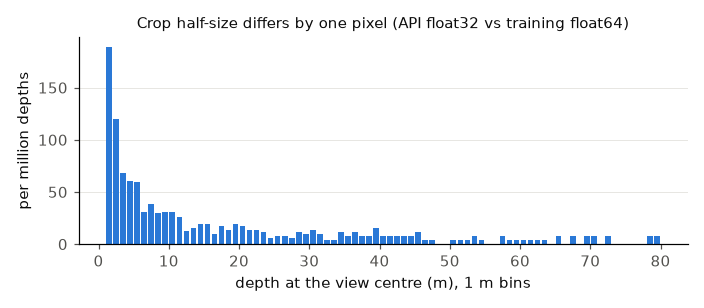
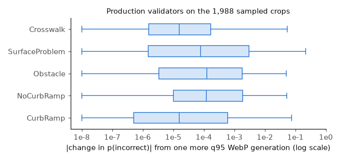

# Train/serve parity: do training and sidewalk-ai-api cut the same crop and tensor? (October 2026)

Issue [#5](https://github.com/ProjectSidewalk/sidewalk-validator-ai/issues/5) has one box left open: "Train, eval and
serving produce byte-identical crops and tensors for the same label." The retrained models will be served behind
[sidewalk-ai-api#17](https://github.com/ProjectSidewalk/sidewalk-ai-api/pull/17), so this check has to pass before
that deploy. It runs both pipelines on the same panorama and label points, stage by stage, and measures every
difference and its effect on the five production validators. The code is `analysis/serving_parity.py`, the tests are
`tests/test_serving_parity.py`, and `serving-parity-2026-10/provenance.json` pins the inputs, versions and commands.

## Answer

**The code is at parity. Two settings are not.** With the same package versions, the training code and the API's
`/process` produce byte-identical views, depth maps and crops, and identical logits, in 30 of 30 cases (10 points ×
3 poses, all five models). Two things still put a different input in front of the model:

| Skew | Size on the input | Effect on the five production models (150 model × case pairs) | Fix |
|---|---|---|---|
| **opencv version**: the env that cut round 3 has opencv-python 4.12.0.88, the API image 5.0.0.93. Their `cv2.resize(INTER_LINEAR)` of the panorama differs (JPEG decode and `INTER_CUBIC` do not) | 1 level on 10.1% of panorama values; then 0/30 crops identical, crop half-size off by 1–6 px in 5/30 | max \|Δp\| 0.064, p90 0.011; 0 verdict flips, 0 vote changes | The API pins opencv-python 4.12.0.88 |
| **WebP q95**: training models see a decoded q95 WebP, the API the raw crop | mean 1.16 levels per value, max 25 | max \|Δp\| 0.109, p90 0.026; 1 verdict flip, **2 vote changes** | The API encodes and decodes q95 WebP in memory (Pillow) for the validator only |

The opencv attribution is measured, not inferred: fed the training side's resized panorama
(`api-worker --pano-npy`), the API's own code in its own venv (torch 2.14.1, numpy 2.5.4) renders 30/30 identical views
and cuts 30/30 identical crops. Its depth maps then differ from training's by at most 1.8 mm (torch 2.7.1 vs 2.14.1 in
the Depth Anything forward), which changed no crop size here.

Everything else is exact or negligible: preprocessing (transformers 4.55 `use_fast=False` vs 5.20 `backend="pil"`:
identical tensors), the transformers/torch version on the model itself (max \|Δp\| 1.7e-5), the camera tilt (same
package, same frame rule for every pose a GSV label has), the depth model (same checkpoint, BGR on both sides) and the
crop rule (identical except a float32 rounding that hits about 1 label in 90,000). One frame-rule difference exists,
a roll sent without a pitch, and no real label has one (below).

With both fixes the served input is **expected** to be byte-identical to what training saw on the CPU: each fix
removes the only difference measured at its stage, and the q95 WebP bytes were identical across the two Pillow builds
here (40/40 crops). No API build with both fixes was run, the Pillow check was on arm64 only, and GPU-to-GPU
differences (klone's CUDA vs the server's) were not measured. The only device probe is the mps *render* (\|Δp\| ≤
0.0016); GPU depth and GPU classifier outputs were not measured, and a depth change of under 1 mm can flip a crop by
a pixel (below).
The deploy smoke test proposed below checks the real thing on the server.

## How the numbers were made

- **Training side**: `data_generation.py`'s own functions, unchanged: `read_store_panorama` on a one-pano shim store,
  `main`'s BGR→RGB, `render_label_view` (numpy, torch cpu, torch mps), `create_perspective_crop` with the real
  Depth Anything V2 metric vkitti ViT-B (a recorder wraps `infer_image`), `save_webp`, then `evaluate.run_inference`'s
  preprocessing (`AutoImageProcessor(use_fast=False)`, `Image.open(...).convert("RGB")`) and model call.
- **Serving side**: sidewalk-ai-api `tilt-fields` at 174a169, read-only. Its real `/process` handler runs through
  Flask's test client with the real `Panorama` cache path (`SIDEWALK_SCRAPES_DIR` = the same shim store), the real
  `DepthAnythingPredictor` and the real `ImageValidator` for each type. Recorders capture the image handed to depth
  and the PIL crop handed to the validator, so nothing is re-derived. The recorder's logits reproduce `validate()`'s
  verdict and confidence in 200/200 calls. Two inputs are not the API checkout's own: its `Depth-Anything-V2` submodule
  is not initialised in the read-only worktree, so the API worker uses this repo's (the same commit, a561b84), and the
  API-side `crop_half_px` in the tables is re-derived from the recorded depth map with the API's expression (the API
  does not return it); the crop itself is recorded.
- **Environments** (each a separate venv; arrays cross between them as `.npy` / lossless `.png`):

| | python | numpy | opencv | pillow (libwebp) | torch | transformers |
|---|---|---|---|---|---|---|
| train (the klone env's versions) | 3.10.19 | 2.2.6 | 4.12.0 | 11.3.0 (1.5.0) | 2.7.1 | 4.55.0 |
| train_other1 (`requirements.txt` venv) | 3.12.14 | 2.5.4 | 5.0.0 | 13.0.0 (1.6.0) | 2.14.1 | 4.55.0 |
| api (sidewalk-ai-api `requirements.txt`) | 3.12.14 | 2.5.4 | 5.0.0 | 12.3.0 (1.6.0) | 2.14.1 | 5.20.0 |

  The API pins the CUDA build of torch 2.14.1; the Mac gets the CPU/MPS wheel of the same version, and `triton` is
  left out. Both repos pin sidewalk-panorama-tools v1.0.0 (= 7ce25ff, the commit round-3's `generation_run.json`
  records) and Depth-Anything-V2 a561b84. `pip freeze` for each venv is in `serving-parity-2026-10/pip-freeze/`; the
  requirements.txt venv is unpinned (it resolved opencv 5.0 and Pillow 13.0), and flask was added to it after the run
  for the live-API tests.
- **The env that cut round 3** (checked on klone, 2026-10-21): the klone conda env that ran round 3 has opencv-python 4.12.0.88 (installed 2026-10-18 07:42), pillow 11.3.0, torch 2.7.1, torchvision 0.22.1,
  transformers 4.55.0, numpy 2.2.6, python 3.10, the same versions as the `train` venv above and as `environment.yml`.
  All five round-3 `generation_run.json` files have `started` 2026-10-20, after that install.
- **Inputs**: sidewalk-panorama-tools' `samples/sample_pano.jpg` (13312 × 6656 GSV). Its `labeldata.csv` rows belong
  to other panoramas (pano_id mismatch), so P01 is the curb ramp hand-picked in that repo's `assets/make_banner.py`
  and P02–P10 are synthetic: sidewalk-level points round the view, the horizon, both sides of the seam, near nadir and
  near zenith. Poses: level, pitch 3°, pitch −5° + roll 1°, and roll 1° alone; β = 0.95.
- **Device**: every reference stage on the CPU. The vendored `infer_image` sends its input to mps on a Mac whatever the
  model's device, so mps is hidden for the reference depth runs; mps renders and depth are probes only.
- **Held-out sample** (stage 5b): the 1,988 round-3 crops (five types, `test` + `test_heldout`, balanced), scored with
  each type's production validator on mps, as stored and after one more q95 encode (`webp-sample`).
- Hardware: Apple M1 Max, 32 GB, macOS 15.5; 2026-10-21. About 40 minutes for `run`, 15 for `webp-sample`.

```bash
python analysis/serving_parity.py run --train-python venv-klone/bin/python --other-train-python .venv/bin/python \
    --api-python venv-api/bin/python --api-dir ~/Git/sidewalk-ai-api-wt/tilt-fields \
    --pano ~/Git/sidewalk-panorama-tools/samples/sample_pano.jpg \
    --depth-checkpoint depth_anything_v2_metric_vkitti_vitb.pth --work WORK --out WORK/out
python analysis/serving_parity.py webp-sample --sample-csv round3/sample.csv --crops round3/crops \
    --api-dir ~/Git/sidewalk-ai-api-wt/tilt-fields --device mps --out-csv ~/Data/serving-parity-2026-10/webp_gen2.csv
python analysis/serving_parity.py crop-half --sample-csv round3/sample.csv
# stage-1 isolation: the API worker on the training side's resized pano, then the comparison
venv-api/bin/python analysis/serving_parity.py api-worker --api-dir ~/Git/sidewalk-ai-api-wt/tilt-fields \
    --depth-checkpoint depth_anything_v2_metric_vkitti_vitb.pth --train-dir WORK/train \
    --pano-npy WORK/train/pano_bgr.npy --out WORK/api_xfeed
python analysis/serving_parity.py isolate --train WORK/train --api WORK/api_xfeed --out isolation.txt
# opencv decode/resize and WebP bytes, per build
venv-klone/bin/python analysis/serving_parity.py pixel-probe --pano sample_pano.jpg \
    --crops WORK/train/*/crop_raw.png --crops-root WORK/train --out P_klone
venv-api/bin/python analysis/serving_parity.py pixel-probe --pano sample_pano.jpg --reference-decode P_klone/decode.npy \
    --crops WORK/train/*/crop_raw.png --crops-root WORK/train --out P_api
python analysis/serving_parity.py pixel-compare P_klone P_api --out pixel_probe.txt
SIDEWALK_AI_API_DIR=~/Git/sidewalk-ai-api-wt/tilt-fields pytest -q tests/test_serving_parity.py   # live API checks
```

`compare` writes `crops.csv`, `models.csv`, `summary.md` and `environments.json` to `WORK/out`. The committed
`serving-parity-2026-10/` holds `crops.csv` (stages 1–4 per case), `summary.md` (every comparison per model and
pooled, with median, p90 and max \|Δp\|), `environments.json`, `isolation.txt`/`.csv`, `pixel_probe.txt`,
`expected_process.csv` (the smoke test's values), `webp_gen2_summary.csv` and `crop_half.txt`. The per-case model
table `models.csv` (359 KB) stays outside the repo, at `~/Data/serving-parity-2026-10/models.csv`, sha256 in
`provenance.json`. Served votes use the tilt-fields `accuracy_mappings/` (sha256 in `provenance.json`), which may not
be the maps production serves today.

## Results by stage

"Matched poses" are the three poses both sides read the same way (30 cases); `roll1_only` is reported apart.

### 1–4. Panorama, view, depth, crop

| Stage | train (opencv 4.12) vs API | train_other1 (opencv 5.0) vs API |
|---|---|---|
| 1. Pano read + resize to 8192 × 4096 | not identical: 1 level on 10.1% of values (17.5% of pixels) | identical |
| 2. View, torch cpu | 0/30 identical, max 2 levels, on 5–32% of pixels | 30/30 identical |
| 3. Depth map | 0/30 identical, max 2.25 m anywhere; centre within 0.05 m | 30/30 identical |
| 4. `crop_half_px` | 25/30 equal (P08–P10: off by 1, 1, 3, 6, 1 px) | 30/30 |
| 4. Crop array | 0/30 identical, mean abs ≤ 3.95 levels | 30/30 identical |

**Isolation.** `pixel_probe.txt`: on the same file, JPEG decode is identical across opencv 4.12 and 5.0, `INTER_CUBIC`
on identical input is identical, and `INTER_LINEAR` on identical input differs (1 level, 10.1% of values).
`isolation.txt`: the API worker fed training's resized pano gives, on the matched poses, 30/30 identical views,
30/30 equal crop half-sizes and 30/30 identical crops; depth maps differ by at most 0.0018 m (0/30 bit-identical:
torch 2.7.1 vs 2.14.1). So every crop difference in the left column comes from the panorama resize, and the depth
differences up to 2.25 m there come from the different views, not from torch.

| Check (all 40 cases) | Result |
|---|---|
| Renderer: numpy `render_view` vs torch cpu (training's `--allow-cpu` path vs the GPU path) | max 1 level, 0.17% of pixels (max 0.30%) |
| Renderer: torch cpu vs mps (torch 2.14) | max 1 level, ≤ 0.16% of pixels; torch 2.7's mps has no `padding_mode="border"` and fails |
| Depth input is the BGR view, training side (array equality with the recorder) | 40/40; the API passes its BGR render directly |
| Probe: the same view with channels swapped | centre depth moves median 0.26 m, max 3.2 m; `crop_half_px` changes in 35/40 |
| Probe: a channel-order bug in the comparison itself | would show as ≥ 3.7 levels mean abs on the view and ≥ 3.6 on the crop; none seen |
| Probe: depth on mps vs cpu | centre within 3.4e-5 m; `crop_half_px` unchanged 40/40 |
| API's float32 crop-half arithmetic on training's depths | equal 40/40 here; see 4b |

**4b. Crop-half rounding.** Training computes `int(6100 / float(depth))` in float64; the API `int(1 / depth * 6100)`
in float32. Over all 52,428,800 float32 depths in 1–80 m they disagree for 3,113 (5.9e-5): the API is 1 px larger in
3,050 and 1 px smaller in 63 (61.0 m gives 100 in training, 99 in the API; `test_round_depth_is_the_crop_half_skew`).
Weighted by the sample's depths (median 24.7 m) that is 1.1e-5 of labels. A one-pixel larger crop moves \|Δp\| by up
to 0.19 (median 0.0013) with no vote change here, so the rare case is not free, but it is rare.



### 5–7. Model outputs, matched poses, 150 model × case pairs

| Comparison | max \|Δlogit\| | median \|Δp\| | p90 \|Δp\| | max \|Δp\| | verdict flips | vote changes |
|---|---|---|---|---|---|---|
| 6+7. Same raw crop: train env (torch 2.7, tf 4.55) vs API env (torch 2.14, tf 5.20) | 2.9e-4 | 2.2e-8 | 9.7e-7 | 1.7e-5 | 0 | 0 |
| 7. Raw crop end to end: train_other1 env vs API | 0 | 0 | 0 | 0 | 0 | 0 |
| 7. Raw crop: train env (opencv 4.12) vs API (opencv 5.0) | 0.204 | 3.4e-4 | 0.011 | 0.064 | 0 | 0 |
| 5. WebP q95 vs raw, same crop | 0.427 | 4.3e-4 | 0.026 | 0.109 | 1 | 2 |
| 5. Second WebP generation vs first | 0.259 | 3.2e-4 | 0.0098 | 0.117 | 1 | 0 |
| **7. End to end: training as on klone (opencv 4.12, WebP) vs API** | 0.383 | 7.6e-4 | 0.026 | 0.081 | 1 | **2** |
| 2. Probe: numpy vs torch render | 0.099 | 1.6e-5 | 5.7e-4 | 0.0073 | 1 | 0 |
| 2. Probe: mps vs cpu render | 0.111 | 1.4e-5 | 4.5e-4 | 0.0016 | 0 | 0 |
| 4. Probe: crop half-size + 1 px | 0.630 | 0.0013 | 0.049 | 0.190 | 0 | 0 |

The verdict flips are at p(incorrect) ≈ 0.50: SurfaceProblem P10 (a zenith point, p 0.500 and 0.472) for WebP vs raw
and end to end, CurbRamp `P04__pitch-5_roll1` (p 0.515) for the second WebP generation. The two vote changes are the
same CurbRamp crops (P07, the left seam edge, level and pitch 3°), whose served accuracy sits on the 0.92 gate. The
points are mostly not curb ramps or obstacles, so the votes column is small (19 of 150 pairs vote); read the \|Δp\|
columns, not the counts.

**6. Preprocessing tensor.** On the same PIL crop, transformers 4.55 `BitImageProcessor` (`use_fast=False`, pillow
11.3) and 5.20 `BitImageProcessorPil` (`backend="pil"`, pillow 12.3) give **identical** `pixel_values` (0 difference,
200/200). The controls differ, as expected: 4.55 `use_fast=True` and 5.20's default torchvision backend both by up to
0.0175 in normalised units. So the API's `backend="pil"` and its class-name assert are load-bearing; keep them.

### 5b. WebP on the 1,988 sampled training crops

These crops are already WebP and their panoramas are gone, so the first-generation loss cannot be recomputed; a
second q95 generation stands in. On the 40 real-panorama crops (one panorama) the second generation changed pixels
5× less than the first (mean abs 0.22 vs 1.16) and p90 \|Δp\| 2.6× less (0.0098 vs 0.026), so this table **likely
underestimates** the first-generation skew; nothing here bounds one by the other. Plain accuracy on this 50/50 sample is not a production number; AUC and balanced accuracy are reported.

| Type | n | median \|Δp\| | p99 \|Δp\| | max \|Δp\| | verdict flips | vote changes | votes | AUC gen1 → gen2 | balanced acc gen1 → gen2 |
|---|---|---|---|---|---|---|---|---|---|
| CurbRamp | 400 | 1.6e-5 | 0.041 | 0.074 | 2 | 1 | 177 | 0.9302 → 0.9297 | 0.8725 → 0.8725 |
| NoCurbRamp | 400 | 1.2e-4 | 0.030 | 0.052 | 2 | 4 | 86 | 0.9078 → 0.9079 | 0.8325 → 0.8325 |
| Obstacle | 400 | 1.3e-4 | 0.028 | 0.049 | 1 | 0 | 30 | 0.8278 → 0.8270 | 0.7325 → 0.7350 |
| SurfaceProblem | 400 | 7.8e-5 | 0.065 | 0.216 | 2 | 0 | 56 | 0.8222 → 0.8230 | 0.7250 → 0.7250 |
| Crosswalk | 388 | 1.6e-5 | 0.022 | 0.054 | 0 | 1 | 190 | 0.9649 → 0.9648 | 0.9054 → 0.9054 |

6 of 1,988 served votes change (0.3%) and AUC moves by at most 0.0009. Production-model numbers on this sample are
optimistic: the 2025-08 models were trained on an undocumented label set that may overlap these labels, and the
retrained round-3 checkpoints were not available.



(Zero changes are drawn at 1e-8.)

## Verdict per skew

| Skew | Verdict | Measured | What to change, where |
|---|---|---|---|
| Preprocessing (issue #5) | **Closed** | identical `pixel_values`, 4.55 slow vs 5.20 pil | Nothing. Keep `use_fast=False` (training) and `backend="pil"` + the assert (API) |
| Camera pitch / tilt (issue #5) | **Closed** for every pose real labels have | 30/30 identical views with the same opencv | Nothing. The API ignores `camera_roll` without `camera_pitch`, training tilts by it; no label has that pose: 0 of 64,465 round-3 `ok` rows have a roll at all, and the review counted 0 of 1,071,562 cached 2026-10-17 rawLabels rows with a roll and no pitch (2,968 rolls, all with a pitch) |
| Depth model (issue #5) | **Closed** | same ViT-B checkpoint (sha256 4dad67a7…) and submodule; BGR on both sides; identical maps with the same torch, ≤ 1.8 mm apart across torch 2.7.1 / 2.14.1 | Nothing |
| Crop rule | **Closed, with a 1e-5 residual** | float32 vs float64 crop half-size, 1.1e-5 of labels | API: `crop_size_half = int(6100 / float(depth[center_y, center_x]))` |
| WebP (not in issue #5) | **Open → sidewalk-ai-api** | p90 \|Δp\| 0.026, max 0.11; 2/150 vote changes on real-panorama crops; 6/1,988 on the sample for a second generation | API: an in-memory q95 encode + decode (Pillow, as `save_webp`) on a separate `validator_image`. q95 bytes were identical for 40/40 crops across Pillow 11.3.0 (libwebp 1.5.0) and 12.3.0 (1.6.0) on arm64 |
| transformers / torch version (not in issue #5) | **Closed** | max \|Δp\| 1.7e-5, no flip | Nothing |
| opencv version (found here) | **Open → sidewalk-ai-api** | 1 level on 10% of the panorama → max \|Δp\| 0.064 (cross-feed: all of the crop difference) | API pins opencv-python 4.12.0.88, the version round 3 was cut with (not regenerating round 3) |
| GPU (not measured) | **Unknown** | mps render only: \|Δp\| ≤ 0.0016; GPU depth and classifier not measured | No klone CUDA run; the deploy smoke test (tolerance 0.01, on the cases far from a crop-size boundary) covers it |

## Caveats

- One panorama, ten points, four poses. The byte-identity results are structural (same code, same pins), but the
  \|Δp\| sizes are from 150 model × case pairs on mostly non-feature points, and one sampled distribution for WebP.
- `generation_run.json` records no package versions; the round-3 environment was read on klone by hand (above).
- Everything ran on an arm64 Mac. The opencv 4.12 vs 5.0 `INTER_LINEAR` difference was measured with the arm64 wheels;
  x86 wheels may differ differently, and so may the WebP bytes. Training renders on klone's CUDA and the API on the
  server's; neither was run.
- The sample's WebP study is a second generation standing in for the first (likely an underestimate, above).
- The fixed API (opencv 4.12 + WebP round trip) was not built or run; "byte-identical after both fixes" is expected
  from the stage-by-stage results, not measured.
- The production validators were not trained on these crops (their 2025-08 data is undocumented and may overlap the
  sample), so model sensitivity may differ for the retrained ones; rerun `run` with the round-3 checkpoints when
  they exist (`model_map.py` is read from `--api-dir`).
- On a Mac the API's `DepthAnythingPredictor` crashes (`Input type (MPSFloatType) and weight type (torch.FloatTensor)
  should be the same`): the model goes to "cuda else cpu", the vendored `infer_image` input to "cuda else mps else
  cpu". Production (CUDA) is unaffected; a developer running `SIDEWALK_ALLOW_CPU=1` on Apple silicon hits it.

## What to do next

1. sidewalk-ai-api: the issue below (opencv pin, WebP round trip for the validator, smoke test), in the PR that ships
   the retrained model map.
2. Record package versions in `generation_run.json`, so the round-3 lookup above never has to be done by hand. A
   training-path change, so proposed here, not made (`data_generation.py`, `main()`, the `json.dump` of the run record):

   ```diff
   -                   "selection_sha256": sel_hash, "started": date.today().isoformat()}, f, indent=2)
   +                   "selection_sha256": sel_hash, "started": date.today().isoformat(),
   +                   "versions": {m: getattr(__import__(m), "__version__", None)
   +                                for m in ("numpy", "cv2", "PIL", "torch")}}, f, indent=2)
   ```
3. Rerun `analysis/serving_parity.py run` against the API branch that will serve the retrained models (its
   `model_map.py` is read from `--api-dir`); with the fixes, expect 30/30 identical crops and 0 \|Δp\| on the CPU.

## Proposed closing text for #5

> The last box ("byte-identical crops and tensors") is answered in docs/serving-parity-2026-10.md. With the same
> package versions, training's code and the API's `/process` produce byte-identical views, depth maps, crops and
> logits (30/30 cases, five models), and the preprocessing tensors are identical across transformers 4.55 slow and
> 5.20 pil. The three skews listed here (preprocessing, camera pitch, depth checkpoint) are closed. Two residuals
> remain, both settings in sidewalk-ai-api, and move there: its image's opencv 5.0 resizes the panorama differently
> from the 4.12 that cut round 3 (max |Δp| 0.064; a cross-feed run shows this is the whole crop difference), and it
> feeds the validator the raw crop where training models saw q95 WebP (max |Δp| 0.11, 2 of 150 served votes
> changed). Decided: the API pins opencv-python 4.12.0.88 and round-trips the validator's crop through q95 WebP, and
> a deploy smoke test checks `/process` against the 105 smoke-set rows of
> `docs/serving-parity-2026-10/expected_process.csv` within 0.01.
> `tests/test_serving_parity.py` checks the live API code when `SIDEWALK_AI_API_DIR` is set.

## Proposed sidewalk-ai-api issue

> **Serve the validator the input training used: opencv 4.12, a q95 WebP round trip, and a deploy smoke test**
>
> sidewalk-validator-ai's parity check (`docs/serving-parity-2026-10.md` there) found that `/process` cuts the same
> crop as training, byte for byte, when both run the same opencv, and that two settings change what reaches the
> retrained validators:
>
> 1. **opencv.** `requirements.txt` pins opencv-python 5.0.0.93; the env that cut the round-3 training crops has
>    4.12.0.88, and the two `cv2.resize(INTER_LINEAR)` the panorama differently (1 level on 10% of values; max |Δp|
>    0.064 downstream). Pin `opencv-python==4.12.0.88`.
> 2. **WebP.** Training models saw every crop after a q95 WebP encode and decode; `/process` passes the raw array
>    (max |Δp| 0.11, p90 0.026, 2 of 150 served votes changed). After `cvtColor`, keep `perspective_image` for the
>    tagger and give the validator its own copy, encoded the way training's `save_webp` does (Pillow, quality 95;
>    training used Pillow 11.3.0):
>
>    ```python
>    buf = io.BytesIO()
>    perspective_image.save(buf, format="WEBP", quality=95)   # sidewalk-validator-ai data_generation.save_webp
>    validator_image = Image.open(io.BytesIO(buf.getvalue())).convert("RGB")
>    ...
>    validation_result, validation_confidence = validator.validate(validator_image)
>    ```
>
>    The tagger keeps the raw `perspective_image` (its training data was not this pipeline's WebP).
> 3. **Deploy smoke test.** Put `sample_pano.jpg` (sidewalk-panorama-tools `samples/`) in the server's pano store as
>    `<store>/parity/pa/parityPano01.jpg`, call `/process` with `city=parity`, `panorama_id=parityPano01` and each row
>    of sidewalk-validator-ai's `docs/serving-parity-2026-10/expected_process.csv` (`x`, `y` as written,
>    `camera_pitch`/`camera_roll` when present, `tilt_beta`, `label_type`), and require |p(incorrect) −
>    `expected_p_incorrect`| ≤ 0.01 for every row with `in_smoke_set` true: 105 of the 150 rows (21 of 30 cases).
>    p(incorrect) is `validation_score` when `validation_result` is `incorrect`, else 1 − `validation_score`. The 45
>    rows left out (9 cases) have a centre depth within 5 mm of a crop-size boundary (`depth_margin_mm`, the depth
>    change that would move `expected_crop_half_px` by one pixel): the five cases whose crop size changed between the opencv
>    4.12 and 5.0 runs (by 1–6 px) are exactly the five with margins under 2.1 mm, and a one-pixel change moves p by
>    up to 0.19, so a correct server could fail them. Today's API (174a169) misses 24 of the 105 smoke-set rows (max 0.057), so the test separates
>    the fixed pipeline from the current one. The tolerance has not been checked against GPU depth or GPU classifier
>    noise (only the mps render was probed, \|Δp\| ≤ 0.0016); if correct-looking deploys fail by a little, measure
>    that before loosening it.
>    The expected values hold for the current production validators (the `model_map.py` revisions in the doc's
>    provenance); regenerate the file with `serving_parity.py expected` when the retrained models are mapped in.
> 4. **To do:** re-measure on the x86 server image that the q95 WebP bytes match training's (Pillow 11.3.0 on klone)
>    and that opencv 4.12.0.88's resize matches klone's; both were checked on arm64 only.
>
> Smaller: `crop_size_half = int(inv_depth * 6100)` is float32 arithmetic; `int(6100 / float(depth[cy, cx]))`
> matches training exactly (they differ for about 1e-5 of labels). `camera_roll` without `camera_pitch` is ignored
> while training applies it (no label has that pose today). `DepthAnythingPredictor` fails on Apple silicon with
> `SIDEWALK_ALLOW_CPU=1`, because the vendored `infer_image` moves its input to mps while the model stays on the cpu.
