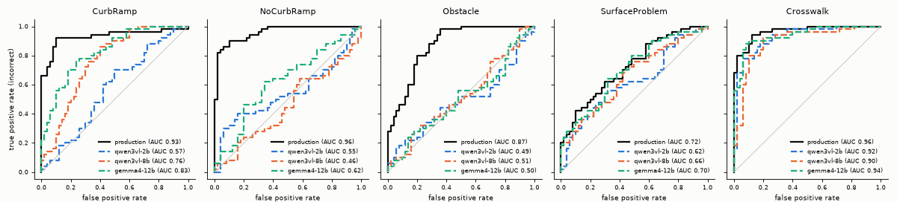

# Open-weight VLMs as zero-shot label validators: first baseline (October 2026)

Issue [#16](https://github.com/ProjectSidewalk/sidewalk-validator-ai/issues/16) asks how well current open-weight
vision-language models (VLMs) validate Project Sidewalk labels zero-shot, and whether their explanations are
worth showing. This is the first measurement. Three MLX models ran on a Mac on the round-3 held-out crops, which
come from the same crop pipeline as the round-3 training inputs. The five production DINOv2-L validators ran on the
same crops. The code is `analysis/vlm_baseline.py`. Every number below comes from its `report` stage, apart from the
packet counts, which come from `packet`. `vlm-baseline-2026-10/provenance.json` pins the inputs, the model
revisions, both environments and the output tables.

## Short answer

**Zero-shot open-weight VLMs are not a substitute for the production validators. Their explanations should not
go into the API response yet.**

- **Production is ahead on every type, on all 1,988 crops.** The best VLM, `gemma4-12b` (4-bit), has these AUCs:

  | | Crosswalk | CurbRamp | SurfaceProblem | NoCurbRamp | Obstacle | Pooled |
  |---|---|---|---|---|---|---|
  | `gemma4-12b` | 0.94 | 0.79 | 0.74 | 0.63 | 0.51 | 0.72 |
  | production | 0.96 | 0.93 | 0.82 | 0.91 | 0.83 | 0.89 |

  The paired interval on the difference excludes zero on all five types when labels are resampled. It excludes
  zero on four when deployments are resampled; on Crosswalk it reaches +0.001.
- **Scale helps a little, the definition helps a lot.** On the 500-crop subset that all three VLMs scored, the mean
  per-type AUC is 0.63 for the 2B model, 0.66 for the 8B and 0.72 for the 12B. Dropping the type definition from
  the prompt takes the 8B model's CurbRamp AUC from 0.76 to 0.56.
- **Production scores lower on the three held-out deployments, mostly on SurfaceProblem.** Pooled, production goes
  from 0.91 to 0.84 (difference 0.07, CI 0.04–0.10). SurfaceProblem accounts for most of it, at 0.90 to 0.66.
  `gemma4-12b` goes from 0.74 to 0.70 (CI −0.00 to 0.09). These deployments were held out of round-3 training.
  Production was trained in 2025-08 on an unrecorded label set, so this says nothing about how well production
  generalises.
- **A VLM verdict costs about 33x production's time per label on this Mac.** Idle, at batch size 1, the median is
  2.33 s per crop for `gemma4-12b` and 0.071 s for production. A reason adds 3.72 s.
- **The explanations are fluent, and some argue against the model's own answer.** One reason calls a utility pole
  "an obstacle because it sits directly in the pedestrian path" next to the answer No. A blinded, two-pass packet
  of 100 reasons is ready for rating. The rating will show whether the reasons help a validator.

## Coverage

| Model | Crops scored | Types | Notes |
|---|---|---|---|
| production (DINOv2-L, 2025-08-16 revisions) | 1,988 (all) | all five | |
| `gemma4-12b` | 1,988 (all) | all five | the best VLM on the subset, scored on everything for the comparison with production |
| `qwen3vl-8b` | 500 headline subset | all five | plus the no-definition prompt on the subset's 100 CurbRamp crops |
| `qwen3vl-2b` | 500 headline subset (plus 171 crops from an interrupted full run, unused) | all five | |
| Few-shot prompting | not run | — | needs in-context crops from the round-3 `train` split, which are not on this machine and would have to be pulled from klone |
| Frontier models (Claude, Gemini) | not run | — | out of scope here; designed in [#47](https://github.com/ProjectSidewalk/sidewalk-validator-ai/issues/47) |

The three-model VLM comparison uses `balanced_subset(per_type=100)`. Per label type it takes 30 correct and 30
incorrect crops from `test`, and 20 and 20 from `test_heldout`, drawn with seed 20261021 after sorting by
`label_uid`. Only `gemma4-12b` and production were scored on all crops.

## How the numbers were made

**Data.** The held-out round-3 sample is `~/Data/sidewalk-validator-ai-retrain-2026-10/round3/sample.csv`, with
1,988 rows from 41 deployments. Per type it has up to 125 + 125 `test` and 75 + 75 `test_heldout` rows, so it is
class-balanced by construction. `test_heldout` comes from three deployments that were never in the round-3
training data; one is public (`tucson-az`) and two are private. The crops are the round-3 training inputs: WebP
q95, 640 x 640, label-centred, depth-sized, and tilt-corrected at β 0.95 (1,982 of 1,988 have
`tilt_applied = 1`). The label point is the crop centre. The target is `label_class` from the human-vote margin
rule, with `incorrect` as the positive class, as in `evaluate.py`.

**VLM score.** Each crop gets one prompt, at batch size 1, with greedy decoding and no sampling. The score is read
from the next-token distribution after the prompt: `p_incorrect = P(no) / (P(yes) + P(no))`.
- P(yes) sums the probability of every single-token spelling of yes: `yes`, `Yes`, `YES`, ` yes`, ` Yes` and
  ` YES`. All six are single tokens in both tokenizers. P(no) is summed the same way.
- The score is computed from the log-odds, so it stays resolved even when one answer holds almost all the mass.
- The two answers hold a median 0.98 of the next-token mass for every VLM (`answer_mass.csv`).
- mlx-vlm returns bfloat16 log-probabilities, so scores have about three significant digits. That creates a few
  ties, which AUC counts as half.
- The verdict at the argmax is `incorrect` when `p_incorrect > 0.5`.

**Greedy check.** Two crops per type were drawn from the subset for each model (`stratified_crops`, seed 16). For
each crop, greedy generation's first word was compared with the score's argmax.

| Model | Crops | Agree | Disagreements |
|---|---|---|---|
| `qwen3vl-2b` | 10 | 10 | |
| `qwen3vl-8b` | 10 | 10 | |
| `gemma4-12b` | 10 | 8 | both Crosswalk, `p_incorrect` 0.500 and 0.485 |

The two disagreements are not bugs. The single most likely token was a form of no, but `Yes` + `yes` together
slightly outweighed `No` + `no`. Summing the spellings can flip a verdict that sits near 0.5, and
`test_summed_variants_can_disagree_with_greedy` pins that case. An earlier version of this check used the first
10 crops of each run. For two of the three models those were all Crosswalk, so that version is superseded.

**Prompts.** Each prompt is a short definition of the type, then "The labelled point is at the centre of the
image.", then "Is this a correct <type> label? Answer yes or no." The chat template puts the image first, and
thinking is switched off where the template has a switch.

The definitions were written for this baseline; no source in this repo has them. They are also not parallel
across types:
- NoCurbRamp and Crosswalk end with a "the label is wrong if..." clause.
- CurbRamp lists exclusions.
- SurfaceProblem and Obstacle have neither.

So some of the per-type differences may come from the wording rather than the model.

| Type | Prompt (the `no-definition` variant drops the first part) |
|---|---|
| CurbRamp | A curb ramp is a short ramp cut into or built up to a curb so that people using wheelchairs, walkers or strollers can move between the sidewalk and the street, often with yellow tactile paving at the bottom. Driveways, alleys and flush building entrances are not curb ramps. The labelled point is at the centre of the image. Is this a correct curb ramp label? Answer yes or no. |
| NoCurbRamp | A missing curb ramp label marks a place where a curb ramp is needed but absent: a sidewalk meets a street crossing or corner at a raised curb, with no ramp for wheelchair users. The label is wrong if a curb ramp is actually present, or if no pedestrian route crosses there. The labelled point is at the centre of the image. Is this a correct missing curb ramp label? Answer yes or no. |
| Obstacle | An obstacle label marks an object in the sidewalk's pedestrian path that blocks it or narrows it so a wheelchair user could not easily pass, such as a pole, sign, fire hydrant, tree, bin, parked vehicle or overgrown vegetation. An object beside the path that leaves it clear is not an obstacle. The labelled point is at the centre of the image. Is this a correct obstacle label? Answer yes or no. |
| SurfaceProblem | A surface problem label marks damage to the sidewalk's walking surface that makes it hard to roll or walk on, such as large cracks, uplifted or sunken slabs (often from tree roots), bumps, missing or broken pavement, loose gravel or dirt, or grass growing over the sidewalk. The labelled point is at the centre of the image. Is this a correct surface problem label? Answer yes or no. |
| Crosswalk | A crosswalk label marks a designated place for pedestrians to cross a road, usually painted stripes or parallel lines on the roadway surface, sometimes raised or textured paving. The label is wrong if there is no marked crossing at the labelled point. The labelled point is at the centre of the image. Is this a correct crosswalk label? Answer yes or no. |

The explanation is a second turn after the model's own answer (`Yes.` or `No.`, its argmax). It asks "In at most
30 words, why?", decoded greedily with at most 60 new tokens.

**Production baseline.** The five validators ran at the revisions sidewalk-ai-api pins (`model_map.py`, trained
2025-08-16). They were preprocessed as `evaluate.py` does (`AutoImageProcessor.from_pretrained(..., use_fast=False)`,
`id2label = {0: correct, 1: incorrect}`). They ran on MPS with transformers 4.55.0 and torch 2.14.1, in a separate
venv, because mlx-vlm upgrades transformers. Both environments are listed in `provenance.json` under `venvs`.

**Metrics.** Every slice uses `evaluate.slice_metrics`: AUC, balanced accuracy at the argmax, and recall at
precision 0.95 and 0.92 for each class. `R@P95 incorrect` is the share of incorrect labels a model could flag at
95% precision. The analyses on top of that:

- **Best VLM vs production.** A paired bootstrap with 1,000 resamples and seed 20261021, done two ways.
  - Resampling labels within class answers "other labels from these deployments".
  - Resampling whole deployments with replacement answers "other deployments". A draw that lacks a class is
    redrawn. These intervals are wider.
- **Test minus held-out difference.** A 95% CI from resampling labels within split and class.
- **Within-city AUC.** Per-deployment AUCs averaged with weights n_incorrect x n_correct (the pairs each one
  contributes), over deployments with both classes and at least 10 rows. This is the stratified Mann-Whitney
  statistic the segmentation-prior analysis in [#49](https://github.com/ProjectSidewalk/sidewalk-validator-ai/pull/49)
  uses. A score that only tells deployments apart cannot raise it.
- **Naming.** A deployment is named only if `calibration.per_city.public_name` lists it as public; every private
  deployment is pooled into one row.
- **Best VLM.** This is the model with the highest mean per-type AUC on the 500-crop subset. It was picked on part of
  the data it is reported on.

**Timing.** Each model was timed on its own:
- 50 crops (10 per type, half per class) at batch size 1, after one warm-up call.
- Each run started once a `pgrep` found no other `python ... analysis/...` process and the 1-minute load average
  was below 3 (2.6–3.0 at the four starts). The 5- and 15-minute averages were still 4.1–4.9 and 6.6–7.6, so the
  machine had been busier shortly before. Processes outside that `pgrep` pattern were not checked.
- The load before and after each run is in `latency.csv`. It rose to 7.7 by the end of `gemma4-12b`'s run, but
  that run's p90 stayed within 4% of its median.
- The latencies logged during the scoring runs, taken while the machine was shared, are not used.

**Hardware and versions.** Apple M1 Max, 32 GB, macOS 15.5, Python 3.12.14. VLM venv: mlx 0.32.4, mlx-vlm 0.7.10,
transformers 5.20.2. Production venv: torch 2.14.1, transformers 4.55.0. Exact repo revisions and on-disk sizes
are in `provenance.json`.

## Results

The tables are in `vlm-baseline-2026-10/`: `full_sample.csv`, `headline.csv`, `bootstrap_auc.csv`, `by_split.csv`,
`split_diff.csv`, `within_city.csv`, `per_city.csv`, `per_city_type.csv`, `hard.csv`, `ablation.csv`,
`latency.csv` and `greedy_check.csv`. Apart from the first two, each has a `set` column that is `subset` or
`full`.

### Three VLMs and production on the same 500 crops

AUC (incorrect = positive):

| Model | CurbRamp | NoCurbRamp | Obstacle | SurfaceProblem | Crosswalk | All (pooled) |
|---|---|---|---|---|---|---|
| production | 0.93 | 0.96 | 0.87 | 0.72 | 0.96 | 0.89 |
| gemma4-12b | 0.83 | 0.62 | 0.50 | 0.70 | 0.94 | 0.72 |
| qwen3vl-8b | 0.76 | 0.46 | 0.51 | 0.66 | 0.90 | 0.68 |
| qwen3vl-2b | 0.57 | 0.55 | 0.49 | 0.62 | 0.92 | 0.61 |



Balanced accuracy at the argmax:

| Model | CurbRamp | NoCurbRamp | Obstacle | SurfaceProblem | Crosswalk | All (pooled) |
|---|---|---|---|---|---|---|
| production | 0.90 | 0.89 | 0.72 | 0.64 | 0.87 | 0.80 |
| gemma4-12b | 0.61 | 0.51 | 0.48 | 0.65 | 0.85 | 0.62 |
| qwen3vl-8b | 0.66 | 0.46 | 0.52 | 0.60 | 0.83 | 0.61 |
| qwen3vl-2b | 0.50 | 0.50 | 0.49 | 0.51 | 0.85 | 0.57 |

The VLMs' answers are lopsided by type, and that is why their balanced accuracy sits near 0.5 even where the score
ranks crops better than chance.
- On the full sample, `gemma4-12b` answers "no" (incorrect) to 91% of CurbRamp and 96% of NoCurbRamp crops.
- On the subset, `qwen3vl-8b` answers "yes" to 96% of Obstacle crops.
- Production's share of `incorrect` verdicts is 41–50% on every type.

A per-type threshold would fix this. It would have to be fitted on labelled data, so the result would no longer be
zero-shot.

### Best VLM vs production on all 1,988 crops

| Type | n | gemma4-12b AUC (label CI) | production AUC (label CI) | Difference (label CI) | Difference (deployment CI, deployments) |
|---|---|---|---|---|---|
| CurbRamp | 400 | 0.79 (0.75–0.83) | 0.93 (0.90–0.96) | −0.14 (−0.18 to −0.10) | −0.23 to −0.09 (29) |
| NoCurbRamp | 400 | 0.63 (0.58–0.69) | 0.91 (0.88–0.94) | −0.27 (−0.33 to −0.22) | −0.34 to −0.11 (24) |
| Obstacle | 400 | 0.51 (0.45–0.56) | 0.83 (0.79–0.87) | −0.32 (−0.38 to −0.26) | −0.43 to −0.25 (28) |
| SurfaceProblem | 400 | 0.74 (0.69–0.78) | 0.82 (0.78–0.86) | −0.09 (−0.14 to −0.04) | −0.16 to −0.02 (28) |
| Crosswalk | 388 | 0.94 (0.92–0.96) | 0.96 (0.95–0.98) | −0.02 (−0.04 to −0.00) | −0.06 to +0.00 (26) |
| All (pooled) | 1,988 | 0.72 (0.70–0.75) | 0.89 (0.88–0.91) | −0.17 (−0.19 to −0.15) | −0.20 to −0.13 (41) |

Production is ahead on every type. The deployment-resampled interval reaches zero only on Crosswalk.

On the subset (`bootstrap_auc.csv`, `set = subset`), SurfaceProblem could not separate the two models: −0.02, CI
−0.15 to +0.09. That was the draw. On all 1,988 crops the gap is −0.09 and excludes zero under both resampling
schemes.

**For production, the subset is not representative per type.** Production's AUC on the 500-crop subset and on
all 1,988 crops:

| | CurbRamp | NoCurbRamp | Obstacle | SurfaceProblem | Crosswalk | All (pooled) |
|---|---|---|---|---|---|---|
| subset (n 100 per type) | 0.93 | 0.96 | 0.87 | 0.72 | 0.96 | 0.89 |
| full (n 388–400 per type) | 0.93 | 0.91 | 0.83 | 0.82 | 0.96 | 0.89 |
| subset − full | −0.00 | +0.05 | +0.04 | −0.10 | −0.00 | −0.01 |

The pooled number agrees, but single types move by up to 0.10. The three-model table above is fine for ranking the
VLMs against each other. Any type-level claim against production should use the full-sample table.

### Recall at fixed precision, all 1,988 crops

| Model | Type | R@P95 incorrect | R@P92 incorrect | R@P95 correct | R@P92 correct |
|---|---|---|---|---|---|
| production | CurbRamp | 0.72 | 0.81 | 0.20 | 0.75 |
| production | NoCurbRamp | 0.49 | 0.71 | 0.48 | 0.59 |
| production | Obstacle | 0.12 | 0.14 | 0.00 | 0.23 |
| production | SurfaceProblem | 0.15 | 0.20 | 0.26 | 0.38 |
| production | Crosswalk | 0.85 | 0.89 | 0.78 | 0.89 |
| gemma4-12b | CurbRamp | 0.20 | 0.20 | 0.34 | 0.36 |
| gemma4-12b | NoCurbRamp | 0.01 | 0.01 | 0.01 | 0.01 |
| gemma4-12b | Obstacle | 0.01 | 0.01 | 0.01 | 0.01 |
| gemma4-12b | SurfaceProblem | 0.00 | 0.12 | 0.03 | 0.03 |
| gemma4-12b | Crosswalk | 0.71 | 0.83 | 0.51 | 0.83 |

The 50/50 prior makes high precision easier to reach than it would be in production. Even so, `gemma4-12b` cannot
flag more than a fifth of incorrect labels at 95% precision on any type except Crosswalk.

### Test vs held-out deployments, all 1,988 crops

AUC on `test` and `test_heldout`, their difference and its 95% CI (`split_diff.csv`):

| Model | Type | test | held-out | Difference (CI) |
|---|---|---|---|---|
| production | CurbRamp | 0.95 | 0.89 | +0.06 (−0.00 to +0.12) |
| production | NoCurbRamp | 0.90 | 0.94 | −0.04 (−0.09 to +0.01) |
| production | Obstacle | 0.82 | 0.84 | −0.02 (−0.10 to +0.07) |
| production | SurfaceProblem | 0.90 | 0.66 | +0.24 (+0.14 to +0.34) |
| production | Crosswalk | 0.98 | 0.92 | +0.06 (+0.01 to +0.12) |
| production | All (pooled) | 0.91 | 0.84 | +0.07 (+0.04 to +0.10) |
| gemma4-12b | CurbRamp | 0.76 | 0.84 | −0.07 (−0.16 to +0.01) |
| gemma4-12b | NoCurbRamp | 0.62 | 0.67 | −0.06 (−0.16 to +0.05) |
| gemma4-12b | Obstacle | 0.50 | 0.52 | −0.02 (−0.13 to +0.09) |
| gemma4-12b | SurfaceProblem | 0.78 | 0.67 | +0.11 (+0.01 to +0.21) |
| gemma4-12b | Crosswalk | 0.97 | 0.89 | +0.07 (+0.02 to +0.14) |
| gemma4-12b | All (pooled) | 0.74 | 0.70 | +0.04 (−0.00 to +0.09) |

Within-city AUC, pooled over types (`within_city.csv`; 17 `test` deployments, 3 held-out):

| Model | test | held-out |
|---|---|---|
| production | 0.92 | 0.84 |
| gemma4-12b | 0.73 | 0.70 |

Production scores lower on these three deployments, mostly on SurfaceProblem and a little on Crosswalk and
CurbRamp. `gemma4-12b` also scores lower there on SurfaceProblem and Crosswalk. So those deployments' crops are
probably harder, and the drop is not only production failing to generalise.

Of the three held-out deployments, only `tucson-az` is public. Its all-type AUC is 0.74 for production and 0.63 for
`gemma4-12b` (`per_city.csv`). The two private ones are in the pooled private row.

The split was defined for the round-3 retrain, and production was trained on an unrecorded set, so this comparison
cannot isolate generalisation.

### Per deployment, all 1,988 crops

A model's per-type verdict offsets combine with each deployment's type mix, so a deployment's pooled AUC partly
reflects which types it has. `mean_within_type_auc` is the mean AUC over the types with both classes and at least
10 rows in that deployment. Public deployments with n >= 30 are shown, and private ones are pooled.

| Deployment | n | Types | production AUC (pooled / within-type) | gemma4-12b AUC (pooled / within-type) |
|---|---|---|---|---|
| seattle-wa | 328 | 5 | 0.92 / 0.93 | 0.73 / 0.75 |
| chicago-il | 206 | 5 | 0.94 / 0.90 | 0.71 / 0.69 |
| tucson-az (held out) | 85 | 4 | 0.74 / 0.80 | 0.63 / 0.68 |
| mendota-il | 53 | 2 | 1.00 / 1.00 | 0.82 / 0.91 |
| amsterdam | 49 | 2 | 0.94 / 1.00 | 0.66 / 0.70 |
| spgg | 43 | 3 | 0.83 / 0.40 | 0.84 / 0.60 |
| pittsburgh-pa | 40 | 1 | 0.75 / 0.56 | 0.71 / 0.73 |
| teaneck-nj | 34 | 1 | 0.96 / 1.00 | 0.79 / 0.92 |
| other (10 private deployments) | 971 | 5 | 0.88 / 0.87 | 0.73 / 0.73 |

Per deployment x type with n >= 20 (`per_city_type.csv`), seattle-wa and chicago-il have all five types. Two more
cells qualify: mendota-il for Crosswalk and tucson-az for SurfaceProblem. Production's AUC is at or above
`gemma4-12b`'s in every one of those cells except two:
- chicago-il Crosswalk: production 0.95, gemma 0.97.
- tucson-az SurfaceProblem: production 0.53, gemma 0.67. This is the held-out SurfaceProblem drop again.

The smaller deployments' within-type means rest on one to three types each, and on few rows per type.

### The `hard` slice

`hard` marks labels where the deployed AI was wrong against a unanimous crowd or an expert.

| Set | Model | n (incorrect) | AUC | Recall of incorrect | Balanced accuracy |
|---|---|---|---|---|---|
| full | production | 20 (10) | 0.22 | 0.30 | 0.20 |
| full | gemma4-12b | 20 (10) | 0.46 | 0.80 | 0.40 |
| subset | production | 6 (6) | — | 0.33 | (equals recall of incorrect) |
| subset | gemma4-12b | 6 (6) | — | 0.67 | (equals recall of incorrect) |

Every subset row is incorrect, so balanced accuracy there is just recall of incorrect. On the full sample,
`gemma4-12b`'s 0.80 recall of incorrect labels mostly reflects its habit of answering "no". With 20 labels these
rows say little.

### Prompt ablation (`qwen3vl-8b`, CurbRamp)

| Prompt | n | AUC | Balanced accuracy |
|---|---|---|---|
| with definition | 100 | 0.76 | 0.66 |
| without definition | 100 | 0.56 | 0.55 |

Both prompts ran on the same 100 crops, the subset's CurbRamp rows. The ablation is on `qwen3vl-8b`, not
`gemma4-12b`. It was chosen when the 8B model was the largest one scored, before Gemma's results existed. It covers
one model and one type.

### Latency and size (this Mac, idle, batch size 1, 50 crops each)

| Model | Median s per crop (p10–p90) | Prompt tokens | Size on disk |
|---|---|---|---|
| production (DINOv2-L, one per type) | 0.071 (0.068–0.074) | — | 1.2 GB each, 5 models |
| qwen3vl-2b | 0.72 (0.68–0.73) | 493 | 1.8 GB |
| qwen3vl-8b | 2.19 (2.07–2.30) | 493 | 5.8 GB |
| gemma4-12b | 2.33 (2.15–2.42) | 353 | 11.0 GB |
| gemma4-12b reason (second turn, about 27 words) | 3.72 (3.38–3.95) | — | same |

`gemma4-12b` is about as fast as `qwen3vl-8b` despite being larger, because it uses about 140 fewer image and prompt
tokens per crop.

## Explanations packet (for rating)

**Methods.** Nothing the rater sees describes the packet's composition: not the rubrics, not the sheets, not the
images. It is written down only here.

The best VLM, `gemma4-12b`, gave a reason for each of 100 crops, 20 per type, all from public deployments and drawn
from its full-sample run. The items were chosen so that neither the shown answer nor the item mix carries
information about the crowd verdict. For each type and each shown answer, there are equally many items where the
VLM agrees with the crowd as where it does not. So P(VLM right) = 0.5 for every type, and P(crowd says correct |
shown answer) = 0.5 for every type and answer.

Within each cell, items were taken in this order:
1. items whose reason already existed from an earlier build;
2. items where production disagrees with the crowd (the comparison the issue asks for);
3. a seeded random draw.

| Type | Shown "No" (crowd correct / incorrect) | Shown "Yes" (crowd correct / incorrect) | VLM right, production wrong | VLM right, production right | VLM wrong, production right | VLM wrong, production wrong |
|---|---|---|---|---|---|---|
| CurbRamp | 10 / 10 | — | 9 | 1 | 7 | 3 |
| NoCurbRamp | 5 / 5 | 5 / 5 | 5 | 5 | 6 | 4 |
| Obstacle | 5 / 5 | 5 / 5 | 7 | 3 | 2 | 8 |
| SurfaceProblem | 5 / 5 | 5 / 5 | 7 | 3 | 4 | 6 |
| Crosswalk | 5 / 5 | 5 / 5 | 5 | 5 | 7 | 3 |
| **All** | **30 / 30** | **20 / 20** | **33** | **17** | **26** | **24** |

CurbRamp has no "Yes" items. Among public CurbRamp crops there were not enough pairs where the model says yes and is
right and where it says yes and is wrong, so all 10 of its pairs are "No".

Of the 100 reasons, 77 are reused from the two earlier builds and 23 are new. The reused ones came from the same
model, prompt and greedy settings. A re-check regenerated 5 of them without `--reuse` (one per type, in `.venv`),
and 5 of 5 came out character-for-character identical to the text in the packet (`reuse_check` in
`provenance.json`). The median reason is 27 words
(range 19–32).

**Design.** The packet has two passes, shipped as two separate zips with the same items, ids and key:
- **Pass 1**, `vlm-explanations-packet-pass1.zip`: only the crop and the label type (`items_bare/`), with
  `pass1_sheet.csv` for the rater's own verdict and a pass-1 `RUBRIC.md` that does not mention the model.
- **Pass 2**, `vlm-explanations-packet-pass2.zip`: the same crops with the answer and reason (`items_annotated/`),
  with `pass2_sheet.csv` for coding the reason and the pass-2 `RUBRIC.md`.

Hand out the pass-2 zip only after the filled pass-1 sheet has come back. That way the rater cannot see any answer
before `my_verdict` is final, so `my_verdict` cannot be anchored on the model's answer. The rest follows PR #40's
packet:
- Each item gets a random `p<6 hex>` id, and the items are shuffled with a secret seed that has no default.
- The category, crowd class, scores, deployment and label id are only in the key.
- The key and the seed are kept outside the repo, in `~/Data/sidewalk-validator-ai-vlm-2026-10/private-key-do-not-share/`.

Both zips are in `~/Data/sidewalk-validator-ai-vlm-2026-10/`. Each holds 100 images, one sheet, one `RUBRIC.md`
and `rate.html`.

**Rating page.** `rate.html` (`analysis/rating_page.py`, modelled on RampNet's GT-check galleries) is an alternative
to editing the sheet by hand. It shows one card per item, with radio answers, a notes box and keyboard shortcuts.
Answers are saved in the browser per rater id. **Export** writes the sheet in the blank sheet's exact columns and
order, so `agreement` reads it unchanged. The pass-1 page holds only the bare crops and label types. The pass-2
page keeps its cards hidden until a pass-1 sheet with a verdict for every item is loaded, which guards against
opening pass 2 first by accident; it is not a security boundary, since the annotated crops sit beside it. The
pages were added after the packet was built, with `vlm_baseline.py gallery`, which leaves the key, ids, sheets and
crops unchanged.

- Key sha256: `12fe5dad393b82cb46dc80d58962d2783d0b3e82de902b36f63504fbdb47831e` (`vlm-baseline-2026-10/packet_key.sha256`).
- Earlier builds were never rated, and their keys are in `~/Data/sidewalk-validator-ai-vlm-2026-10/superseded/`:
  - the first: 86 items, 65 of them VLM errors, one pass;
  - an intermediate one, balanced on VLM correctness but not on the shown answer;
  - this packet as a single zip, which carried the pass-2 material alongside pass 1.
- **Prior exposure.** The first two builds show 77 of these 100 crops together with the model's answer and reason.
  The rater must not have opened them. A rater who has opened them has seen answers before pass 1, and should be
  replaced by one who has not.

**Rubrics** (the two `RUBRIC.md` files, abridged):

| Pass | Column | Values | Meaning |
|---|---|---|---|
| 1 | `my_verdict` | `correct` / `incorrect` / `cant_tell` | Is this a correct label of the stated type at the ringed point? Judged from the crop alone |
| 2 | `reason_correct` | `yes` / `partly` / `no` | Does the reason truly describe what the crop shows, and does it bear on the question? `partly`: some of it is right, or it is right but misses the deciding feature |
| 2 | `would_change_my_vote` | `yes` / `no` | Had you been validating this label, would this answer and reason have changed your vote? |

To unblind both sheets, run
`python analysis/vlm_baseline.py agreement <pass1> <pass2> --key <key> --key-sha256 docs/vlm-baseline-2026-10/packet_key.sha256`.
It prints, overall, by whether the VLM was right, and per category:
- the rater's verdict against the VLM's;
- the rater's verdict against the crowd's;
- the reason codes.

## Should explanations go into the API response? What would a VLM cost?

**Not yet.** There are three reasons.

1. **The verdicts behind the explanations are weak.** An explanation attached to an AI vote would come from a model
   that is near chance on NoCurbRamp and Obstacle. A fluent reason for a wrong verdict is worse than no reason,
   because validators may defer to it. The packet's `would_change_my_vote` and `reason_correct` columns measure
   exactly this risk. Ship nothing until they are coded.
2. **The reasons are post hoc.** The reason is generated after the answer and conditioned on it, so it is a
   rationalisation, not a trace of how the model decided. It would also come from a different model than the
   DINOv2-L validator that casts the vote. Putting it next to a DINOv2-L verdict would explain a decision the VLM did
   not make. The honest version is a separate, labelled signal: "VLM verdict + VLM reason".
3. **The cost is out of proportion to the API's volume.** SidewalkWebpage's nightly actor sends up to 800 labels per
   city. Measured on this Mac, idle, at batch size 1:

| Per label | production (DINOv2-L) | `gemma4-12b` verdict | `gemma4-12b` verdict + reason |
|---|---|---|---|
| Median seconds (p10–p90) | 0.071 (0.068–0.074) | 2.33 (2.15–2.42) | 6.04 (2.33 + 3.72) |
| One city, 800 labels | 57 s | 31 min | 81 min |
| 41 public deployments at 800 each (32,800 labels) | 0.65 h | 21 h | 55 h |
| Relative to production | 1x | 33x | 85x |

These are Mac numbers, not serving numbers. A GPU server with batching would shrink every column, and nothing here
predicts by how much for each model. One VLM would replace five classifiers, which would simplify operations, but
not at this accuracy.

**What would change the answer:** both of these:
- a VLM, open or frontier, that matches production's AUC on these crops;
- a coded packet showing that its reasons are mostly correct (`reason_correct = yes`) and that they move validators
  toward the crowd verdict rather than away from it.

A cheaper use is offline: run the VLM only on the labels production abstains on (below the 0.92 gate). There a
second opinion has value and the volume is smaller.

## Caveats

- **The crops are not exactly what production sees, and the biases run both ways.**
  - The production models were trained in 2025-08 on an unrecorded label set that may overlap these labels. That
    would push production's numbers up.
  - These crops are tilt-corrected at β 0.95, and the current production models were trained on untilted crops;
    sidewalk-ai-api PR #17 is held for this mismatch. Camera pitch on these panoramas is small (median 0.81°, max
    14°), so the effect is probably modest, but it pushes production's numbers down.
  - Neither effect is measured, so the gap is not a bound in either direction. The round-3 retrained checkpoints,
    trained on these crops without the overlap, would give the clean comparison. They do not exist yet.
- **The class balance is 50/50 by construction.** In production about 85–90% of labels are correct, so plain
  accuracy here is not a production number and is not reported. AUC and balanced accuracy do not depend on the
  prior. Recall at fixed precision does: at the production prior, precision for `incorrect` is lower at every
  threshold.
- **Several slices are small.**
  - The three-model comparison uses 100 crops per type.
  - The held-out split has 3 deployments, one of them public.
  - The `hard` slice has 20 labels.
  - Per-deployment rows rest on 1 to 5 types.
  - The deployment-resampled CIs draw from 24–41 deployments of very unequal size.
- **Zero-shot, one wording per type, and the wordings are not parallel** (see Prompts). A tuned prompt, few-shot
  examples or a larger model could do better. This baseline measures what works with no tuning.
- **The crowd verdict is the reference, not ground truth.** It comes from the human-vote margin rule. The packet's
  pass-1 `my_verdict` gives a second reference on 100 items.
- **Latency is from one Mac at batch size 1.** Serving hardware differs, and batching changes the ratios by amounts
  not measured here.
- **Model choice.** The three models were chosen by the 32 GB limit and by what mlx-community publishes:
  `Qwen3-VL-2B/8B-Instruct-4bit` and `gemma-4-12B-it-qat-4bit`. Larger open models (Qwen3-VL-32B, Gemma-4-31B) do
  not fit with headroom at 4 bits.

## Next steps

1. **Rate the packet.** Give the rater `vlm-explanations-packet-pass1.zip` (open `rate.html` in it). Hand out
   `vlm-explanations-packet-pass2.zip` only once the filled pass-1 sheet is back. Then run `agreement` on the two
   sheets. A second rater on the same packet gives inter-rater agreement.
2. **Rerun against the round-3 retrained checkpoints** once they exist. That replaces the production column with a
   comparison that has neither the training overlap nor the tilt mismatch.
3. **Try the cheap improvements on Obstacle and NoCurbRamp**, the types with the largest gaps:
   - few-shot prompting with 4 `train` crops per type, pulled from klone first;
   - a per-type threshold fitted on `val`;
   - definitions rewritten in a parallel form;
   - prompts that ask about each type's own failure modes, for example "is this a driveway?".
4. **Frontier-model legs** (Claude, Gemini) on the same crops, with a cost ledger, are designed in a follow-up
   issue: [#47](https://github.com/ProjectSidewalk/sidewalk-validator-ai/issues/47).

## Reproduce

```
S=~/Data/sidewalk-validator-ai-retrain-2026-10/round3; O=~/Data/sidewalk-validator-ai-vlm-2026-10
C=~/Data/sidewalk-validator-ai-prod-2026-10-17/cities.json
uv venv --python 3.12 .venv && source .venv/bin/activate && uv pip install -r requirements.txt mlx-vlm==0.7.10
uv venv --python 3.12 .venv-prod && VIRTUAL_ENV=.venv-prod uv pip install -r requirements.txt
.venv-prod/bin/python analysis/vlm_baseline.py baseline --device mps --sample-dir $S --out-dir $O
for m in qwen3vl-2b qwen3vl-8b; do python analysis/vlm_baseline.py score --model $m --subset 100 --sample-dir $S --out-dir $O; done
python analysis/vlm_baseline.py score --model gemma4-12b --sample-dir $S --out-dir $O          # all 1,988 crops
python analysis/vlm_baseline.py score --model qwen3vl-8b --subset 100 --label-types CurbRamp --variant no-definition \
    --sample-dir $S --out-dir $O
# timing: one model at a time, nothing else running
.venv-prod/bin/python analysis/vlm_baseline.py timing --model production --sample-dir $S --out-dir $O
for m in qwen3vl-2b qwen3vl-8b; do python analysis/vlm_baseline.py timing --model $m --sample-dir $S --out-dir $O; done
python analysis/vlm_baseline.py timing --model gemma4-12b --with-reason --sample-dir $S --out-dir $O
for m in qwen3vl-2b qwen3vl-8b gemma4-12b; do python analysis/vlm_baseline.py greedy --model $m --sample-dir $S --out-dir $O; done
python analysis/vlm_baseline.py report --cities-json $C --sample-dir $S --out-dir $O --doc-dir docs/vlm-baseline-2026-10
python analysis/vlm_baseline.py explain --model gemma4-12b --cities-json $C --seed 20261021 \
    --reuse $O/superseded/explanations_reuse.csv --sample-dir $S --out-dir $O
python analysis/vlm_baseline.py packet --packet-dir $O/packet --key $O/private-key-do-not-share/packet_key.csv \
    --seed <secret> --sample-dir $S --out-dir $O
```

The per-crop score, timing and greedy CSVs, and `explanations.csv`, hold label-level rows from private
deployments. They stay in `~/Data/sidewalk-validator-ai-vlm-2026-10/`, and their sha256 values are in
`provenance.json`. `--reuse` is only a shortcut: without it, `explain` regenerates the reused reasons from the same
model, prompt and greedy settings. A 5-item re-check, one per type, found 5 of 5 identical. `packet` writes both
zips into `$O`.
