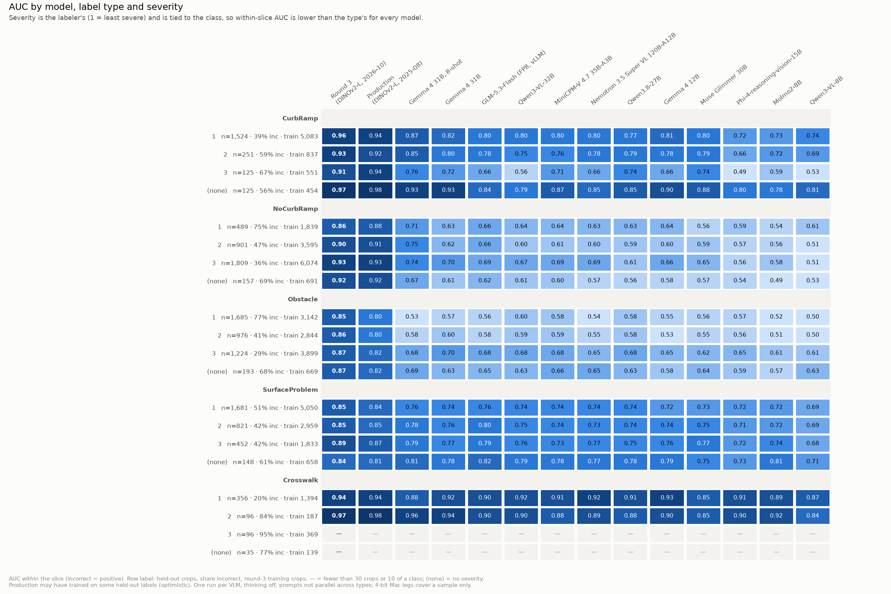
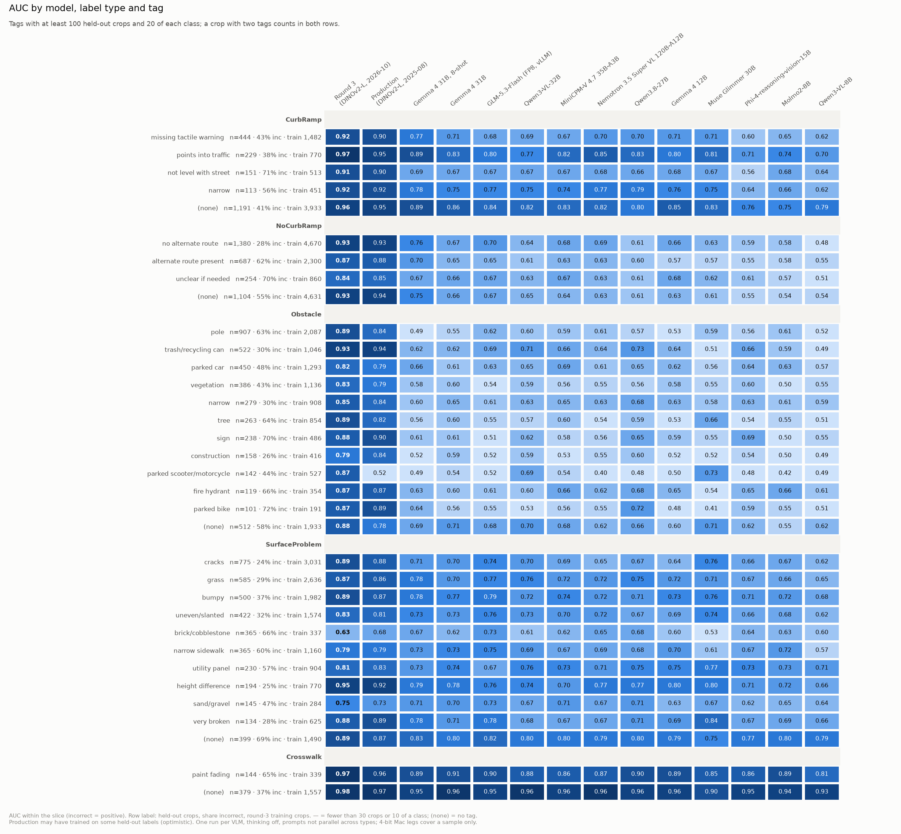

# Open-weight VLM scoreboard (October 2026)

Issue [#63](https://github.com/ProjectSidewalk/sidewalk-validator-ai/issues/63) puts current open-weight
vision-language models (VLMs) next to the purpose-trained validators on the whole round-3 held-out split, in the
style of RampNet's `docs/model_scoreboard.md`. Everything below the headings is generated by
`analysis/vlm_scoreboard.py` from per-crop score files that stay outside the repo (they name private deployments);
the aggregate tables are in `vlm-scoreboard/*.csv` and `vlm-scoreboard/provenance.json` pins every input by sha256.
`python analysis/vlm_scoreboard.py build --check` fails if this page drifts from those tables.

The board has 17 legs, 14 of them scored all 13,144 held-out crops. Round 3 leads the best VLM (Gemma 4 31B, 8-shot) by
0.139 macro-AUC on the crops both scored.

## Short answer

<!-- BEGIN GENERATED: short_answer (analysis/vlm_scoreboard.py) -->

- **Round 3 (DINOv2-L, 2026-10)**: macro-AUC 0.915 [0.910, 0.919] on all 13,144 held-out crops.
- **Gemma 4 31B, 8-shot**, the best VLM with full coverage: macro-AUC 0.775 [0.768, 0.783] on 13,144 crops.
- Paired on the crops both scored, Gemma 4 31B, 8-shot minus round 3: -0.139 [-0.147, -0.132] macro-AUC.
- Production (optimistic, see caveats): macro-AUC 0.899 [0.894, 0.905] on 13,144 crops.

<!-- END GENERATED: short_answer -->

## The board

Macro-AUC is the mean of the five per-type AUCs (each type equal weight), with a 95% interval from a class-stratified
label bootstrap within each type. *test* is the training deployments' test share, *held-out* the deployments no
round-3 model was trained on (both macro over types). *within-city* is the pair-weighted within-deployment AUC
(macro over types). *bal. acc.* is balanced accuracy at the argmax (`p_incorrect > 0.5`); *R@P95* is recall of
`incorrect` at precision ≥ 0.95. *Δ vs round 3* is the paired difference on the crops both legs scored. Rows below
the rule did not score every crop: their AUCs are on other (smaller) crop sets and are not ranked against the full
rows.

<!-- BEGIN GENERATED: board (analysis/vlm_scoreboard.py) -->

| # | model | class | macro-AUC [95% CI] | CurbRamp | NoCurbRamp | Obstacle | SurfaceProblem | Crosswalk | test | held-out | within-city | bal. acc. | R@P95 | Δ vs round 3 [95% CI] | s/crop (GPU, batch) | coverage |
|---|---|---|---|---|---|---|---|---|---|---|---|---|---|---|---|---|
| 1 | **Round 3 (DINOv2-L, 2026-10)** | purpose-trained | 0.915 [0.910, 0.919] | 0.953 | 0.920 | 0.873 | 0.855 | 0.972 | 0.932 | 0.862 | 0.886 | 0.850 | 0.407 | — | — | 13,144 / 13,144 |
| 2 | Production (DINOv2-L, 2025-08) | purpose-trained | 0.899 [0.894, 0.905] | 0.942 | 0.925 | 0.814 | 0.846 | 0.970 | 0.918 | 0.846 | 0.880 | 0.819 | 0.436 | -0.015 [-0.020, -0.011] | 0.0499 (NVIDIA A40, 1) | 13,144 / 13,144 |
| 3 | Gemma 4 31B, 8-shot | chat VLM | 0.775 [0.768, 0.783] | 0.865 | 0.745 | 0.557 | 0.772 | 0.938 | 0.799 | 0.744 | 0.784 | 0.703 | 0.156 | -0.139 [-0.147, -0.132] | 2.46 (2xNVIDIA L40S, 4) | 13,144 / 13,144 |
| 4 | Gemma 4 31B | chat VLM | 0.756 [0.748, 0.763] | 0.825 | 0.659 | 0.584 | 0.756 | 0.954 | 0.769 | 0.734 | 0.741 | 0.698 | 0.145 | -0.159 [-0.167, -0.151] | 0.409 (2xNVIDIA A40, 16) | 13,144 / 13,144 |
| 5 | GLM-5.3-Flash (FP8, vLLM) | chat VLM | 0.754 [0.746, 0.762] | 0.801 | 0.674 | 0.574 | 0.777 | 0.944 | 0.759 | 0.748 | 0.745 | 0.684 | 0.150 | -0.160 [-0.169, -0.153] | 0.0314 (4xH200, 32) | 13,144 / 13,144 |
| 6 | Qwen3-VL-32B | chat VLM | 0.748 [0.740, 0.756] | 0.785 | 0.645 | 0.613 | 0.752 | 0.946 | 0.744 | 0.746 | 0.741 | 0.665 | 0.147 | -0.166 [-0.174, -0.159] | 0.229 (2xNVIDIA L40S, 16) | 13,144 / 13,144 |
| 7 | MiniCPM-V 4.7 35B-A3B | chat VLM | 0.742 [0.734, 0.749] | 0.793 | 0.652 | 0.580 | 0.743 | 0.941 | 0.751 | 0.728 | 0.728 | 0.641 | 0.132 | -0.173 [-0.181, -0.165] | 0.264 (NVIDIA H200, 1) | 13,144 / 13,144 |
| 8 | Nemotron 3.5 Super VL 120B-A12B | chat VLM | 0.738 [0.730, 0.746] | 0.797 | 0.650 | 0.553 | 0.748 | 0.942 | 0.738 | 0.732 | 0.718 | 0.652 | 0.147 | -0.177 [-0.185, -0.169] | 0.106 (2xNVIDIA H200, 4) | 13,144 / 13,144 |
| 9 | Qwen3.8-27B | chat VLM | 0.736 [0.728, 0.744] | 0.779 | 0.619 | 0.589 | 0.746 | 0.948 | 0.736 | 0.738 | 0.726 | 0.672 | 0.142 | -0.179 [-0.187, -0.171] | 0.53 (2xNVIDIA A40, 1) | 13,144 / 13,144 |
| 10 | Gemma 4 12B | chat VLM | 0.736 [0.727, 0.743] | 0.809 | 0.632 | 0.549 | 0.738 | 0.949 | 0.734 | 0.731 | 0.722 | 0.677 | 0.143 | -0.179 [-0.187, -0.171] | 0.129 (NVIDIA A40, 16) | 13,144 / 13,144 |
| 11 | Muse Glimmer 30B | chat VLM | 0.722 [0.714, 0.731] | 0.802 | 0.605 | 0.568 | 0.746 | 0.891 | 0.742 | 0.672 | 0.693 | 0.501 | 0.010 | -0.192 [-0.202, -0.184] | 0.551 (2xNVIDIA A40, 16) | 13,144 / 13,144 |
| 12 | Phi-4-reasoning-vision-15B | chat VLM | 0.700 [0.692, 0.709] | 0.709 | 0.569 | 0.566 | 0.721 | 0.934 | 0.697 | 0.694 | 0.692 | 0.615 | 0.124 | -0.215 [-0.224, -0.206] | 0.84 (NVIDIA A40, 1) | 13,144 / 13,144 |
| 13 | Molmo2-8B | pointing model | 0.694 [0.685, 0.702] | 0.732 | 0.560 | 0.513 | 0.728 | 0.935 | 0.688 | 0.705 | 0.696 | 0.540 | 0.134 | -0.221 [-0.230, -0.212] | 0.264 (NVIDIA A40, 16) | 13,144 / 13,144 |
| 14 | Qwen3-VL-8B | chat VLM | 0.679 [0.670, 0.688] | 0.737 | 0.540 | 0.515 | 0.692 | 0.912 | 0.686 | 0.654 | 0.669 | 0.609 | 0.094 | -0.235 [-0.246, -0.227] | 0.131 (NVIDIA A40, 16) | 13,144 / 13,144 |
|  | *partial coverage, not ranked against the rows above* |  |  |  |  |  |  |  |  |  |  |  |  |  |  |  |
|  | Gemma 4 12B (4-bit, Mac) | chat VLM | 0.722 [0.702, 0.745] | 0.790 | 0.634 | 0.508 | 0.735 | 0.944 | 0.724 | 0.718 | 0.696 | 0.625 | 0.185 | -0.183 [-0.206, -0.162] | 2.33 (Apple M1 Max (MLX), 1) | 1,988 / 13,144 |
|  | Qwen3-VL-2B (4-bit, Mac) | chat VLM | 0.621 [0.578, 0.662] | 0.530 | 0.546 | 0.486 | 0.618 | 0.924 | 0.613 | 0.648 | 0.629 | 0.570 | 0.152 | -0.286 [-0.334, -0.236] | 0.717 (Apple M1 Max (MLX), 1) | 671 / 13,144 |
|  | Qwen3-VL-8B (4-bit, Mac) | chat VLM | 0.657 [0.611, 0.701] | 0.761 | 0.457 | 0.515 | 0.656 | 0.895 | 0.655 | 0.658 | 0.633 | 0.614 | 0.100 | -0.248 [-0.298, -0.201] | 2.19 (Apple M1 Max (MLX), 1) | 500 / 13,144 |

<!-- END GENERATED: board -->

## Per label type

<!-- BEGIN GENERATED: per_type (analysis/vlm_scoreboard.py) -->

| model | type | n | incorrect | AUC [95% CI] | test | held-out | within-city (cities) | bal. acc. | R@P95 |
|---|---|---|---|---|---|---|---|---|---|
| Round 3 (DINOv2-L, 2026-10) | Crosswalk | 583 | 271 | 0.972 [0.956, 0.985] | 0.980 | 0.941 | 0.968 (11) | 0.943 | 0.926 |
| Round 3 (DINOv2-L, 2026-10) | CurbRamp | 2,025 | 895 | 0.953 [0.944, 0.962] | 0.968 | 0.907 | 0.930 (22) | 0.892 | 0.692 |
| Round 3 (DINOv2-L, 2026-10) | NoCurbRamp | 3,356 | 1,554 | 0.920 [0.910, 0.929] | 0.934 | 0.881 | 0.891 (21) | 0.852 | 0.418 |
| Round 3 (DINOv2-L, 2026-10) | Obstacle | 4,078 | 2,186 | 0.873 [0.862, 0.884] | 0.883 | 0.868 | 0.833 (21) | 0.780 | 0.000 |
| Round 3 (DINOv2-L, 2026-10) | SurfaceProblem | 3,102 | 1,475 | 0.855 [0.842, 0.868] | 0.896 | 0.710 | 0.808 (24) | 0.784 | 0.000 |
| Production (DINOv2-L, 2025-08) | Crosswalk | 583 | 271 | 0.970 [0.955, 0.983] | 0.978 | 0.919 | 0.965 (11) | 0.916 | 0.867 |
| Production (DINOv2-L, 2025-08) | CurbRamp | 2,025 | 895 | 0.942 [0.932, 0.951] | 0.958 | 0.884 | 0.913 (22) | 0.874 | 0.630 |
| Production (DINOv2-L, 2025-08) | NoCurbRamp | 3,356 | 1,554 | 0.925 [0.916, 0.933] | 0.932 | 0.910 | 0.918 (21) | 0.845 | 0.438 |
| Production (DINOv2-L, 2025-08) | Obstacle | 4,078 | 2,186 | 0.814 [0.801, 0.827] | 0.837 | 0.824 | 0.792 (21) | 0.711 | 0.100 |
| Production (DINOv2-L, 2025-08) | SurfaceProblem | 3,102 | 1,475 | 0.846 [0.833, 0.859] | 0.886 | 0.693 | 0.812 (24) | 0.749 | 0.144 |
| Gemma 4 31B, 8-shot | Crosswalk | 583 | 271 | 0.938 [0.917, 0.956] | 0.945 | 0.914 | 0.958 (11) | 0.815 | 0.756 |
| Gemma 4 31B, 8-shot | CurbRamp | 2,025 | 895 | 0.865 [0.849, 0.880] | 0.872 | 0.849 | 0.871 (22) | 0.786 | 0.007 |
| Gemma 4 31B, 8-shot | NoCurbRamp | 3,356 | 1,554 | 0.745 [0.728, 0.762] | 0.741 | 0.762 | 0.769 (21) | 0.674 | 0.013 |
| Gemma 4 31B, 8-shot | Obstacle | 4,078 | 2,186 | 0.557 [0.539, 0.574] | 0.652 | 0.478 | 0.577 (21) | 0.546 | 0.001 |
| Gemma 4 31B, 8-shot | SurfaceProblem | 3,102 | 1,475 | 0.772 [0.756, 0.788] | 0.783 | 0.717 | 0.745 (24) | 0.694 | 0.002 |
| Gemma 4 31B | Crosswalk | 583 | 271 | 0.954 [0.939, 0.968] | 0.970 | 0.889 | 0.939 (11) | 0.887 | 0.723 |
| Gemma 4 31B | CurbRamp | 2,025 | 895 | 0.825 [0.807, 0.842] | 0.822 | 0.835 | 0.845 (22) | 0.734 | 0.002 |
| Gemma 4 31B | NoCurbRamp | 3,356 | 1,554 | 0.659 [0.639, 0.678] | 0.658 | 0.683 | 0.626 (21) | 0.611 | 0.000 |
| Gemma 4 31B | Obstacle | 4,078 | 2,186 | 0.584 [0.567, 0.600] | 0.626 | 0.571 | 0.576 (21) | 0.564 | 0.001 |
| Gemma 4 31B | SurfaceProblem | 3,102 | 1,475 | 0.756 [0.739, 0.773] | 0.768 | 0.693 | 0.718 (24) | 0.695 | 0.001 |
| GLM-5.3-Flash (FP8, vLLM) | Crosswalk | 583 | 271 | 0.944 [0.926, 0.960] | 0.961 | 0.876 | 0.920 (11) | 0.874 | 0.745 |
| GLM-5.3-Flash (FP8, vLLM) | CurbRamp | 2,025 | 895 | 0.801 [0.783, 0.819] | 0.789 | 0.836 | 0.826 (22) | 0.683 | 0.003 |
| GLM-5.3-Flash (FP8, vLLM) | NoCurbRamp | 3,356 | 1,554 | 0.674 [0.655, 0.692] | 0.656 | 0.735 | 0.674 (21) | 0.617 | 0.001 |
| GLM-5.3-Flash (FP8, vLLM) | Obstacle | 4,078 | 2,186 | 0.574 [0.558, 0.591] | 0.602 | 0.570 | 0.548 (21) | 0.539 | 0.001 |
| GLM-5.3-Flash (FP8, vLLM) | SurfaceProblem | 3,102 | 1,475 | 0.777 [0.761, 0.793] | 0.788 | 0.722 | 0.755 (24) | 0.706 | 0.000 |
| Qwen3-VL-32B | Crosswalk | 583 | 271 | 0.946 [0.927, 0.961] | 0.962 | 0.879 | 0.936 (11) | 0.862 | 0.723 |
| Qwen3-VL-32B | CurbRamp | 2,025 | 895 | 0.785 [0.766, 0.805] | 0.768 | 0.831 | 0.829 (22) | 0.615 | 0.006 |
| Qwen3-VL-32B | NoCurbRamp | 3,356 | 1,554 | 0.645 [0.625, 0.664] | 0.641 | 0.684 | 0.636 (21) | 0.609 | 0.000 |
| Qwen3-VL-32B | Obstacle | 4,078 | 2,186 | 0.613 [0.597, 0.630] | 0.579 | 0.660 | 0.571 (21) | 0.548 | 0.005 |
| Qwen3-VL-32B | SurfaceProblem | 3,102 | 1,475 | 0.752 [0.736, 0.769] | 0.769 | 0.678 | 0.735 (24) | 0.693 | 0.001 |
| MiniCPM-V 4.7 35B-A3B | Crosswalk | 583 | 271 | 0.941 [0.922, 0.958] | 0.961 | 0.855 | 0.914 (11) | 0.866 | 0.653 |
| MiniCPM-V 4.7 35B-A3B | CurbRamp | 2,025 | 895 | 0.793 [0.774, 0.811] | 0.787 | 0.817 | 0.816 (22) | 0.616 | 0.001 |
| MiniCPM-V 4.7 35B-A3B | NoCurbRamp | 3,356 | 1,554 | 0.652 [0.632, 0.670] | 0.647 | 0.693 | 0.625 (21) | 0.606 | 0.001 |
| MiniCPM-V 4.7 35B-A3B | Obstacle | 4,078 | 2,186 | 0.580 [0.562, 0.597] | 0.613 | 0.576 | 0.560 (21) | 0.553 | 0.004 |
| MiniCPM-V 4.7 35B-A3B | SurfaceProblem | 3,102 | 1,475 | 0.743 [0.725, 0.759] | 0.749 | 0.701 | 0.725 (24) | 0.567 | 0.002 |
| Nemotron 3.5 Super VL 120B-A12B | Crosswalk | 583 | 271 | 0.942 [0.923, 0.959] | 0.964 | 0.835 | 0.907 (11) | 0.857 | 0.731 |
| Nemotron 3.5 Super VL 120B-A12B | CurbRamp | 2,025 | 895 | 0.797 [0.778, 0.816] | 0.792 | 0.811 | 0.812 (22) | 0.693 | 0.002 |
| Nemotron 3.5 Super VL 120B-A12B | NoCurbRamp | 3,356 | 1,554 | 0.650 [0.630, 0.669] | 0.633 | 0.726 | 0.604 (21) | 0.499 | 0.000 |
| Nemotron 3.5 Super VL 120B-A12B | Obstacle | 4,078 | 2,186 | 0.553 [0.536, 0.569] | 0.550 | 0.578 | 0.540 (21) | 0.528 | 0.001 |
| Nemotron 3.5 Super VL 120B-A12B | SurfaceProblem | 3,102 | 1,475 | 0.748 [0.731, 0.763] | 0.752 | 0.709 | 0.727 (24) | 0.685 | 0.001 |
| Qwen3.8-27B | Crosswalk | 583 | 271 | 0.948 [0.930, 0.963] | 0.963 | 0.879 | 0.921 (11) | 0.868 | 0.697 |
| Qwen3.8-27B | CurbRamp | 2,025 | 895 | 0.779 [0.758, 0.798] | 0.770 | 0.804 | 0.803 (22) | 0.676 | 0.002 |
| Qwen3.8-27B | NoCurbRamp | 3,356 | 1,554 | 0.619 [0.600, 0.638] | 0.606 | 0.670 | 0.628 (21) | 0.580 | 0.000 |
| Qwen3.8-27B | Obstacle | 4,078 | 2,186 | 0.589 [0.572, 0.607] | 0.588 | 0.627 | 0.552 (21) | 0.553 | 0.012 |
| Qwen3.8-27B | SurfaceProblem | 3,102 | 1,475 | 0.746 [0.729, 0.763] | 0.750 | 0.711 | 0.726 (24) | 0.684 | 0.000 |
| Gemma 4 12B | Crosswalk | 583 | 271 | 0.949 [0.930, 0.964] | 0.960 | 0.895 | 0.938 (11) | 0.883 | 0.697 |
| Gemma 4 12B | CurbRamp | 2,025 | 895 | 0.809 [0.790, 0.828] | 0.797 | 0.845 | 0.837 (22) | 0.679 | 0.002 |
| Gemma 4 12B | NoCurbRamp | 3,356 | 1,554 | 0.632 [0.613, 0.652] | 0.630 | 0.660 | 0.620 (21) | 0.602 | 0.002 |
| Gemma 4 12B | Obstacle | 4,078 | 2,186 | 0.549 [0.532, 0.568] | 0.528 | 0.589 | 0.509 (21) | 0.542 | 0.012 |
| Gemma 4 12B | SurfaceProblem | 3,102 | 1,475 | 0.738 [0.720, 0.754] | 0.754 | 0.664 | 0.706 (24) | 0.681 | 0.001 |
| Muse Glimmer 30B | Crosswalk | 583 | 271 | 0.891 [0.863, 0.914] | 0.918 | 0.779 | 0.832 (11) | 0.502 | 0.004 |
| Muse Glimmer 30B | CurbRamp | 2,025 | 895 | 0.802 [0.785, 0.821] | 0.801 | 0.811 | 0.808 (22) | 0.500 | 0.043 |
| Muse Glimmer 30B | NoCurbRamp | 3,356 | 1,554 | 0.605 [0.586, 0.625] | 0.598 | 0.631 | 0.572 (21) | 0.500 | 0.002 |
| Muse Glimmer 30B | Obstacle | 4,078 | 2,186 | 0.568 [0.551, 0.586] | 0.628 | 0.478 | 0.552 (21) | 0.500 | 0.001 |
| Muse Glimmer 30B | SurfaceProblem | 3,102 | 1,475 | 0.746 [0.728, 0.763] | 0.763 | 0.660 | 0.700 (24) | 0.501 | 0.000 |
| Phi-4-reasoning-vision-15B | Crosswalk | 583 | 271 | 0.934 [0.913, 0.952] | 0.958 | 0.828 | 0.899 (11) | 0.764 | 0.609 |
| Phi-4-reasoning-vision-15B | CurbRamp | 2,025 | 895 | 0.709 [0.686, 0.729] | 0.698 | 0.738 | 0.738 (22) | 0.623 | 0.007 |
| Phi-4-reasoning-vision-15B | NoCurbRamp | 3,356 | 1,554 | 0.569 [0.550, 0.589] | 0.567 | 0.580 | 0.578 (21) | 0.500 | 0.000 |
| Phi-4-reasoning-vision-15B | Obstacle | 4,078 | 2,186 | 0.566 [0.549, 0.584] | 0.539 | 0.616 | 0.543 (21) | 0.548 | 0.003 |
| Phi-4-reasoning-vision-15B | SurfaceProblem | 3,102 | 1,475 | 0.721 [0.705, 0.739] | 0.723 | 0.706 | 0.703 (24) | 0.641 | 0.002 |
| Molmo2-8B | Crosswalk | 583 | 271 | 0.935 [0.915, 0.953] | 0.952 | 0.865 | 0.919 (11) | 0.558 | 0.668 |
| Molmo2-8B | CurbRamp | 2,025 | 895 | 0.732 [0.710, 0.754] | 0.724 | 0.757 | 0.771 (22) | 0.500 | 0.000 |
| Molmo2-8B | NoCurbRamp | 3,356 | 1,554 | 0.560 [0.540, 0.580] | 0.544 | 0.628 | 0.581 (21) | 0.537 | 0.001 |
| Molmo2-8B | Obstacle | 4,078 | 2,186 | 0.513 [0.496, 0.531] | 0.496 | 0.548 | 0.486 (21) | 0.516 | 0.001 |
| Molmo2-8B | SurfaceProblem | 3,102 | 1,475 | 0.728 [0.711, 0.745] | 0.722 | 0.729 | 0.722 (24) | 0.590 | 0.002 |
| Qwen3-VL-8B | Crosswalk | 583 | 271 | 0.912 [0.890, 0.933] | 0.949 | 0.753 | 0.853 (11) | 0.814 | 0.454 |
| Qwen3-VL-8B | CurbRamp | 2,025 | 895 | 0.737 [0.717, 0.758] | 0.730 | 0.758 | 0.773 (22) | 0.577 | 0.002 |
| Qwen3-VL-8B | NoCurbRamp | 3,356 | 1,554 | 0.540 [0.520, 0.560] | 0.523 | 0.595 | 0.522 (21) | 0.498 | 0.000 |
| Qwen3-VL-8B | Obstacle | 4,078 | 2,186 | 0.515 [0.497, 0.531] | 0.519 | 0.526 | 0.511 (21) | 0.530 | 0.011 |
| Qwen3-VL-8B | SurfaceProblem | 3,102 | 1,475 | 0.692 [0.674, 0.711] | 0.709 | 0.639 | 0.688 (24) | 0.627 | 0.001 |
| Gemma 4 12B (4-bit, Mac) | Crosswalk | 388 | 198 | 0.944 [0.923, 0.965] | 0.967 | 0.892 | 0.922 (10) | 0.854 | 0.707 |
| Gemma 4 12B (4-bit, Mac) | CurbRamp | 400 | 200 | 0.790 [0.748, 0.830] | 0.763 | 0.838 | 0.800 (11) | 0.595 | 0.195 |
| Gemma 4 12B (4-bit, Mac) | NoCurbRamp | 400 | 200 | 0.634 [0.580, 0.689] | 0.616 | 0.673 | 0.607 (8) | 0.507 | 0.010 |
| Gemma 4 12B (4-bit, Mac) | Obstacle | 400 | 200 | 0.508 [0.453, 0.562] | 0.500 | 0.518 | 0.471 (7) | 0.505 | 0.015 |
| Gemma 4 12B (4-bit, Mac) | SurfaceProblem | 400 | 200 | 0.735 [0.689, 0.783] | 0.777 | 0.668 | 0.678 (9) | 0.665 | 0.000 |
| Qwen3-VL-2B (4-bit, Mac) | Crosswalk | 100 | 50 | 0.924 [0.863, 0.971] | 0.938 | 0.910 | 0.943 (4) | 0.850 | 0.680 |
| Qwen3-VL-2B (4-bit, Mac) | CurbRamp | 271 | 126 | 0.530 [0.460, 0.597] | 0.504 | 0.682 | 0.565 (10) | 0.499 | 0.000 |
| Qwen3-VL-2B (4-bit, Mac) | NoCurbRamp | 100 | 50 | 0.546 [0.432, 0.657] | 0.504 | 0.605 | 0.504 (2) | 0.500 | 0.000 |
| Qwen3-VL-2B (4-bit, Mac) | Obstacle | 100 | 50 | 0.486 [0.371, 0.598] | 0.491 | 0.460 | 0.514 (5) | 0.490 | 0.060 |
| Qwen3-VL-2B (4-bit, Mac) | SurfaceProblem | 100 | 50 | 0.618 [0.496, 0.731] | 0.630 | 0.585 | 0.620 (4) | 0.510 | 0.020 |
| Qwen3-VL-8B (4-bit, Mac) | Crosswalk | 100 | 50 | 0.895 [0.817, 0.955] | 0.909 | 0.868 | 0.891 (4) | 0.830 | 0.180 |
| Qwen3-VL-8B (4-bit, Mac) | CurbRamp | 100 | 50 | 0.761 [0.667, 0.855] | 0.698 | 0.853 | 0.778 (3) | 0.660 | 0.080 |
| Qwen3-VL-8B (4-bit, Mac) | NoCurbRamp | 100 | 50 | 0.457 [0.352, 0.566] | 0.423 | 0.525 | 0.301 (2) | 0.460 | 0.020 |
| Qwen3-VL-8B (4-bit, Mac) | Obstacle | 100 | 50 | 0.515 [0.400, 0.626] | 0.497 | 0.557 | 0.596 (5) | 0.520 | 0.040 |
| Qwen3-VL-8B (4-bit, Mac) | SurfaceProblem | 100 | 50 | 0.656 [0.537, 0.763] | 0.750 | 0.487 | 0.599 (4) | 0.600 | 0.180 |

<!-- END GENERATED: per_type -->

## Paired against round 3

Each leg against round 3 on the crops both scored, per type and macro; 1,000 paired, class-stratified label
draws (seed 20261021). A partial leg's comparison is on its own crops only.

<!-- BEGIN GENERATED: paired (analysis/vlm_scoreboard.py) -->

| model | type | shared crops | AUC (model) | AUC (round 3) | difference [95% CI] |
|---|---|---|---|---|---|
| Gemma 4 12B | CurbRamp | 2,025 | 0.809 | 0.953 | -0.144 [-0.162, -0.127] |
| Gemma 4 12B | NoCurbRamp | 3,356 | 0.632 | 0.920 | -0.287 [-0.307, -0.268] |
| Gemma 4 12B | Obstacle | 4,078 | 0.549 | 0.873 | -0.324 [-0.344, -0.304] |
| Gemma 4 12B | SurfaceProblem | 3,102 | 0.738 | 0.855 | -0.117 [-0.134, -0.099] |
| Gemma 4 12B | Crosswalk | 583 | 0.949 | 0.972 | -0.023 [-0.038, -0.010] |
| Gemma 4 12B | macro (5 types) | 13,144 | 0.736 | 0.915 | -0.179 [-0.187, -0.171] |
| Gemma 4 12B (4-bit, Mac) | CurbRamp | 400 | 0.790 | 0.936 | -0.147 [-0.193, -0.106] |
| Gemma 4 12B (4-bit, Mac) | NoCurbRamp | 400 | 0.634 | 0.910 | -0.276 [-0.338, -0.222] |
| Gemma 4 12B (4-bit, Mac) | Obstacle | 400 | 0.508 | 0.881 | -0.372 [-0.432, -0.311] |
| Gemma 4 12B (4-bit, Mac) | SurfaceProblem | 400 | 0.735 | 0.831 | -0.096 [-0.147, -0.049] |
| Gemma 4 12B (4-bit, Mac) | Crosswalk | 388 | 0.944 | 0.968 | -0.024 [-0.045, -0.006] |
| Gemma 4 12B (4-bit, Mac) | macro (5 types) | 1,988 | 0.722 | 0.905 | -0.183 [-0.206, -0.162] |
| Gemma 4 31B | CurbRamp | 2,025 | 0.825 | 0.953 | -0.128 [-0.147, -0.112] |
| Gemma 4 31B | NoCurbRamp | 3,356 | 0.659 | 0.920 | -0.260 [-0.279, -0.240] |
| Gemma 4 31B | Obstacle | 4,078 | 0.584 | 0.873 | -0.289 [-0.309, -0.271] |
| Gemma 4 31B | SurfaceProblem | 3,102 | 0.756 | 0.855 | -0.099 [-0.117, -0.081] |
| Gemma 4 31B | Crosswalk | 583 | 0.954 | 0.972 | -0.017 [-0.031, -0.005] |
| Gemma 4 31B | macro (5 types) | 13,144 | 0.756 | 0.915 | -0.159 [-0.167, -0.151] |
| Gemma 4 31B, 8-shot | CurbRamp | 2,025 | 0.865 | 0.953 | -0.088 [-0.103, -0.074] |
| Gemma 4 31B, 8-shot | NoCurbRamp | 3,356 | 0.745 | 0.920 | -0.175 [-0.193, -0.158] |
| Gemma 4 31B, 8-shot | Obstacle | 4,078 | 0.557 | 0.873 | -0.316 [-0.335, -0.298] |
| Gemma 4 31B, 8-shot | SurfaceProblem | 3,102 | 0.772 | 0.855 | -0.083 [-0.100, -0.065] |
| Gemma 4 31B, 8-shot | Crosswalk | 583 | 0.938 | 0.972 | -0.034 [-0.053, -0.016] |
| Gemma 4 31B, 8-shot | macro (5 types) | 13,144 | 0.775 | 0.915 | -0.139 [-0.147, -0.132] |
| GLM-5.3-Flash (FP8, vLLM) | CurbRamp | 2,025 | 0.801 | 0.953 | -0.152 [-0.171, -0.135] |
| GLM-5.3-Flash (FP8, vLLM) | NoCurbRamp | 3,356 | 0.674 | 0.920 | -0.246 [-0.265, -0.227] |
| GLM-5.3-Flash (FP8, vLLM) | Obstacle | 4,078 | 0.574 | 0.873 | -0.299 [-0.319, -0.280] |
| GLM-5.3-Flash (FP8, vLLM) | SurfaceProblem | 3,102 | 0.777 | 0.855 | -0.078 [-0.095, -0.061] |
| GLM-5.3-Flash (FP8, vLLM) | Crosswalk | 583 | 0.944 | 0.972 | -0.027 [-0.043, -0.013] |
| GLM-5.3-Flash (FP8, vLLM) | macro (5 types) | 13,144 | 0.754 | 0.915 | -0.160 [-0.169, -0.153] |
| MiniCPM-V 4.7 35B-A3B | CurbRamp | 2,025 | 0.793 | 0.953 | -0.160 [-0.180, -0.143] |
| MiniCPM-V 4.7 35B-A3B | NoCurbRamp | 3,356 | 0.652 | 0.920 | -0.268 [-0.286, -0.247] |
| MiniCPM-V 4.7 35B-A3B | Obstacle | 4,078 | 0.580 | 0.873 | -0.293 [-0.312, -0.275] |
| MiniCPM-V 4.7 35B-A3B | SurfaceProblem | 3,102 | 0.743 | 0.855 | -0.113 [-0.129, -0.095] |
| MiniCPM-V 4.7 35B-A3B | Crosswalk | 583 | 0.941 | 0.972 | -0.031 [-0.047, -0.015] |
| MiniCPM-V 4.7 35B-A3B | macro (5 types) | 13,144 | 0.742 | 0.915 | -0.173 [-0.181, -0.165] |
| Molmo2-8B | CurbRamp | 2,025 | 0.732 | 0.953 | -0.222 [-0.247, -0.199] |
| Molmo2-8B | NoCurbRamp | 3,356 | 0.560 | 0.920 | -0.359 [-0.381, -0.338] |
| Molmo2-8B | Obstacle | 4,078 | 0.513 | 0.873 | -0.360 [-0.381, -0.341] |
| Molmo2-8B | SurfaceProblem | 3,102 | 0.728 | 0.855 | -0.127 [-0.147, -0.108] |
| Molmo2-8B | Crosswalk | 583 | 0.935 | 0.972 | -0.037 [-0.056, -0.021] |
| Molmo2-8B | macro (5 types) | 13,144 | 0.694 | 0.915 | -0.221 [-0.230, -0.212] |
| Muse Glimmer 30B | CurbRamp | 2,025 | 0.802 | 0.953 | -0.151 [-0.170, -0.134] |
| Muse Glimmer 30B | NoCurbRamp | 3,356 | 0.605 | 0.920 | -0.315 [-0.335, -0.295] |
| Muse Glimmer 30B | Obstacle | 4,078 | 0.568 | 0.873 | -0.305 [-0.325, -0.287] |
| Muse Glimmer 30B | SurfaceProblem | 3,102 | 0.746 | 0.855 | -0.110 [-0.127, -0.091] |
| Muse Glimmer 30B | Crosswalk | 583 | 0.891 | 0.972 | -0.081 [-0.106, -0.058] |
| Muse Glimmer 30B | macro (5 types) | 13,144 | 0.722 | 0.915 | -0.192 [-0.202, -0.184] |
| Nemotron 3.5 Super VL 120B-A12B | CurbRamp | 2,025 | 0.797 | 0.953 | -0.156 [-0.176, -0.139] |
| Nemotron 3.5 Super VL 120B-A12B | NoCurbRamp | 3,356 | 0.650 | 0.920 | -0.270 [-0.290, -0.248] |
| Nemotron 3.5 Super VL 120B-A12B | Obstacle | 4,078 | 0.553 | 0.873 | -0.320 [-0.340, -0.301] |
| Nemotron 3.5 Super VL 120B-A12B | SurfaceProblem | 3,102 | 0.748 | 0.855 | -0.107 [-0.125, -0.089] |
| Nemotron 3.5 Super VL 120B-A12B | Crosswalk | 583 | 0.942 | 0.972 | -0.029 [-0.046, -0.015] |
| Nemotron 3.5 Super VL 120B-A12B | macro (5 types) | 13,144 | 0.738 | 0.915 | -0.177 [-0.185, -0.169] |
| Phi-4-reasoning-vision-15B | CurbRamp | 2,025 | 0.709 | 0.953 | -0.245 [-0.268, -0.223] |
| Phi-4-reasoning-vision-15B | NoCurbRamp | 3,356 | 0.569 | 0.920 | -0.351 [-0.372, -0.329] |
| Phi-4-reasoning-vision-15B | Obstacle | 4,078 | 0.566 | 0.873 | -0.307 [-0.327, -0.287] |
| Phi-4-reasoning-vision-15B | SurfaceProblem | 3,102 | 0.721 | 0.855 | -0.134 [-0.152, -0.115] |
| Phi-4-reasoning-vision-15B | Crosswalk | 583 | 0.934 | 0.972 | -0.037 [-0.055, -0.021] |
| Phi-4-reasoning-vision-15B | macro (5 types) | 13,144 | 0.700 | 0.915 | -0.215 [-0.224, -0.206] |
| Production (DINOv2-L, 2025-08) | CurbRamp | 2,025 | 0.942 | 0.953 | -0.012 [-0.019, -0.004] |
| Production (DINOv2-L, 2025-08) | NoCurbRamp | 3,356 | 0.925 | 0.920 | 0.005 [-0.005, 0.014] |
| Production (DINOv2-L, 2025-08) | Obstacle | 4,078 | 0.814 | 0.873 | -0.059 [-0.072, -0.046] |
| Production (DINOv2-L, 2025-08) | SurfaceProblem | 3,102 | 0.846 | 0.855 | -0.009 [-0.020, 0.003] |
| Production (DINOv2-L, 2025-08) | Crosswalk | 583 | 0.970 | 0.972 | -0.002 [-0.014, 0.011] |
| Production (DINOv2-L, 2025-08) | macro (5 types) | 13,144 | 0.899 | 0.915 | -0.015 [-0.020, -0.011] |
| Qwen3.8-27B | CurbRamp | 2,025 | 0.779 | 0.953 | -0.175 [-0.195, -0.155] |
| Qwen3.8-27B | NoCurbRamp | 3,356 | 0.619 | 0.920 | -0.301 [-0.322, -0.281] |
| Qwen3.8-27B | Obstacle | 4,078 | 0.589 | 0.873 | -0.284 [-0.305, -0.266] |
| Qwen3.8-27B | SurfaceProblem | 3,102 | 0.746 | 0.855 | -0.109 [-0.127, -0.092] |
| Qwen3.8-27B | Crosswalk | 583 | 0.948 | 0.972 | -0.024 [-0.041, -0.010] |
| Qwen3.8-27B | macro (5 types) | 13,144 | 0.736 | 0.915 | -0.179 [-0.187, -0.171] |
| Qwen3-VL-2B (4-bit, Mac) | CurbRamp | 271 | 0.530 | 0.958 | -0.428 [-0.501, -0.351] |
| Qwen3-VL-2B (4-bit, Mac) | NoCurbRamp | 100 | 0.546 | 0.930 | -0.384 [-0.513, -0.258] |
| Qwen3-VL-2B (4-bit, Mac) | Obstacle | 100 | 0.486 | 0.894 | -0.409 [-0.538, -0.284] |
| Qwen3-VL-2B (4-bit, Mac) | SurfaceProblem | 100 | 0.618 | 0.777 | -0.160 [-0.283, -0.033] |
| Qwen3-VL-2B (4-bit, Mac) | Crosswalk | 100 | 0.924 | 0.973 | -0.048 [-0.101, -0.003] |
| Qwen3-VL-2B (4-bit, Mac) | macro (5 types) | 671 | 0.621 | 0.906 | -0.286 [-0.334, -0.236] |
| Qwen3-VL-32B | CurbRamp | 2,025 | 0.785 | 0.953 | -0.168 [-0.189, -0.150] |
| Qwen3-VL-32B | NoCurbRamp | 3,356 | 0.645 | 0.920 | -0.275 [-0.294, -0.255] |
| Qwen3-VL-32B | Obstacle | 4,078 | 0.613 | 0.873 | -0.260 [-0.279, -0.242] |
| Qwen3-VL-32B | SurfaceProblem | 3,102 | 0.752 | 0.855 | -0.103 [-0.119, -0.086] |
| Qwen3-VL-32B | Crosswalk | 583 | 0.946 | 0.972 | -0.026 [-0.042, -0.011] |
| Qwen3-VL-32B | macro (5 types) | 13,144 | 0.748 | 0.915 | -0.166 [-0.174, -0.159] |
| Qwen3-VL-8B | CurbRamp | 2,025 | 0.737 | 0.953 | -0.216 [-0.239, -0.195] |
| Qwen3-VL-8B | NoCurbRamp | 3,356 | 0.540 | 0.920 | -0.380 [-0.401, -0.359] |
| Qwen3-VL-8B | Obstacle | 4,078 | 0.515 | 0.873 | -0.358 [-0.379, -0.340] |
| Qwen3-VL-8B | SurfaceProblem | 3,102 | 0.692 | 0.855 | -0.163 [-0.182, -0.143] |
| Qwen3-VL-8B | Crosswalk | 583 | 0.912 | 0.972 | -0.060 [-0.081, -0.040] |
| Qwen3-VL-8B | macro (5 types) | 13,144 | 0.679 | 0.915 | -0.235 [-0.246, -0.227] |
| Qwen3-VL-8B (4-bit, Mac) | CurbRamp | 100 | 0.761 | 0.952 | -0.191 [-0.295, -0.090] |
| Qwen3-VL-8B (4-bit, Mac) | NoCurbRamp | 100 | 0.457 | 0.930 | -0.472 [-0.582, -0.360] |
| Qwen3-VL-8B (4-bit, Mac) | Obstacle | 100 | 0.515 | 0.894 | -0.380 [-0.510, -0.257] |
| Qwen3-VL-8B (4-bit, Mac) | SurfaceProblem | 100 | 0.656 | 0.777 | -0.122 [-0.241, 0.000] |
| Qwen3-VL-8B (4-bit, Mac) | Crosswalk | 100 | 0.895 | 0.973 | -0.078 [-0.144, -0.021] |
| Qwen3-VL-8B (4-bit, Mac) | macro (5 types) | 500 | 0.657 | 0.905 | -0.248 [-0.298, -0.201] |

<!-- END GENERATED: paired -->

## Per deployment

Mean within-type AUC per deployment (all five types, types with ≥ 10 rows and both classes), for round 3,
production and the best VLM with full coverage. Public deployments with ≥ 30 crops are named; the two
private held-out deployments are lettered as in [`retrain-2026-10.md`](retrain-2026-10.md); every other private
deployment is pooled into one row. The crops are the whole held-out split, the round-3 `test` + `test_heldout` rows,
which is wider than the board's *held-out* column (`test_heldout` only).

<!-- BEGIN GENERATED: per_deployment (analysis/vlm_scoreboard.py) -->

| deployment | split | n | Round 3 (DINOv2-L, 2026-10) | Production (DINOv2-L, 2025-08) | Gemma 4 31B, 8-shot |
|---|---|---|---|---|---|
| amsterdam | test | 317 | 0.882 | 0.947 | 0.676 |
| burnaby | test | 93 | 0.921 | 0.835 | 0.841 |
| cdmx | test | 183 | 0.711 | 0.771 | 0.546 |
| chicago-il | test | 1,529 | 0.910 | 0.907 | 0.774 |
| columbus-oh | test | 228 | 0.828 | 0.790 | 0.685 |
| knox-oh | test | 33 | 0.762 | 0.667 | 1.000 |
| mendota-il | test | 297 | 0.948 | 0.972 | 0.929 |
| newberg-or | test | 208 | 0.916 | 0.916 | 0.834 |
| oradell-nj | test | 163 | 0.874 | 0.923 | 0.835 |
| other (5 private deployments) | test | 2,028 | 0.922 | 0.888 | 0.780 |
| paterson-nj | test | 35 | 0.689 | 0.780 | 0.521 |
| pittsburgh-pa | test | 216 | 0.831 | 0.828 | 0.681 |
| seattle-wa | test | 2,630 | 0.918 | 0.931 | 0.841 |
| spgg | test | 337 | 0.762 | 0.755 | 0.681 |
| st-louis-mo | test | 156 | 0.827 | 0.914 | 0.537 |
| teaneck-nj | test | 214 | 0.940 | 0.956 | 0.848 |
| vancouver-wa | test | 36 | 0.961 | 0.945 | 0.727 |
| walla-walla-wa | test | 134 | 0.933 | 0.789 | 0.801 |
| private city A (outside the US) | held-out | 1,803 | 0.757 | 0.763 | 0.701 |
| private city B (US) | held-out | 1,741 | 0.882 | 0.856 | 0.751 |
| tucson-az | held-out | 542 | 0.843 | 0.800 | 0.699 |

<!-- END GENERATED: per_deployment -->

## By severity and tag

Every full leg, scored within label type × severity and label type × tag, so that a severity or tag a model handles
badly shows up even when its type-level AUC looks fine, and thin training slices point at where more data would
help. A crop with several tags counts once in each; `(none)` is an untagged crop, or one with no severity. The
tables give round 3, production and the best full-coverage VLM with 95% label-bootstrap intervals; the heatmaps have
every full leg. A tag gets a row when it has at least 100 held-out crops of its type and 20 of each class, and an AUC
is blank below 30 crops or 10 of a class.

What the slices show at this build (read the numbers off the tables, which regenerate):

- **Severity is tied to the class**, so every model scores lower within a severity than across the type; some
  slices (Crosswalk severity 3, almost all incorrect) have too few correct crops to score at all.
- **Round 3 holds up in every scoreable severity slice.** The VLMs fall towards chance on CurbRamp severity 3 and
  Obstacle severities 1 and 2.
- **Round 3's weak tags are SurfaceProblem surface types** (brick/cobblestone, sand/gravel, narrow sidewalk) and
  Obstacle construction. Brick/cobblestone has the fewest round-3 training crops of these, and it is the one slice
  where several VLMs score above round 3.
- **Production's outlier is Obstacle parked scooter/motorcycle**, a tag that barely existed in its 2025 training
  data; round 3 handles it.
- **The VLMs are weakest on the most common Obstacle tags** (pole, tree, vegetation, construction), and best on
  trash can and parked bike.
- **Untagged CurbRamp and Crosswalk crops are among the easiest slices for every model**; most tagged slices are
  harder.

### By severity

<!-- BEGIN GENERATED: by_severity (analysis/vlm_scoreboard.py) -->

| type | severity | held-out crops | incorrect | round-3 train | Round 3 (DINOv2-L, 2026-10) | Production (DINOv2-L, 2025-08) | Gemma 4 31B, 8-shot |
|---|---|---|---|---|---|---|---|
| CurbRamp | 1 | 1,524 | 39% | 5,083 | 0.955 [0.946, 0.966] | 0.941 [0.928, 0.953] | 0.868 [0.849, 0.886] |
| CurbRamp | 2 | 251 | 59% | 837 | 0.930 [0.892, 0.963] | 0.918 [0.880, 0.950] | 0.854 [0.803, 0.897] |
| CurbRamp | 3 | 125 | 67% | 551 | 0.912 [0.836, 0.968] | 0.944 [0.889, 0.980] | 0.764 [0.667, 0.848] |
| CurbRamp | (none) | 125 | 56% | 454 | 0.966 [0.930, 0.995] | 0.975 [0.953, 0.993] | 0.932 [0.887, 0.969] |
| NoCurbRamp | 1 | 489 | 75% | 1,839 | 0.859 [0.816, 0.897] | 0.884 [0.843, 0.919] | 0.711 [0.656, 0.765] |
| NoCurbRamp | 2 | 901 | 47% | 3,595 | 0.898 [0.877, 0.917] | 0.915 [0.898, 0.932] | 0.750 [0.717, 0.782] |
| NoCurbRamp | 3 | 1,809 | 36% | 6,074 | 0.934 [0.921, 0.946] | 0.928 [0.916, 0.939] | 0.739 [0.714, 0.763] |
| NoCurbRamp | (none) | 157 | 69% | 691 | 0.919 [0.871, 0.957] | 0.922 [0.873, 0.961] | 0.669 [0.562, 0.769] |
| Obstacle | 1 | 1,685 | 77% | 3,142 | 0.849 [0.824, 0.873] | 0.801 [0.774, 0.827] | 0.526 [0.495, 0.558] |
| Obstacle | 2 | 976 | 41% | 2,844 | 0.855 [0.831, 0.878] | 0.797 [0.770, 0.822] | 0.575 [0.540, 0.612] |
| Obstacle | 3 | 1,224 | 29% | 3,899 | 0.874 [0.854, 0.894] | 0.815 [0.791, 0.839] | 0.683 [0.646, 0.715] |
| Obstacle | (none) | 193 | 68% | 669 | 0.869 [0.808, 0.922] | 0.817 [0.746, 0.881] | 0.685 [0.605, 0.761] |
| SurfaceProblem | 1 | 1,681 | 51% | 5,050 | 0.847 [0.827, 0.866] | 0.841 [0.821, 0.859] | 0.757 [0.732, 0.778] |
| SurfaceProblem | 2 | 821 | 42% | 2,959 | 0.847 [0.820, 0.876] | 0.846 [0.819, 0.872] | 0.779 [0.747, 0.809] |
| SurfaceProblem | 3 | 452 | 42% | 1,833 | 0.888 [0.855, 0.919] | 0.869 [0.834, 0.899] | 0.786 [0.741, 0.827] |
| SurfaceProblem | (none) | 148 | 61% | 658 | 0.840 [0.770, 0.899] | 0.808 [0.729, 0.871] | 0.808 [0.731, 0.873] |
| Crosswalk | 1 | 356 | 20% | 1,394 | 0.943 [0.905, 0.975] | 0.941 [0.908, 0.971] | 0.876 [0.824, 0.924] |
| Crosswalk | 2 | 96 | 84% | 187 | 0.970 [0.932, 1.000] | 0.979 [0.951, 0.999] | 0.957 [0.918, 0.988] |
| Crosswalk | 3 | 96 | 95% | 369 | — | — | — |
| Crosswalk | (none) | 35 | 77% | 139 | — | — | — |

<!-- END GENERATED: by_severity -->

### By tag

<!-- BEGIN GENERATED: by_tag (analysis/vlm_scoreboard.py) -->

| type | tag | held-out crops | incorrect | round-3 train | Round 3 (DINOv2-L, 2026-10) | Production (DINOv2-L, 2025-08) | Gemma 4 31B, 8-shot |
|---|---|---|---|---|---|---|---|
| CurbRamp | missing tactile warning | 444 | 43% | 1,482 | 0.916 [0.888, 0.942] | 0.899 [0.871, 0.924] | 0.772 [0.729, 0.813] |
| CurbRamp | points into traffic | 229 | 38% | 770 | 0.974 [0.944, 0.994] | 0.952 [0.914, 0.979] | 0.888 [0.841, 0.927] |
| CurbRamp | not level with street | 151 | 71% | 513 | 0.909 [0.850, 0.963] | 0.904 [0.848, 0.952] | 0.692 [0.598, 0.776] |
| CurbRamp | narrow | 113 | 56% | 451 | 0.922 [0.862, 0.969] | 0.918 [0.866, 0.964] | 0.783 [0.700, 0.863] |
| CurbRamp | (none) | 1,191 | 41% | 3,933 | 0.962 [0.951, 0.972] | 0.946 [0.933, 0.960] | 0.892 [0.872, 0.910] |
| NoCurbRamp | no alternate route | 1,380 | 28% | 4,670 | 0.930 [0.911, 0.945] | 0.931 [0.916, 0.944] | 0.762 [0.733, 0.789] |
| NoCurbRamp | alternate route present | 687 | 62% | 2,300 | 0.872 [0.844, 0.899] | 0.881 [0.852, 0.907] | 0.703 [0.665, 0.740] |
| NoCurbRamp | unclear if needed | 254 | 70% | 860 | 0.836 [0.774, 0.887] | 0.846 [0.791, 0.899] | 0.667 [0.594, 0.741] |
| NoCurbRamp | (none) | 1,104 | 55% | 4,631 | 0.932 [0.917, 0.947] | 0.937 [0.923, 0.950] | 0.748 [0.717, 0.776] |
| Obstacle | pole | 907 | 63% | 2,087 | 0.889 [0.867, 0.912] | 0.841 [0.815, 0.866] | 0.487 [0.444, 0.525] |
| Obstacle | trash/recycling can | 522 | 30% | 1,046 | 0.933 [0.910, 0.955] | 0.938 [0.915, 0.959] | 0.620 [0.563, 0.673] |
| Obstacle | parked car | 450 | 48% | 1,293 | 0.820 [0.780, 0.856] | 0.790 [0.751, 0.829] | 0.658 [0.604, 0.705] |
| Obstacle | vegetation | 386 | 43% | 1,136 | 0.833 [0.791, 0.871] | 0.792 [0.749, 0.833] | 0.580 [0.518, 0.637] |
| Obstacle | narrow | 279 | 30% | 908 | 0.849 [0.802, 0.890] | 0.835 [0.783, 0.880] | 0.600 [0.525, 0.675] |
| Obstacle | tree | 263 | 64% | 854 | 0.887 [0.841, 0.928] | 0.818 [0.765, 0.871] | 0.562 [0.495, 0.634] |
| Obstacle | sign | 238 | 70% | 486 | 0.883 [0.835, 0.930] | 0.900 [0.853, 0.944] | 0.605 [0.525, 0.684] |
| Obstacle | construction | 158 | 26% | 416 | 0.793 [0.713, 0.863] | 0.840 [0.765, 0.905] | 0.520 [0.411, 0.627] |
| Obstacle | parked scooter/motorcycle | 142 | 44% | 527 | 0.866 [0.808, 0.924] | 0.518 [0.421, 0.611] | 0.490 [0.398, 0.589] |
| Obstacle | fire hydrant | 119 | 66% | 354 | 0.867 [0.781, 0.940] | 0.874 [0.800, 0.936] | 0.628 [0.526, 0.727] |
| Obstacle | parked bike | 101 | 72% | 191 | 0.873 [0.760, 0.967] | 0.892 [0.802, 0.962] | 0.643 [0.532, 0.757] |
| Obstacle | (none) | 512 | 58% | 1,933 | 0.883 [0.855, 0.910] | 0.780 [0.737, 0.819] | 0.690 [0.646, 0.738] |
| SurfaceProblem | cracks | 775 | 24% | 3,031 | 0.891 [0.862, 0.918] | 0.881 [0.854, 0.908] | 0.711 [0.667, 0.754] |
| SurfaceProblem | grass | 585 | 29% | 2,636 | 0.874 [0.835, 0.906] | 0.863 [0.829, 0.893] | 0.778 [0.737, 0.817] |
| SurfaceProblem | bumpy | 500 | 37% | 1,982 | 0.888 [0.859, 0.916] | 0.869 [0.837, 0.897] | 0.775 [0.733, 0.817] |
| SurfaceProblem | uneven/slanted | 422 | 32% | 1,574 | 0.833 [0.793, 0.872] | 0.811 [0.767, 0.855] | 0.734 [0.686, 0.780] |
| SurfaceProblem | brick/cobblestone | 365 | 66% | 337 | 0.633 [0.578, 0.692] | 0.683 [0.630, 0.736] | 0.669 [0.614, 0.723] |
| SurfaceProblem | narrow sidewalk | 365 | 60% | 1,160 | 0.793 [0.743, 0.839] | 0.792 [0.743, 0.840] | 0.725 [0.670, 0.774] |
| SurfaceProblem | utility panel | 230 | 57% | 904 | 0.813 [0.757, 0.869] | 0.830 [0.775, 0.877] | 0.728 [0.664, 0.788] |
| SurfaceProblem | height difference | 194 | 25% | 770 | 0.947 [0.908, 0.977] | 0.924 [0.877, 0.966] | 0.790 [0.714, 0.858] |
| SurfaceProblem | sand/gravel | 145 | 47% | 284 | 0.748 [0.663, 0.828] | 0.727 [0.642, 0.808] | 0.713 [0.625, 0.797] |
| SurfaceProblem | very broken | 134 | 28% | 625 | 0.877 [0.803, 0.941] | 0.886 [0.814, 0.952] | 0.781 [0.684, 0.872] |
| SurfaceProblem | (none) | 399 | 69% | 1,490 | 0.888 [0.853, 0.922] | 0.873 [0.835, 0.908] | 0.829 [0.789, 0.870] |
| Crosswalk | paint fading | 144 | 65% | 339 | 0.965 [0.933, 0.994] | 0.956 [0.922, 0.985] | 0.888 [0.821, 0.947] |
| Crosswalk | (none) | 379 | 37% | 1,557 | 0.975 [0.956, 0.991] | 0.967 [0.944, 0.985] | 0.947 [0.919, 0.971] |

<!-- END GENERATED: by_tag -->

## Latency and cost

Median seconds per crop with the hardware named; batch-1 and run-batch timings are separate rows. GPU-hours scale
the median by the GPU count, for 1,000 labels and for a nightly 800-label city.

<!-- BEGIN GENERATED: timing (analysis/vlm_scoreboard.py) -->

| model | GPU | GPUs | batch | crops timed | median s/crop | p90 s/crop | GPU-h / 1,000 labels | GPU-h / 800-label night | source |
|---|---|---|---|---|---|---|---|---|---|
| Gemma 4 12B | NVIDIA A40 | 1 | 1 | 50 | 0.176 | 0.178 | 0.049 | 0.0392 | batch-1 timing run |
| Gemma 4 12B | NVIDIA L40S | 1 | 1 | 50 | 0.104 | 0.106 | 0.029 | 0.0232 | batch-1 timing run |
| Gemma 4 12B | NVIDIA A40 | 1 | 16 | 13,088 | 0.129 | 0.129 | 0.0357 | 0.0286 | full run |
| Gemma 4 12B (4-bit, Mac) | Apple M1 Max (MLX) | 1 | 1 | 50 | 2.33 | 2.42 | 0.647 | 0.517 | vlm_baseline timing (#16), idle Mac |
| Gemma 4 31B | 2xNVIDIA A40 | 2 | 1 | 50 | 0.489 | 0.491 | 0.272 | 0.218 | batch-1 timing run |
| Gemma 4 31B | 2xNVIDIA A40 | 2 | 16 | 13,088 | 0.409 | 0.411 | 0.227 | 0.182 | full run |
| Gemma 4 31B, 8-shot | 2xNVIDIA A40 | 2 | 4 | 1,988 | 4.22 | 4.23 | 2.35 | 1.88 | full run |
| Gemma 4 31B, 8-shot | 2xNVIDIA L40S | 2 | 4 | 11,148 | 2.46 | 2.54 | 1.37 | 1.09 | full run |
| GLM-5.3-Flash (FP8, vLLM) | 4xH200 | 4 | 1 | 50 | 0.256 | 0.262 | 0.285 | 0.228 | vlm_vllm timing: 10 crops per type, concurrency 1, after one warm-up |
| GLM-5.3-Flash (FP8, vLLM) | 4xH200 | 4 | 32 | 13,144 | 0.0314 | 0.0322 | 0.0349 | 0.0279 | vlm_vllm score: chunk wall / chunk size at concurrency 32 |
| MiniCPM-V 4.7 35B-A3B | NVIDIA H200 | 1 | 1 | 50 | 0.964 | 0.978 | 0.268 | 0.214 | batch-1 timing run |
| MiniCPM-V 4.7 35B-A3B | NVIDIA H200 | 1 | 1 | 13,144 | 0.264 | 0.276 | 0.0733 | 0.0586 | full run |
| Molmo2-8B | NVIDIA A40 | 1 | 1 | 50 | 0.296 | 0.304 | 0.0824 | 0.0659 | batch-1 timing run |
| Molmo2-8B | NVIDIA L40S | 1 | 1 | 50 | 0.152 | 0.156 | 0.0422 | 0.0338 | batch-1 timing run |
| Molmo2-8B | NVIDIA A40 | 1 | 16 | 13,088 | 0.264 | 0.265 | 0.0732 | 0.0586 | full run |
| Muse Glimmer 30B | 2xNVIDIA A40 | 2 | 1 | 50 | 0.645 | 0.646 | 0.358 | 0.287 | batch-1 timing run |
| Muse Glimmer 30B | 2xNVIDIA A40 | 2 | 16 | 13,088 | 0.551 | 0.56 | 0.306 | 0.245 | full run |
| Nemotron 3.5 Super VL 120B-A12B | 2xNVIDIA H200 | 2 | 4 | 13,136 | 0.106 | 0.11 | 0.0588 | 0.047 | full run |
| Phi-4-reasoning-vision-15B | NVIDIA A40 | 1 | 1 | 50 | 0.833 | 0.836 | 0.231 | 0.185 | batch-1 timing run |
| Phi-4-reasoning-vision-15B | NVIDIA A40 | 1 | 1 | 13,144 | 0.84 | 0.844 | 0.233 | 0.187 | full run |
| Production (DINOv2-L, 2025-08) | NVIDIA A40 | 1 | 1 | 13,139 | 0.0499 | 0.0625 | 0.0139 | 0.0111 | full run |
| Qwen3.8-27B | 2xNVIDIA A40 | 2 | 1 | 50 | 0.527 | 0.555 | 0.293 | 0.234 | batch-1 timing run |
| Qwen3.8-27B | 2xNVIDIA A40 | 2 | 1 | 13,144 | 0.53 | 0.534 | 0.294 | 0.235 | full run |
| Qwen3-VL-2B (4-bit, Mac) | Apple M1 Max (MLX) | 1 | 1 | 50 | 0.717 | 0.727 | 0.199 | 0.159 | vlm_baseline timing (#16), idle Mac |
| Qwen3-VL-32B | 2xNVIDIA L40S | 2 | 1 | 50 | 0.298 | 0.308 | 0.166 | 0.133 | batch-1 timing run |
| Qwen3-VL-32B | 2xNVIDIA L40S | 2 | 16 | 13,088 | 0.229 | 0.231 | 0.127 | 0.102 | full run |
| Qwen3-VL-8B | NVIDIA A40 | 1 | 1 | 50 | 0.16 | 0.185 | 0.0444 | 0.0355 | batch-1 timing run |
| Qwen3-VL-8B | NVIDIA L40S | 1 | 1 | 50 | 0.0847 | 0.154 | 0.0235 | 0.0188 | batch-1 timing run |
| Qwen3-VL-8B | NVIDIA A40 | 1 | 16 | 13,088 | 0.131 | 0.132 | 0.0363 | 0.0291 | full run |
| Qwen3-VL-8B (4-bit, Mac) | Apple M1 Max (MLX) | 1 | 1 | 50 | 2.19 | 2.3 | 0.609 | 0.487 | vlm_baseline timing (#16), idle Mac |

<!-- END GENERATED: timing -->

## Coverage

Crops scored per (model, type) out of the held-out crops of that type, and why a cell is not complete.

<!-- BEGIN GENERATED: coverage (analysis/vlm_scoreboard.py) -->

| model | CurbRamp | NoCurbRamp | Obstacle | SurfaceProblem | Crosswalk | why not complete |
|---|---|---|---|---|---|---|
| Gemma 4 12B | 2,025 / 2,025 | 3,356 / 3,356 | 4,078 / 4,078 | 3,102 / 3,102 | 583 / 583 |  |
| Gemma 4 12B (4-bit, Mac) | 400 / 2,025 | 400 / 3,356 | 400 / 4,078 | 400 / 3,102 | 388 / 583 | 4-bit, Mac, sample (#16's 1,988-crop sample or its 500-crop subset) |
| Gemma 4 31B | 2,025 / 2,025 | 3,356 / 3,356 | 4,078 / 4,078 | 3,102 / 3,102 | 583 / 583 |  |
| Gemma 4 31B, 8-shot | 2,025 / 2,025 | 3,356 / 3,356 | 4,078 / 4,078 | 3,102 / 3,102 | 583 / 583 |  |
| GLM-5.3-Flash (FP8, vLLM) | 2,025 / 2,025 | 3,356 / 3,356 | 4,078 / 4,078 | 3,102 / 3,102 | 583 / 583 |  |
| MiniCPM-V 4.7 35B-A3B | 2,025 / 2,025 | 3,356 / 3,356 | 4,078 / 4,078 | 3,102 / 3,102 | 583 / 583 |  |
| Molmo2-8B | 2,025 / 2,025 | 3,356 / 3,356 | 4,078 / 4,078 | 3,102 / 3,102 | 583 / 583 |  |
| Muse Glimmer 30B | 2,025 / 2,025 | 3,356 / 3,356 | 4,078 / 4,078 | 3,102 / 3,102 | 583 / 583 |  |
| Nemotron 3.5 Super VL 120B-A12B | 2,025 / 2,025 | 3,356 / 3,356 | 4,078 / 4,078 | 3,102 / 3,102 | 583 / 583 |  |
| Phi-4-reasoning-vision-15B | 2,025 / 2,025 | 3,356 / 3,356 | 4,078 / 4,078 | 3,102 / 3,102 | 583 / 583 |  |
| Production (DINOv2-L, 2025-08) | 2,025 / 2,025 | 3,356 / 3,356 | 4,078 / 4,078 | 3,102 / 3,102 | 583 / 583 |  |
| Qwen3.8-27B | 2,025 / 2,025 | 3,356 / 3,356 | 4,078 / 4,078 | 3,102 / 3,102 | 583 / 583 |  |
| Qwen3-VL-2B (4-bit, Mac) | 271 / 2,025 | 100 / 3,356 | 100 / 4,078 | 100 / 3,102 | 100 / 583 | #16's 500-crop subset; #16's 500-crop subset plus 171 crops of an interrupted run |
| Qwen3-VL-32B | 2,025 / 2,025 | 3,356 / 3,356 | 4,078 / 4,078 | 3,102 / 3,102 | 583 / 583 |  |
| Qwen3-VL-8B | 2,025 / 2,025 | 3,356 / 3,356 | 4,078 / 4,078 | 3,102 / 3,102 | 583 / 583 |  |
| Qwen3-VL-8B (4-bit, Mac) | 100 / 2,025 | 100 / 3,356 | 100 / 4,078 | 100 / 3,102 | 100 / 583 | 4-bit, Mac, sample (#16's 1,988-crop sample or its 500-crop subset) |
| Round 3 (DINOv2-L, 2026-10) | 2,025 / 2,025 | 3,356 / 3,356 | 4,078 / 4,078 | 3,102 / 3,102 | 583 / 583 |  |

<!-- END GENERATED: coverage -->

## How the numbers were made

- **Crops.** The round-3 `test` + `test_heldout` rows of the five types: the label-centred, tilt-corrected
  (β 0.95), depth-sized 640 px WebP crops the round-3 validators were evaluated on. `incorrect` (the human-vote
  margin rule's class) is the positive class, and every leg's score is `p_incorrect`.
- **VLM score.** One prompt per crop, image first, thinking disabled, greedy, and the score read from the next-token
  distribution: `p_incorrect = P(no) / (P(yes) + P(no))` over six single-token spellings each side. The prompts are
  the per-type definitions of [`vlm-baseline-2026-10.md`](vlm-baseline-2026-10.md) (`analysis/vlm_baseline.py
  build_prompt`); the transformers and vLLM paths reuse that scorer (the vLLM leg reads the first token's top-20
  log-probs and records the yes/no mass that fell outside them).
- **Reference rows.** Round 3 is `predictions.csv` of each type's round-3 checkpoint, held-out rows. Production is
  the five DINOv2-L revisions pinned in `analysis/vlm_baseline.py` (`PRODUCTION`), run on the same crops.
- **Intervals.** 1,000 class-stratified label bootstrap draws per type, seed 20261021; macro intervals average
  the per-type draws. Paired comparisons use the same draws for both legs.
- **Within-city AUC.** `vlm_baseline.within_city_auc`: per-deployment AUCs weighted by the number of
  incorrect × correct pairs, deployments with ≥ 10 rows and both classes, then the mean over types.
- **The 8-shot arm.** Gemma 4 31B, the best zero-shot leg when the arm was launched, with eight in-context `train`
  crops per type (four correct, four incorrect, seed 20261021, the same eight for every query of a type; no query
  shared a panorama with its examples). Prompts run to about 3,100 tokens, hence about 10× the latency.
- **Thinking.** Off through the chat template where there is a switch (Qwen3.8, Gemma 4, MiniCPM-V, Nemotron 3.5).
  GLM-5.3-Flash has none, so the client prefills an empty, closed `<think></think>` assistant turn (confirmed in
  every rendered prompt); Muse Glimmer is forced to its final-answer channel by a prompt suffix; Phi-4 takes the `<nothink>` prefix.
- **The vLLM leg.** GLM-5.3-Flash is the only model served by vLLM (FP8 weights, tensor parallel 4 on four H200s,
  the vllm/vllm-openai 0.32.0 image under Apptainer); it reads the first token's top-20 log-probs, and no crop had
  a yes/no spelling outside them. `docs/vlm-scoreboard/runs.md` is the job log for every klone leg.
- **Timing.** Per leg, a batch-1 timing run where one was made (not Nemotron, the 8-shot arm or production) and the
  full run on a named GPU, median and p90 seconds per crop; the vLLM leg's rows are concurrency 1 and 32; the Mac legs are #16's idle-machine batch-1 timings.

## Caveats

- **Production is optimistic.** The 2025-08 production models were trained on an unrecorded label set that may
  include some of these held-out labels.
- **One run per model.** No seeds to average over; the intervals are over labels, not runs.
- **Prompt wording is not parallel across types** (NoCurbRamp and Crosswalk say when the label is wrong, CurbRamp
  lists exclusions, the other two neither), which may favour some types; see #16's doc.
- **The 4-bit Mac legs scored a sample only** (#16's 1,988-crop sample for Gemma 4 12B, its 500-crop subset for the
  Qwen3-VL legs, plus 171 crops of an interrupted run for the 2B), so their rows are not comparable row-for-row with
  the full ones.
- **Thinking is off** for every model (switch, prefill, channel or prefix, see above); a reasoning pass might
  change some answers at many times the cost.
- **Batch effects.** The transformers legs ran at batch 16 (batch 4 for the 8-shot arm and Nemotron, batch 1 for
  MiniCPM-V, Qwen3.8 and Phi-4). In bf16 a crop's `p_incorrect` at the run batch differs from batch 1 by up to
  0.02–0.22 per leg (median 0.0001–0.012); the fp32 difference is 2e-5, so this is kernel noise, not a bug.
  `vlm-scoreboard/runs.md` has the per-leg numbers.

## Related

- [#16](https://github.com/ProjectSidewalk/sidewalk-validator-ai/issues/16) and
  [`vlm-baseline-2026-10.md`](vlm-baseline-2026-10.md): the first, Mac-only measurement and the explanation packet.
- [#47](https://github.com/ProjectSidewalk/sidewalk-validator-ai/issues/47): frontier (API) rows, same harness.
- [#64](https://github.com/ProjectSidewalk/sidewalk-validator-ai/issues/64): whole-node open-weight models. Their
  trigger, GLM-5.3-Flash beating Gemma 4 31B by 0.03 macro-AUC, was not met here (0.754 against 0.756).
- [`retrain-2026-10.md`](retrain-2026-10.md): the round-3 report this board's reference row comes from.
